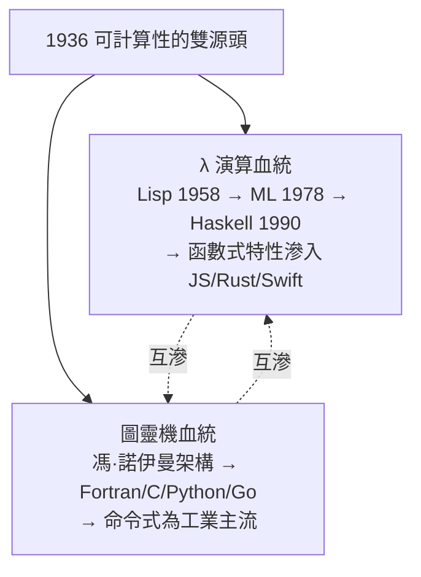

# 3.3 邱奇-圖靈等價性：函數抽象與機械模型在極限處的完美相遇

## 1936 年的兩座孤峰

邱奇與圖靈從完全相反的方向登頂：

| | 邱奇的 $\lambda$ 演算 | 圖靈機 |
|---|---|---|
| 出發點 | 邏輯與函數（「計算是什麼樣的**數學操作**」） | 人類計算員（「計算是什麼樣的**物理行為**」） |
| 核心動作 | 代入與規約 | 紙帶上的讀寫與移動 |
| 味道 | 代數的、無時間的 | 機械的、有時間的（一步步） |
| 天然對應 | 函數式語言、高階函數 | 命令式語言、狀態機 |

1936–37 年，圖靈（在普林斯頓）與邱奇證明：**兩個模型可計算的函數集合完全相同**。此後波斯特系統、一般遞歸函數、馬爾可夫演算法等所有嚴肅候選模型也都被證明等價。

$$\lambda\text{-可定義} = \text{圖靈可計算} = \text{一般遞歸} = \text{波斯特可計算}$$

## 為什麼「等價」比「哪個對」更重要

五個獨立起源的模型重合，這在數學上是強力的證據（與「極限定義的多路徑收斂」同理）：我們捕捉到的不是某個模型的性質，而是**「有效可計算」這個前數學直覺本身的邊界**。這就是：

> **邱奇–圖靈論題**：一切「直觀上有效可計算」的函數，恰好是圖靈機可計算的函數。

注意論題的認識論地位：它是**論題（thesis）而非定理（theorem）**——「直觀可計算」不是數學對象，無法證明。它的正確性由三重證據支撐：

1. **收斂證據**：所有精確化候選等價
2. **穩健性**：加了隨機性（機率圖靈機）、量子（量子圖靈機）都不擴大可計算範圍（只改變**效率**）
3. **物理證據**：所有已實現的計算裝置都未超越它

## 論題的兩個強化版本（與現代爭論）

**物理版（物理邱奇–圖靈論題）**：宇宙中一切物理過程都可由圖靈機模擬（至多多項式慢）。這是更強的主張，仍在辯論中——超陶（hypercomputation）的支持者訴諸無窮精度測量、黑洞等，主流觀點認為這些路線在物理上不可實現。**這個爭論與 AI 哲學直接相連**：若物理版成立，則人腦（物理系統）原則上可被模擬——「機器能否思考」在原則層面只剩工程問題。

## 等價性的實踐果實：兩種程式設計範式

理論上的等價，落到工程上是**風格與生態的分岔**，並貫穿了本書後半部：

- **圖靈血統**：狀態、賦值、迴圈——貼合硬體，效能取向，工業主流
- **$\lambda$ 血統**：不可變、高階函數、組合子——數學取向，正確性與抽象取向
- **歷史規律**：每當並行與分散式問題變大（多核 2005+、分散式系統、資料流），函數式思想就回潮——因為**無狀態的純函數沒有共享可變狀態的坑**。MapReduce、RxJS、React Hooks、Rust 的迭代器鏈，全是 $\lambda$ 血統的回流

**理論等價 ≠ 工程等價**：兩台等價的機器，表達不同問題的**認知成本**完全不同。語言設計的百年史（本書第三、四篇），很大程度上就是這兩種心智模型在爭奪程式員的肌肉記憶。

## 停機問題的「對偶視角」：數學與工程共用一個邊界

邱奇路線的不可判定性（$\lambda$ 項是否有規範形）與圖靈路線的停機問題互相歸約——**數學系統的「證明搜索」與程式的「執行終止」是同一件事**。這條邊界線為全書後續埋下三個伏筆：

1. **第 6 章**：喬姆斯基譜系中，0 型文法 = 圖靈機 = 一般遞歸 = $\lambda$ 演算——譜系的最頂層正是本章的等價類
2. **第 8 章**：Dijkstra 的結構化程式設計證明（任何流程圖可用順序/選擇/迴圈表達）背後，是對「控制流」的理論自覺
3. **第 16 章**：LLM 生成的代碼「無法靜態保證正確」，其理論根源就是本章的不可判定性——驗證必須執行或受限

## 一段私誼與一段歷史

圖靈 1936–38 在普林斯頓跟隨邱奇讀博士。兩人性格南轅北轍（邱奇安靜內斂，圖靈直率古怪），學術上互相尊重。圖靈的博士論文做了重要補充：引入**序數邏輯**——證明任何單一公理系統都有更強的系統，不完備性是**無窮遞進的**。「證明沒有天花板，只有天花板之上的天花板」——這個結論既謙卑又壯麗。

戰後兩人走上了不同的路：圖靈走向機器與智能（曼徹斯特、圖靈測試），邱奇留在邏輯與教育（普林斯頓 39 年，帶出 31 位博士，包括後來的邏輯學與語言學重鎮）。**一個向工程墜落，一個向哲學上升，共同撐起了計算機科學的地基。**

## 本章小結

| 概念 | 內容 | 遺產 |
|------|------|------|
| $\lambda$ 演算 | 函數 + 代入 = 全部計算 | 函數式語言、閉包、類型論 |
| 圖靈機 | 紙帶 + 狀態轉移 | 計算模型、儲存程式概念 |
| 停機問題 | 萬能檢查器不存在 | 不可判定性、靜態分析的邊界 |
| 邱奇–圖靈論題 | 直觀可計算 = 圖靈可計算 | 計算的哲學基礎、AI 論域 |

至此，人類知道了**計算是什麼、極限在哪裡**。但理論的機器還在紙上。下一章，戰爭把它造了出來。

---
[下一節：4.1 儲存程式電腦](04.1-儲存程式電腦.md)
