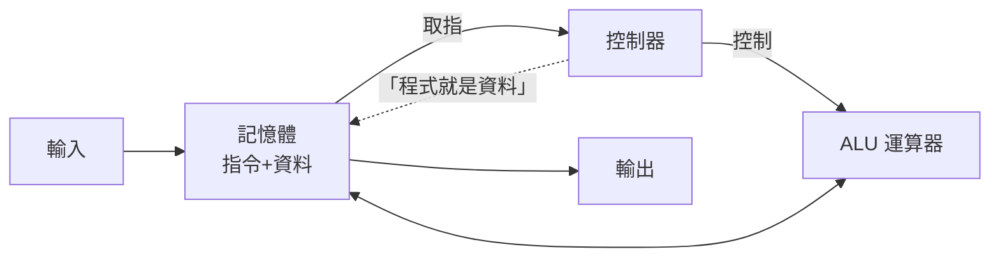

# 4.1 從理論走向實體：儲存程式電腦與資料指令共用記憶體的革命

## 戰爭把數學家送進了工廠

1936 年圖靈寫下通用機時，全世界的「計算裝置」是機械加法器與打孔卡製表機。五年內，三股力量把它變成現實：

**1. 彈道計算**：二戰中炮兵彈道表的瓶頸驚人——一台加法器算一條彈道要 30 秒，而新式火炮需要數百個射角 × 每個炮位 × 氣候修正。賓州大學莫爾學院的 **ENIAC**（1943 開工，1945 完成）由陸軍彈道研究實驗室出資 50 萬美元（最終花費近百萬——**軍方是第一位大客戶**）。

**2. 原子彈**：曼哈頓計畫的流體動力學與中子擴散計算，需要超出一切現有裝置的能力。馮·諾伊曼正是以洛斯阿拉莫斯顧問的身份捲入計算機事業（第 7.2 章的蒙地卡羅方法也源於此）。

**3. 密碼學**：英國的 Colossus（1943，湯米·弗勞爾斯設計，用於破解洛倫茲密碼）已是電子式、半可程式的機器——但**戰後保密制度讓英國自廢武功**：Colossus 的存在 1970s 才解密，英國計算機產業失去了本可領先的十年。**保密制度對產業的殺傷，不亞於技術落後。**

## ENIAC 的困境：程式在哪裡？

ENIAC（18,000 根真空管、30 噸、150 千瓦）解決了「算得快」，卻留下一個尷尬：

> **「程式」是用插線與開關配置的。** 換一個任務，工程師要拔插幾百條纜線、設置上千個開關，費時數天——而計算本身只需幾分鐘。

程式存在於**機器的物理佈線**中。這正是圖靈 1936 年已經解決的理論問題：「把機器描述寫進紙帶」。ENIAC 團隊與馮·諾伊曼 1944 年夏天的一次火車站會面（歷史上有名的偶遇）後，馮·諾伊曼加入顧問群，開始起草新架構。

## 《EDVAC 報告初稿》（1945）：電腦的憲法

1945 年 6 月，馮·諾伊曼寫下《EDVAC 報告的第一份草案》——一份 101 頁的手稿，卻被視為**計算機科學的獨立宣言**。核心思想（後世稱「馮·諾伊曼架構」）：

1. **儲存程式**：指令以數字形式存放在記憶體中，與資料同質
2. **共用記憶體**：單一儲存空間同時容納指令與資料
3. **序列執行**：取指令 → 解碼 → 執行 → 下一條（取指—執行循環）
4. **五大單元**：運算器（ALU）、控制器、記憶體、輸入、輸出

**為什麼這是革命**：修改程式 = 修改記憶體裡的數 = 不用動機器。程式從「機器的佈線」降格為「記憶體裡的檔案」——**軟體與硬體的分工**，整個軟體產業的地基，就建立在這一條上。圖靈機的 $U(\langle M\rangle, w)$ 至此有了身體。

## 「馮·諾伊曼架構」這個名字的歷史爭議

報告只署名馮·諾伊曼，但思想是集體的：

- **普雷斯珀·艾克特與約翰·莫奇利**（ENIAC 的工程師）主張「儲存程式」的關鍵工程想法（用延遲線儲存）有他們的貢獻，且他們本就打算改進 ENIAC
- 圖靈 1936 的理論源頭眾所周知（馮·諾伊曼深諳哥德爾—圖靈文獻）
- 結果：EDVAC 專利糾紛爆發，艾克特—莫奇利 1946 年辭職創辦全世界第一家電腦公司（Eckert–Mauchly Computer Corp，後被 Remington Rand 收購，1951 年 UNIVAC 成為第一台商用電腦——**預測 1952 年總統大選結果，電視直播讓「電腦」進入美國家庭詞彙**）。馮·諾伊曼架構的單一署名，是**學術—產業產權邊界模糊**時代的一次著名爭端，它催生了後來電腦專利制度的調整（IBM 1956 同意放棄部分專利壟斷——反壟斷訴訟的產物，客觀上開放了產業競爭）

## 全球的第一批機器

| 機器 | 時間 | 特點 |
|------|------|------|
| Manchester Baby | 1948.6 | 世界第一台執行儲存程式的機器（圖靈參與其後續發展） |
| EDSAC | 1949.5 | 劍橋，Wilkes 主持——第一台**實用**儲存程式電腦；Wilkes 1946 年讀到 EDVAC 報告後從美國帶回歐洲 |
| UNIVAC I | 1951 | 第一台商用電腦 |
| IBM 701 | 1952 | IBM 帝國入場——**打孔卡霸主被電子計算的未來倒逼轉型** |

英國先行（Baby/EDSAC）、美國收割（UNIVAC/IBM）的格局，與 Colossus 保密的歷史直接相關——又一次，**制度（保密）塑造了產業地理**。

## 儲存程式的深層意義：自我指涉的法律化

回顧第二章：哥德爾編號讓「命題是數」；圖靈讓「程式是資料」。馮·諾伊曼架構是這個數學事實的**物理立法**。它帶來的深層後果包括：

- **編譯器與解譯器可以寫在機器上**（自舉：用 Fortran 寫 Fortran 編譯器）
- **程式可以生成程式**（宏、元程式設計、基因演算法、LLM 生成代碼——全書第 16 章的技術前提）
- **惡意程式也獲得了同等地位**（病毒：修改其他程式的記憶體）——Neumann 本人 1949 年就寫過「自複製自動機」的理論，預言了自複製程式的可能性

**讓程式成為資料，人類同時獲得了軟體產業與電腦犯罪。** 這是抽象化的辯證法：每上一層台階，風險與機會同步升級。

---
[下一節：4.2 機器碼編程](04.2-機器碼編程.md)
