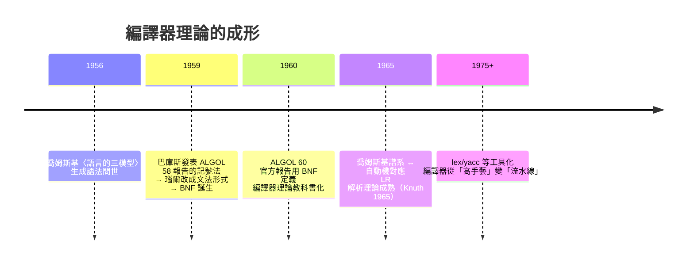

# 5.2 編譯器的數學工程：將高階語意翻譯為機械碼的自動化革命

## 一場持續三年的工程賭局

Fortran I 編譯器（1954.11–1957.4，交付）由巴庫斯率領的 13 人團隊完成（團隊中有多位女性程式員，如 Lois Haibt 負責流程分析）。挑戰在於：**手工組語的程序員是能手動最佳化的，編譯器必須自動做到同等水平，否則一無是處**。

他們發明了幾乎整套最佳化技術的原型：

- **常數摺疊與傳播**：編譯期算出常數表達式
- **強度削減**：把乘法換成移位與加法（$x \times 2^k$ → 移位）
- **公共子表達式消除**：`B**2` 算一次，別算兩次
- **暫存器分配**：盡量讓熱變數住在暫存器（手寫組語的精髓，被自動化）
- **迴圈最佳化**：把不變式提到迴圈外（code motion）

1957.4.20，Fortran 編譯器交付客戶。巴庫斯後來的調查顯示：**超過半數的客戶用它編出的程式，效能達到或超過手工組語**。迷信被擊碎（下一節詳述勝利的社會學）。

## 編譯器理論的成形：等喬姆斯基入場

巴庫斯團隊是在**沒有形式語言理論**的情況下憑直覺造出編譯器的（1954–57）。隨後十年，理論與工程完成歷史性合流：



**最漂亮的歷史巧合**：巴庫斯 1959 年為描述 ALGOL 58 語法發明的記號法，被丹麥電腦科學家**彼得·瑙爾（Peter Naur）** 認出——這就是喬姆斯基的上下文無關文法（CFG）。語言學與程式語言在 1959 年正式握手。BNF 至今是所有語言規範的標準寫法。

## 編譯器的五大階段（以一個表達式為例）

輸入：`x = y + 2*z`

**1. 詞法分析（掃描器）**——正則語言層（喬姆斯基 3 型）：

$$[\text{id:x}][\text{op:=}][\text{id:y}][\text{op:+}][\text{num:2}][\text{op:*}][\text{id:z}]$$

**2. 語法分析（解析器）**——上下文無關語言層（2 型），建構語法樹：

```
      =
     / \
    x   +
       / \
      y   *
         / \
        2   z
```

**3. 語義分析**：符號表查詢、類型檢查——**類型系統是羅素類型論的工程後裔**（第 1.3 章）

**4. 中間表示（IR）與最佳化**：

```
t1 = 2 * z
t2 = y + t1
x  = t2
```

再做死碼消除、暫存器分配、指令選擇、排程

**5. 目標代碼生成**：機器指令流

**理論對應表**（本書的核心交匯點之一）：

| 編譯階段 | 形式語言層級 | 對應自動機 | 可判定性 |
|---------|------------|-----------|---------|
| 詞法 | 3 型（正則） | 有限狀態機 | 完全可判定、線性時間 |
| 語法 | 2 型（CFG） | 下推自動機 | 可判定；LL/LR 線性時間 |
| 語義/最佳化 | 屬性文法、資料流 | — | 許多問題**不可判定**（回憶停機問題） |

**分層的智慧**：編譯器把可判定的部分（詞法、語法）交給自動機理論保證效率，把不可判定的部分（語義等價、全域最佳化）用啟發式處理——**在不可判定海域上劃出可判定航道**，這是 3.2 章理論的工程兌現。

## 指稱語義與形式語義學：翻譯的正確性

「編譯正確」如何證明？1960s–70s 語義學三路並進：

- **操作語義**（Landin/Plotkin）：抽象機器上逐步執行——圖靈機傳統
- **指稱語義**（Dana Scott/Strachey）：每個語句映射到數學對象（域論）——$\lambda$ 演算傳統
- **公理語義**（Hoare 1969）：{前置條件} 程式 {後置條件}——邏輯傳統

Hoare 邏輯後來成為形式驗證（SPARK、Frama-C）與近年 AI 代碼驗證（第 16.3）的理論底座。**編譯器不只翻譯，它還承載了「程式是數學對象」的完整哲學。**

## 經濟與制度的迴響

- **編譯器成為產業准入門檻**：賣電腦必須附帶高階語言編譯器（IBM/UNIVAC/寶來的軍備競賽）；1960s 的語言之戰本質是**廠商標準之戰**
- **COBOL（1959）**：美國國防部推動的「通用商業語言」——**政府作為標準制定者的經典案例**；Grace Hopper 的 FLOW-MATIC 是其前身。COBOL 至今仍在全球金融清算系統中運行數千億行——**「技術債」這個現代概念的歷史標本**
- **開源編譯器的地緣**：GCC（1987）/LLVM（2003）讓編譯器從廠商專利變成公共基礎設施——**編譯器的公共化是軟體生態繁榮的前置條件**

---
[下一節：5.3 效能的勝利](05.3-效能的勝利.md)
