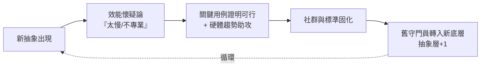

# 5.3 效能的勝利：Fortran 如何擊敗當時保守派對「手寫組合語言」的迷信？

## 一場關於「機器該由誰餵養」的信仰之戰

1950s 的主流觀點可以概括為一句話：

> **機器這麼貴（數百萬美元一台），浪費機器時間去伺候人類的方便，是經濟犯罪。**

手寫組語被視為專業尊嚴：程式員是「騎師」，機器是賽馬，編譯器則像「讓汽車自己開車」——安全疑慮十足。IBM 內部也有強烈反對聲音（包括負責科學市場的部門）。巴庫斯團隊要說服的不是機器，是**人**。

## 勝利的三個證據鏈

**1. 交付的成績單（1957）**：巴庫斯團隊對 25 位早期用戶做了系統調查，Fortran 編譯出的程式中，超過半數與手工組語等速或更快，最差案例也僅慢約 20%。在核工程、彈道等應用中，**開發時間從數週壓到數小時**。

**2. 摩爾定律的助攻（1958–65）**：硬體每年提速 30–50%，使得「編譯器浪費的 20% 效能」的絕對代價迅速縮水，而「人力節省」的絕對收益持續擴大。**抽象化的勝利，本質上是人力/算力比價的勝利**——這條比價曲線在之後六十年反覆宣判同類爭論（GC、解譯器、動態語言、AI 代碼）的勝負。

**3. 數學符號的認知優勢**：`X = B**2 - 4*A*C` 對科學家是母語。**語法接近用戶的心智模型，錯誤率下降、生產力上升**——這是後來所有「高階化」設計（SQL、Python、Julia、SQL-like 的 Prompt）的元原則。

## 傳播的加速器：社群與標準

- **SHARE 用戶社群**（1955 成立的 IBM 大用戶聯盟）：Fortran 成為會員間交換程式的**通用媒介**——程式第一次可以「寄給別人用」。可移植性從技術理想變成**社群實踐**
- **Fortran 標準化（1966 X3.9）**：第一個被 ANSI 前身標準化的程式語言。標準 = 抽象化的法律化：**「寫一次，處處編譯」有了合約效力**
- **教育滲透**：1960s 起大學工程系把 Fortran 列入必修——一代工程師的母語就此形成（本書後面會看到 Python 在 2010s 重演同樣劇本）

## 保守派後來怎麼樣了

有趣的是，保守派的「迷信」並非全無道理——他們的顧慮以不同形式回歸：

| 1950s 保守派的顧慮 | 後來的回歸形式 |
|-------------------|--------------|
| 編譯器產生低效代碼 | JIT 未成熟時的 Java 效能爭議（1995–2002）；Python GIL 下的科學計算瓶頸 |
| 高階語言失控、不可預測 | C++ 編譯時間、動態語言大型專案的維護災難（→ 促生 Go/TypeScript） |
| 專業騎師的價值貶值 | 組語專家轉入編譯器/安全/嵌入式，成為更稀缺的高薪工種 |

**規律**：每一波抽象化都「部分正確」——它確實犧牲了一些控制力，但換來的生態擴容遠超損失；而被犧牲的控制力，會以新的專業崗位形式存活。**抽象化不是取代，是分層。**

## 勝利的歷史條件（反事實思考）

Fortran 的成功依賴一組特定條件，值得拆解：

1. **IBM 的賭注**：巴庫斯的提案需要高層護航；若沒有當時 IBM 對科學市場的押注，Fortran 可能夭折於實驗室
2. **硬體浮點的成熟**（IBM 704）：語言的野心受限於硬體能力——先有浮點運算器，才有公式翻譯的可行性
3. **冷戰科研複合體**：軍方實驗室是首批大客戶，賬單與耐心都有
4. **時機窗口**：早於喬姆斯基理論入場——巴庫斯們憑直覺工程，反而繞過了「理論先行」的延遲

## 這場勝利寫進了後世的「劇本」

Fortran 之後，每一次語言革命都重演同一齣戲（可作為閱讀本書後半部的透鏡）：

- Lisp（1958）：「GC 太慢」→ 工作站/JIT 時代翻案
- Java（1995）：「解譯位元組碼太慢」→ JIT + 伺服器時代翻案
- Python（1991）：「太慢」→ NumPy（C 核心外包）+ AI 時代翻案
- LLM Coding（2020s）：「生成的代碼不可靠」→ 正在被驗證層（測試、編譯器、形式化）翻案中（第 16 章）

**抽象化的經濟學鐵律**：只要人力成本相對算力持續上漲，「用機器的時間換人的時間」的交換永遠划算。這條鐵律，是我們理解第 17 章「程式設計師的終極轉型」的鑰匙。

---
[下一節：6.1 喬姆斯基譜系](06.1-喬姆斯基譜系.md)
