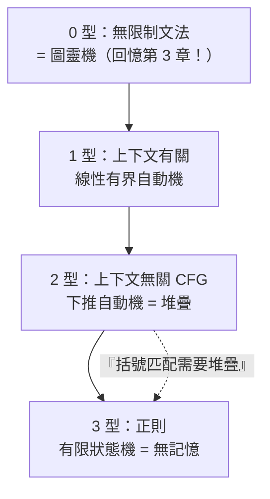

# 6.1 句法結構與喬姆斯基譜系：形式文法如何定義程式語言的邊界

## 一位語言學家闖入了工程學

諾姆·喬姆斯基（Noam Chomsky, 1928–）1956 年發表〈語言的三個模型〉，1957 年《句法結構》。他的戰場是**人類自然語言**：反對當時主流的行為主義（史金納《言語行為》1957——語言是刺激-反應的習得）。喬姆斯基的論證：

1. 兒童接觸的語料貧乏（有限、有誤），卻能產出無窮的新句子——**「刺激的貧乏」論證**
2. 所以人類天生具備普遍文法（UG）——語言能力是本能而非習得

**政治背景**：喬姆斯基同時是激進左翼知識分子（越戰批判使其成為公共知識分子偶像）。他的語言學與政治哲學共享一個母題：**反對將複雜的人類現象化約為外部條件反射**——理論立場與政治立場在此同構。

## 生成文法：用「規則」定義語言

喬姆斯基的形式化工具是**生成文法** $G = (N, \Sigma, P, S)$：非終端符號集 $N$、終端符號集 $\Sigma$、產生規則集 $P$、起始符號 $S$。語言 = 從 $S$ 出發、按 $P$ 重寫、能生成的所有終端字串。

例（簡化英語）：

$$S \to NP\ VP \qquad NP \to \text{the}\ N \qquad VP \to V\ NP \qquad N \to \text{dog} \mid \text{cat} \qquad V \to \text{chases}$$

生成：the dog chases the cat。

## 喬姆斯基譜系：四層文法、四台機器

依產生規則的限制程度，文法分四層——**每層恰好對應一台自動機**（1959 年證明的深層對應）：

| 層級 | 文法類型 | 產生規則形式 | 對應自動機 | 自然語言例 | 程式語言例 |
|------|---------|------------|-----------|-----------|-----------|
| 0 型 | 無限制 | $\alpha \to \beta$ | 圖靈機 | — | 圖靈完備語言全部語義 |
| 1 型 | 上下文有關 | $\alpha A \to \alpha \beta$ | 線性有界自動機 | 瑞士德語嵌套 | — |
| 2 型 | 上下文無關 | $A \to \beta$ | 下推自動機（堆疊） | 中心嵌套句（"the rat the cat..."） | **所有程式語言的語法**（括號、塊結構、嵌套表達式） |
| 3 型 | 正則 | $A \to aB \mid a$ | 有限狀態機 | 無 | 識字器、regex、記號 |

**關鍵的「層級定理」**（1959）：每一層嚴格弱於上一層——例如 $a^n b^n$（括號匹配）**不是正則語言**。這證明了：正則表達式**不可能**解析程式語言（需要配對的括號、嵌套的塊）——必須上推到 CFG。**程式語言的語法被理論鎖定在 2 型；而其語義（任意計算）是 0 型。語法與語義之間隔著一台圖靈機。**

## 對自然語言的衝擊（順帶交代）

喬姆斯基用同樣的工具證明：**自然語言也不是有限狀態的**（中心嵌套遞歸："the man who said that the dog... bit the cat"）——行為主義的「語言=習慣鏈」在數學上被擊倒。語言學由此發生「喬姆斯基革命」，並直接催生了**認知科學**（心理學、語言學、哲學、AI 的 1956 年達特茅斯會議同源）。

但注意諷刺的歷史迴響：**2020s 的大語言模型（LLM）在某種意義上是行為主義的復仇**——純統計、大資料、無顯式文法，卻能生成無窮新句子。喬姆斯基本人對 LLM 的嚴厲批評（「高技術的 plagiarism」）與神經網路陣營的回擊，是本書第 16 章的核心戲碼。**七十年前的理論對決，在新的硬體上重演。**

## 譜系對程式語言的直接含義

| 實踐問題 | 譜系給出的答案 |
|---------|--------------|
| 為什麼不能用 regex 解析 HTML/JSON？ | 嵌套結構需要 2 型（堆疊），regex 是 3 型 |
| 為什麼 C++ 的語法難以解析（歧義、依賴前文）？ | C++ 越出了純 CFG 邊界（需上下文資訊）——**語法沾染語義**的工程債 |
| 為什麼 LSP/編輯器能即時高亮半成品代碼？ | 增量解析技術 + 恢復性錯誤處理（仍在 CFG 框架內） |
| 為什麼「正確語法但語義錯誤」的程式無法被語法排除？ | 語法是 2 型，語義是 0 型——**類型系統試圖用可判定的擴充捕捉不可判定的語義**（第 9.3、15.2 章伏筆） |

## 制度與傳播的腳註

- 喬姆斯基譜系 1960s 經由 **ACM 的課程改革**進入電腦科學教育——「形式語言與自動機」成為必修課，與編譯器課程（龍書，1977）綁定至今
- 蘇聯陣營有獨立的平行傳統（馬爾可夫、波斯特系統），冷戰兩岸的理論在最終等價性上匯合——**數學真理不接受地緣政治的分界**，但教科書的敘事權（誰被引用）確實跟著陣營走

下一節：BNF 如何把喬姆斯基的文法變成工程師的日常工具。

---
[下一節：6.2 BNF 的誕生](06.2-BNF的誕生.md)
