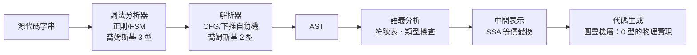

# 6.3 編譯器解析器（Parser）與抽象語法樹（AST）的建構邏輯

## 從字串到結構：編譯的第一次「理解」

解析器（parser）的任務：把線性的 token 流，轉換為**樹狀結構**——語法樹。這是編譯器第一次「理解」程式：字串的先後順序被升維為**嵌套的層級關係**。

## 具體語法樹 vs 抽象語法樹

同一行程式 `x = 1 + 2 * 3`：

- **具體語法樹（CST/parse tree）**：保留所有語法細節——括號、分號、優先級帶來的節點層次
- **抽象語法樹（AST）**：剝掉語法糖，只留**語義結構**：

```
   Assign
   /    \
  x     Add
        /  \
       1   Mul
           / \
          2   3
```

括號呢？`（1+2）*3` 與 `1+2*3` 的區別已完全由**樹的形狀**表達。分號呢？語句邊界已由樹的層級表達。

**AST 的哲學意義**：它是程式的**規範形（canonical form）**——一切表面語法被洗掉後，剩下的純語義骨架。**AST 是程式的「思想」，源代碼只是它的「口音」。**

這個觀念在後世全面開花：

| 應用 | 依賴 AST 的方式 |
|------|---------------|
| 編譯器最佳化 | 在 AST/IR 上做等價變換（死碼消除、內聯、循環展開） |
| Linter / 靜態分析 | 遍歷 AST 找模式（ESLint、Clippy） |
| IDE（重構、跳轉、重命名） | tree-sitter 增量解析，毫秒級維護 AST |
| Babel / TypeScript | TS 編譯 = TS 的 AST → JS 的 AST → 代碼生成 |
| 機器學習代碼模型 | code2vec 把 AST 路徑當特徵——**LLM 之前的「程式理解」就是結構理解** |
| codemod | 大規模代碼庫的自動遷移（API 更新） |

## 解析的理論地圖（把 6.1–6.2 的線索收攏）



**注意縱軸**：編譯器的流水線**恰好沿著喬姆斯基譜系從 3 型爬到 0 型**——從無記憶的模式匹配，到有堆疊的結構識別，到不可判定的語義與任意計算。**喬姆斯基譜系不只是理論，它是編譯器的建築圖紙。**

## 解析器的實戰議題

**1. 錯誤恢復**：用戶寫錯語法時不能「第一個錯就停」。恐慌模式、同步符號集——**友善的錯誤訊息是 2010s 語言競爭的關鍵差異化**（Rust 的編譯器錯誤建議是它吸引開發者的名片之一）。

**2. 增量解析**：IDE 需要在每次按鍵後毫秒級更新高亮。tree-sitter（GitHub，2018 開源）把文法改造成增量可維護的形式——**AI 代碼編輯器（第 17 章）底層同樣依賴它**：LLM 輸出需要即時的語法校驗。

**3. 語法糖與用戶社群**：`x += 1`、解構賦值、箭頭函數都是糖。糖多了可讀性分裂（Perl 的教訓），少了表達力不足。**AST 視角告訴我們：糖是「同一個語義結構的多種人類介面」——它服務的是人的多樣性，不是機器的。**

**4. 歧義的工程化管理**：C++ 的 `x < y > z`（模板還是比較？）——真實語言總在 CFG 邊界打補丁。**純理論的乾淨邊界，遇到現實的兼容性債務**，是所有長壽語言的宿命。

## AST 與 LLM 時代的預言（快速前瞻）

2020s 的 AI Coding 生態（第 16–17 章）本質上是**兩種「程式表示」的分工**：

- **LLM**：在 token 序列（線性、統計）上運作——擅長生成、補全、自然語言對話
- **編譯器/靜態分析**：在 AST 與 IR（結構、確定性）上運作——擅長驗證、重構、保證性質

兩者的介面工具（tree-sitter、AST-grep、LSP、型別檢查器回饋迴圈）正在成為 AI Coding 的基礎設施。**六十多年前 BNF 定義的文法樹，如今是神經網路與圖靈機之間的握手協議。**

## 本章小結

| 概念 | 內容 | 歷史意義 |
|------|------|---------|
| BNF | CFG 記法社會化 | 語言規範成為數學文體 |
| 解析 | token 流 → 樹 | 編譯器的「理解」階段 |
| AST | 剝離語法的語義骨架 | 一切工具鏈的共同表示 |
| 譜系對應 | 3 型→2 型→0 型 | 編譯器的建築圖紙 |

下一章，與 ALGOL 幾乎同期、但哲學完全相反的另一支血統：Lisp——把 $\lambda$ 演算整個搬進電腦的瘋狂實驗。

---
[下一節：7.1 Lisp 與 λ 演算](07.1-Lisp與lambda演算.md)
