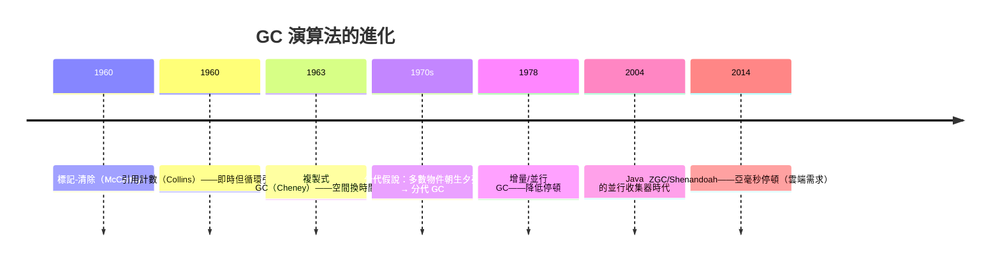

# 7.3 垃圾回收（Garbage Collection）與遞歸：自動記憶體管理的開山祖師

## 遞歸帶來的危機

Lisp 有一個 Fortran 沒有的需求：**遞歸**。遞歸意味著：

1. 同一函數可以同時存在多個「實例」（每次呼叫有自己的區域變數）——**呼叫棧**的誕生
2. 每次呼叫 `(cons a b)` 都在堆上**分配新記憶體**——列表不斷生長，舊結構隨時被丟棄

1958 年的電腦記憶體以 KB 計。如果程式員要手動釋放每個 cons cell，Lisp 的函數式風格（大量中間列表）就會淪為簿記地獄。麥卡錫團隊的決定是歷史性的：

> **記憶體釋放由系統自動完成。** 程式員只管分配，機器回收「不再被引用」的物件——這就是**垃圾回收（GC）**。

## 標記—清除（Mark–Sweep）：第一代 GC

McCarthy 1960 年論文描述的演算法：

1. **標記階段**：從所有「根」（暫存器、棧上的指標）出發，沿指標圖遍歷，標記所有可達物件
2. **清除階段**：掃描整個堆，未標記者回收

**理論底蘊**：GC 是**可達性**問題——「物件是否存活」取決於「是否還有引用路徑」。注意與停機問題的對照：**可達性可判定（GC 可行），程式行為不可判定（靜態分析受限）**——同為指標圖問題，難度天壤之別。

## GC 的技術譜系（1959–2020s）

**分代假說（generational hypothesis）**是 GC 史上最重要的經驗發現：**程式分配的物件大多很快死亡**。把新物件放「年輕代」頻繁回收、倖存者晉升「老年代」低頻回收——用統計規律兌換效能。**這是「觀測到的行為規律 → 系統設計」的典範**，與分支預測、快取預取同屬一族。

## 「GC 太慢」的六十年論戰

GC 的每一次流行都伴隨效能懷疑論（5.3 的劇本重演）：

| 時代 | 懷疑論 | 翻案 |
|------|--------|------|
| 1960s | 「Lisp 在機器上跑不動」 | Lisp 機器的專用硬體 |
| 1995–2002 | 「Java 的 GC 不可用於伺服器」 | HotSpot JIT + 分代 GC，Java 統治企業後端二十年 |
| 2010s | 「GC 停頓不可用於低延遲系統」 | ZGC/Shenandoah 停頓 < 1ms |
| 持續 | 「即時系統/核心不能用 GC」 | **正確**——這是 Rust（第 15 章）的生態位 |

**公平的結論**：GC 的成本是**延遲的不可預測性**，而非吞吐量。對吞吐型服務 GC 綽綽有餘；對硬即時系統不可接受。**沒有「最好的記憶體管理」，只有與工作負載匹配的管理。**

## Lisp 的第二份遺產——真正的遞歸呼叫

Lisp 1.5 首次實現了**完整的遞歸函數呼叫**（Fortran I 不支援遞歸！它的呼叫規範用靜態儲存，遞歸會踩壞自己的變數）。這逼出了：

- **呼叫棧（stack frame）**：每次呼叫一個活動記錄（回傳位址、區域變數）——至今一切語言的執行模型
- **尾呼叫優化（TCO）**：Scheme 標準（1975）要求尾遞歸在常量棧空間執行——**遞歸與迴圈在數學上等價**（$\lambda$ 演算只有代入，遞歸就是它的迴圈）

## 制度與經濟的腳註

- **GC 是「軟體複雜性外包」的第一個大規模案例**：把記憶體簿記從百萬程式員身上移走，集中給少數執行期工程師。**抽象化的經濟學（5.3）**：專業分工 + 人口擴容，再次應驗
- 2020s 的反潮流：Rust 宣稱「零成本安全、無 GC 停頓」，Go 則證明「夠好的 GC + 簡單心智模型」在雲端服務中更受歡迎——**GC 與非 GC 的分界，成為系統語言光譜的主軸**（15.3）
- 教育史：GC 與指標的取捨塑造了兩種教學傳統——「從機器誠實開始（C）」與「從結構思考開始（Python/Java）」

## 小結

| 發明 | 年代 | 遺產 |
|------|------|------|
| 呼叫棧 | 1958–60 | 一切語言的執行模型 |
| 遞歸支援 | 1958 | 函數式、分治演算法 |
| 標記—清除 GC | 1960 | 自動記憶體管理 |
| 分代假說 | 1970s | 統計規律驅動系統設計 |
| 尾呼叫優化 | 1975 | 遞歸=迴圈的理論兌現 |

Lisp 證明了：**讓機器承擔簿記，人類才能思考結構**。下一章，我們回到與 Lisp 同期的另一場實驗——ALGOL 60，它選擇了完全相反的道路：用嚴格的契約與結構，而非可塑性。

---
[下一節：8.1 區塊結構與靜態作用域](08.1-區塊結構與靜態作用域.md)
