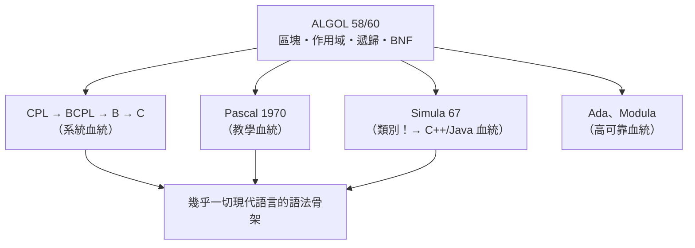

# 8.1 區塊結構（Block Structure）與靜態作用域（Lexical Scope）的革命

## ALGOL 60：一門「寫在紙上先於寫在機器上」的語言

ALGOL 60 的奇特之處：**它先作為「論文語言」存在**。1958 年蘇黎世會議提出 ALGOL 58，1960 年巴黎會議產生 ALGOL 60 報告（瑙爾編輯，13 人委員會含巴庫斯、Dijkstra、Naur 等）。它是**為描述演算法而設計**的——發表在期刊上的演算法應當可以直接被讀懂、被編譯。

委員會的構成決定了它的氣質：**歐洲學術界（追求純粹與優雅）+ 美國學界（追求通用）**，刻意與 IBM 的 Fortran（商業）和國防部的 COBOL（行政）保持距離。ALGOL 從未在商業上成功（IBM 拒絕支援它——**平台壟斷者沒有動機支援無利的標準**），但它的**思想**統治了此後一切主流語言。

## 革命一：區塊結構——程式有了「骨架」

Fortran 的深層問題：**所有變數是扁平的**——任何一行程式碼都能看到（與踩到）所有變數。大型程式的變數名衝突與意外覆蓋成為災難。

ALGOL 60 引入**區塊**：

```algol
begin
    integer x;
    begin
        integer x;    ! 內層的 x 遮蔽外層的 x
        x := 2;
    end;
    x := 1;           ! 這裡的 x 是外層的
end
```

宣告與作用域**嵌套成樹**——這正是語法樹（6.3）的結構在**命名空間**上的映射：**語法層級 = 作用域層級**。大型程式第一次獲得了「模組化」的語言級支持。

## 革命二：靜態作用域——「名字屬於誰」由文本位置決定

| 規則 | 名字由什麼決定 | 問題 |
|------|--------------|------|
| **動態作用域** | 由**呼叫鏈**決定 | 同一函數在不同呼叫路徑下行為不同——不可推論 |
| **靜態作用域** | 由**源代碼的嵌套位置**決定 | 需編譯器記錄宣告層級——但**可靜態推論** |

Lisp 原始版採用動態作用域（實現的偶然選擇），後來 Sussman 與 Steele 在 Scheme（1975）中發現靜態作用域**數學上更協調**（與 $\lambda$ 演算的代入語義一致——「函數的意義在其定義處已完全確定」）。歷史裁決：**靜態作用域全面勝出**——JS 的 `var`（動態化殘餘）成了歷史教訓。

**閉包（closure）**是靜態作用域的深遠結論：內層函數「捕獲」其定義處的環境。閉包 = **函數 + 它出生的環境**，是 $\lambda$ 演算「函數是值」的工程完形，也是 JS/Python/Rust 全部現代代碼的日常。

## 革命三：遞歸被正式承認

ALGOL 委員會曾激烈辯論是否支援遞歸（Lisp 已證明可行，但 Fortran 陣營認為非必需——**節省呼叫棧的硬體成本**）。Dijkstra 與 Naur 力排眾議寫入規範。**語言委員會的一票，決定了一個時代程式員的思維工具箱。**

## 呼叫慣例與「最難的 Bug」

ALGOL 發明了**傳值（call by value）**與**傳名（call by name）**——後者是 $\lambda$ 演算的 $\beta$ 規約直譯（參數作為未求值表達式，每次使用時重新代入）。傳名的 thunk 實現複雜而怪異，衍生出著名的 Jensen's device 與一系列副作用陷阱。經驗教訓使後世全面倒向傳值（+ 引用），直到 Rust 的借用、C++ 的右值引用才重新精緻化這個問題。**語義的每一個「理論優雅」選項，都要通過工程成本的毒打。**

## ALGOL 的影響網路



**一句話總結**：ALGOL 沒有贏得市場，卻贏得了**語法**——今天你寫的每一種大括號或縮排語言，其結構語法都是 ALGOL 60 的直系後裔。**思想的市場份額，比產品的市場份額更長壽。**

## 制度史註腳

- ALGOL 報告確立了「**語言規範獨立於實現**」的原則——軟體**標準化**制度的起點，影響了 ISO/IEC、ECMA、W3C
- 1968 年 NATO 軟體工程會議（「軟體危機」的命名現場）引用的失敗案例，多是大型專案失控——**結構化是藥方，危機是病歷**
- ALGOL 的失敗本身成為管理學案例：**過度委員會化的設計犧牲了可用性**——標準的完美性與採用速度的張力，在 2020s 的 Rust RFC 文化中仍可辨認

---
[下一節：8.2 現代語言的基因庫](08.2-現代語言的基因庫.md)
