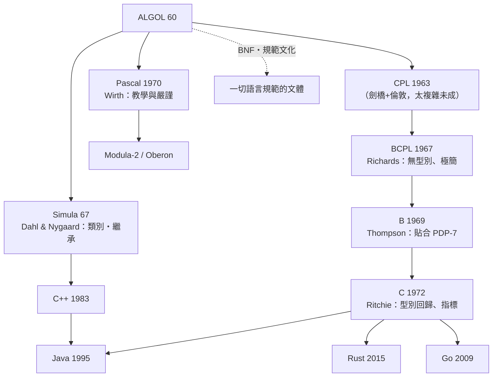

# 8.2 現代語言的基因庫：ALGOL 如何深深影響後世的 C、Pascal 與主流語言

## 血統圖：ALGOL 的三大分支

三個關鍵跳躍值得逐一細看。

## 跳躍一：CPL → BCPL → B → C（系統血統的減法史）

**CPL**（1963）：劍橋與倫敦合作的「ALGOL 加系統能力」，龐大到無法實現——**「ALGOL 的野心 + 系統的需求 = 沒人用」**。

**BCPL**（Martin Richards, 1967）：做減法——**去掉型別**（一切都是機器字）、極簡語法、可自舉的編譯器。教訓的反面運用：**刪除比添加更難也更有效**。

**B**（Ken Thompson, 1969）：在貝爾實驗室為 PDP-7 上的 UNIX 而改。PDP-7 只有 8KB 記憶體——**硬體限制是語言設計的最強約束**。

**C**（Dennis Ritchie, 1972）：為移植 UNIX 到 PDP-11，B 需要型別（字元、浮點、位址算術）——**型別不是理論家的潔癖，而是移植的工程需求**。C 誕生的敘事可以濃縮為：**作業系統的需求定義了語言**（9.2 詳述）。

## 跳躍二：Pascal（1970）——教學的武器

Niklaus Wirth（蘇黎世聯邦理工）設計 Pascal 的動機是**教育**。Pascal 的貢獻：

- **強型別 + 明確宣告**：型別系統成為程式設計課程的訓練架構
- **結構化語法完全體**：while/repeat/case——與 Dijkstra 的結構化運動（8.3）互為表裡
- **Turbo Pascal（1983, Borland）**：把「編譯+編輯+即時錯誤」壓進一個快如閃電的 IDE，售價 49.95 美元——**工具鏈整合 + 極低價格**，讓 Pascal 統治 1980s 微機教育。Anders Hejlsberg（Turbo Pascal 主設計師）後來做出 Delphi 與 **TypeScript**——**教育語言的血統流入了 Web 時代**

## 跳躍三：Simula 67（1967）——被忽略的起源

挪威計算中心的 Ole-Johan Dahl 與 Kristen Nygaard 為**離散事件模擬**（港口、工廠調度——挪威的航運經濟背景！）設計 Simula，發明了**類別、物件、繼承、虛函式**。他們的洞見：模擬的最自然單位不是「過程」而是「互動的實體」——**物件導向最初是建模思想的產物，不是代碼組織技巧**。

**「類別」這個 1967 年的模擬工具，成為 21 世紀最大軟體範式的種子。**

## ALGOL 的「失敗」如何餵養了成功

| ALGOL 的命運 | 教訓 |
|--------------|------|
| 商業失敗（IBM 不採用） | 平台壟斷者會抑制開放標準——除非標準自帶市場 |
| 語法勝利（C/Pascal 繼承） | 「好的思想可以脫離失敗的載體傳播」 |
| 委員會妥協的紛爭 | 設計的純度 vs 採用的速度：Fortran 用「不完美但可用」贏了 ALGOL |
| 規範文化存續 | BNF、語義規範、國際委員會——ALGOL 輸掉了語言，贏下了**文體** |

**「ALGOL 是史上最成功的失敗程式語言」**——影響力有兩種貨幣（部署量與思想滲透率），兩者的時間尺度完全不同。

## 基因檢測：今天的語言裡有多少 ALGOL

- **區塊與嵌套作用域**（`{}` / 縮排）✓
- **靜態作用域與閉包**✓
- **結構化控制流**（if/while/for——而非 GOTO）✓
- **函式宣告 + 參數傳值**✓
- **型別宣告的文化**（C 系靜態；Python/JS 雖動態，但 type hints/TS 正在「ALGOL 化」）
- **規範文體**（EBNF + 語義文檔 + 測試套件）

Python 的縮排語法（12.1）是 ALGOL 區塊思想的「去符號化」極端——**把 begin-end 換成空格**，證明語法的形式可以變，結構的語義不變。

---
[下一節：8.3 GOTO 害人論](08.3-GOTO害人論.md)
