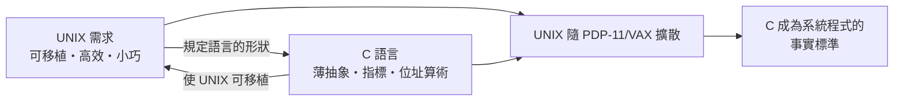

# 9.2 UNIX 與 C 語言的共生：可移植作業系統與高效率系統程式設計

## 一個互相成就的迴圈

C 與 UNIX 不是「語言 + 應用」的關係，而是**共生體**：



**UNIX 需要 C**：1973 年核心重寫後，UNIX 可以在數週內移植到新機器——此前移植一個作業系統需要以年計的組語重寫。**可移植性是 C 給 UNIX 的第一份禮物**，而 1970s–80s 大學與實驗室機型五花八門，可移植性就是採用率。

**C 需要 UNIX**：C 的編譯器、工具鏈（`cc`、`make`、`grep`）隨 UNIX 分發，UNIX 的手冊與文化塑造了 C 程式員的工作方式。**語言的傳播載體不是教科書，是作業系統。**

## 制度的關鍵一躍：UNIX 的開放與 1980s 的分裂

AT&T 因 1956 年的反壟斷同意令**不得經營電腦業務**——UNIX 因此以**象徵性費用授權給大學**（附源代碼！）。這個法律事故造就了歷史最幸運的教育事件：

- 加州大學伯克利分校獲授權後發展出 **BSD**：vi、TCP/IP 實作（1983——**網際網路的作業系統地基**）
- 1983 年 AT&T 反壟斷解除，開始商業化 UNIX → 價格暴漲 → 荷蘭教授 Tanenbaum 為教學寫 MINIX → **Linus Torvalds 1991 年寫出 Linux 核心** → GNU（1983, Stallman）+ Linux = 自由軟體生態的完形

**一條驚人的因果鏈**：1956 年反壟斷令 → 大學授權 → BSD → TCP/IP → Linux → 今天一切雲端伺服器的底座。**法律與制度的遠期後果，常超過技術決策本身。**

## 「一切皆檔案」與管道：UNIX 的設計哲學

Doug McIlroy（管道的發明者）總結的 UNIX 哲學：

> 1. 程式只做一件事，做好它
> 2. 程式的輸出應成為另一程式的輸入
> 3. 盡早設計與建造原型

```bash
cat access.log | grep "404" | awk '{print $1}' | sort | uniq -c | sort -rn | head
```

一行 shell 管道 = 資料流動的組合系統。**這是函數組合（$\lambda$ 血統）的系統級化身**——與 Lisp 的組合思想異曲同工，只是載體從 S 表示式換成了文字流。2020s 的資料管道（Unix pipes → Kafka → Spark → LLM agent pipeline）是同一哲學的雲端重演。

## C 成為「世界的黏合層」

| 層 | C 的角色 |
|----|---------|
| 核心/驅動 | Linux、Windows 核心絕大部分是 C |
| 語言執行期 | Python、PHP、Ruby、Perl 的直譯器都是 C 寫的 |
| 函式庫介面 | POSIX、幾乎所有語言的 FFI 目標 |
| 工具 | Git（2005）、SQLite、Redis、nginx |

**「任何新語言最終都要跟 C 談判」**——FFI 成為語言設計的必修課。這也是為什麼 2020s 的 Rust 要以「C 的替代者」而非「C 的對手」定位（15.3）。

## 文化遺產：駭客倫理的制度化

UNIX 環境孕育的文化（Eric Raymond《大教堂與市集》1997 總結）：

- **源代碼即文檔**：讀別人的程式是學習方式
- **工具箱思維**：第一反應是「組合已有工具」而非「重寫」
- **匿名協作與郵件列表治理**：BSD 的郵件列表 → Linux 的 patch 文化 → GitHub 的 pull request——**協作制度的連續演化**

同時 C 也塑造了「專業主義美學」：K&R 風格、簡潔的介面、對魔法的警惕。Go 語言（15.1）明確自認為「UNIX 哲學的雲端繼承者」——**Go 團隊裡就有 UNIX 元老（Rob Pike，Plan 9 的作者）。**

## 小結

| 發明/事件 | 內容 | 長期後果 |
|----------|------|---------|
| C 重寫 UNIX 核心（1973） | 系統軟體首次高階化 | 可移植性成為 OS 的標配 |
| AT&T 反壟斷授權 | 大學獲得源碼 | BSD、Linux、開源運動的源頭 |
| 管道與工具箱哲學 | 小工具組合 | 資料工程、微服務的祖先 |
| POSIX 標準（1988） | 系統介面標準化 | 跨平台軟體的契約層 |

---
[下一節：9.3 相信程式員哲學](09.3-相信程式員哲學.md)
