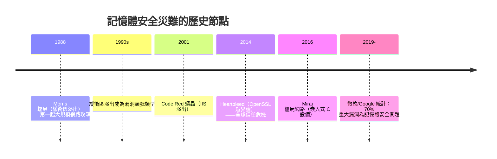

# 9.3 C 語言的「相信程式員」哲學及其雙面刃（記憶體安全隱患）

## 一句口號背後的權利義務觀

C 社群流傳著一句話，概括其設計哲學：

> **Trust the programmer（相信程式員）。**

具體含義：

- C 不阻止你做危險的事（越界、轉型、未初始化）——它假設你知道自己在做什麼
- **零開銷原則**：不為安全性付執行期成本（無邊界檢查、無空指標檢查、無 GC）
- Ritchie 的表述：C 不替你做事，也不阻攔你

這是一種**權利—義務的分配哲學**：把記憶體的決策權完全交給程式員，同時把後果也完全交給程式員。它在 1970s 的語境下完全成立——那時寫 C 的是貝爾實驗室的研究員，程式規模可控，機器週期昂貴。

## 雙面刃的第一刃：漏洞的產業化

隨著 C 成為互聯網基礎設施的母語，這個哲學的成本開始系統性顯現：

經濟規模：漏洞賞金產業、資安公司、國家級攻擊工具（Stuxnet——伊朗核離心機的破壞）——**C 的 UB 不是學術話題，是每年數百億美元的黑色經濟。**

## 產業的修補史：四代防禦

**第一代：事後檢測（1990s）**：Valgrind、fuzzing、ASan（2012）——執行時抓越界。開銷 2–3 倍。

**第二代：靜態分析（2000s）**：clang-tidy、Coverity——在 AST 與資料流上找模式。但回憶停機問題（3.2）：**通用正確性不可判定**，靜態分析只能逼近。

**第三代：受控子集（2010s）**：MISRA C（汽車）、CERT C 規範——用紀律縮小 UB 空間。**文化治理方案的極限：紀律靠人，人會累。**

**第四代：語言級替代（2015+）**：Rust 的所有權系統在**編譯期**排除記憶體錯誤（15.2）。2021 年起，美國國安局、CISA、白宮 ONCD（2024）相繼建議**遷離 C/C++ 轉向記憶體安全語言**——**一門語言的安全問題上升為國家政策議題**，程式語言史首見。

## 雙面刃的第二刃：抽象的「誠實」價值

**1. 教育的透明性**：學 C 的人理解「程式到底在機器上做了什麼」——記憶體佈局、呼叫棧、指標算術。**C 是理解一切其他抽象層的地基。**

**2. 效能的信任底線**：C 沒有隱藏的執行期（無 GC 停頓、無 JIT 預熱），使它成為即時系統、核心、嵌入式四十年的無可爭議之王。**「沒有魔法」本身就是一種可靠性的形式。**

**3. 「相信程式員」的社會學**：它培育了高專業門檻的專家文化（審查、測試、經驗主義）——Linux 核心的 review 文化就是這種哲學的制度化形態。**哲學沒有錯，錯的是把它應用到「不是貝爾實驗室研究員的人」身上。**

## 歷史的天平

| 情境 | 「相信程式員」的表現 |
|------|-------------------|
| 1973 的貝爾實驗室（專家、小規模） | 正確——效能與控制最大化 |
| 1990s 的網路服務（開源協作、全球攻擊面） | 災難——UB 成為攻擊面 |
| 2020s 的基礎設施（幾百億行 C 遺產） | 分層治理：核心層 C，外圍遷移 Rust/Go |
| AI 時代（LLM 生成 C 代碼） | 最危險的組合——LLM 對 UB 的嗅覺遠弱於型別系統（16.2 伏筆） |

**規律**：哲學的適用性是**規模與信任網絡的函數**。同樣的設計，在社群小、能力平均、攻擊面小的環境是美德；在社群大、水平參差、攻擊面全球化的環境是風險。**語言哲學也必須隨時代的社會結構升級。**

## 小結

| 哲學元素 | 收穫 | 代價 |
|---------|------|------|
| 零開銷 | 即時效能、硬體親密 | 無執行期保護 |
| 未定義行為 | 編譯器最佳化自由 | UB 成為漏洞溫床 |
| 權利義務自負 | 專家文化、教育透明性 | 水平參差時的系統性風險 |
| 無魔法 | 可預測性 | 無自動記憶體管理 |

C 用四十年的統治證明了這套哲學的能量，也用四十年的漏洞史寫下了它的賬單。**收賬的人，是 2015 年登場的 Rust**（15.2）。但在那之前，先看另一場 1972 年同時開始的實驗——Smalltalk，它對「軟體該如何組織」給出了與 C 截然不同的答案。

---
[下一節：10.1 訊息傳遞與物件模型](10.1-訊息傳遞與物件模型.md)
