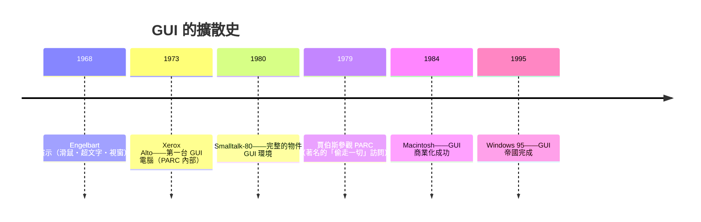

# 10.2 圖形化使用者介面（GUI）與全物件導向環境的誕生

## 從命令列到「隱喻的世界」

1979 年之前的計算介面是**命令列**：使用者打字、機器回字，一切存在於文字流中（UNIX 的管道哲學正是其極致）。Kay 團隊（與 Douglas Engelbart 的 ARC 實驗室——1968 年「一切演示之母」：滑鼠、超連結、視窗、視訊會議**同台首演**——是思想源頭）在 Smalltalk 環境中實現了完整的 GUI：

- **重疊視窗、圖示（icon）、選單、滑鼠指標、所見即所得（WYSIWYG）編輯**
- 關鍵的認知策略：**用實體世界的隱喻組織數位世界**（桌面、檔案夾、垃圾桶、畫布）

**為什麼 GUI 是物件導向的勝利**：視窗、按鈕、圖示天然是「有狀態、回應訊息的自治實體」——OOP 與 GUI 在概念上互為表裡。Smalltalk-80 的類別庫（Model-View-Controller）就是 GUI 框架的原型。**介面形態與語言範式的共生**，再次出現（可對比第 13 章：JavaScript 與瀏覽器）。

## 歷史中的幾次「被偷走」

1979 年賈伯斯參觀 PARC 的故事值得細讀：Xerox 為了投資蘋果的機會讓團隊參觀了 Smalltalk 演示。賈伯斯事後說「他們不知道自己擁有什麼」。蘋果之後以 **Macintosh（1984）** 把 GUI 商業化——**PARC 發明了未來，蘋果定價了未來，微軟普及了未來**。這個「發明→產品→普及」的三段式，是科技史的反覆劇本（對比：英國 Colossus → 美國 ENIAC → IBM；對比：ARPA 網 → TCP/IP → Web → Google）。

**制度的教訓**：Xerox 高層（影印機思維）看不懂 GUI 的價值（他們問「這對賣影印機有什麼幫助」）。**發明者的組織若缺乏「新模式的自利動機」，發明就會外流。** PARC 案例成為創新管理學的必修課。

## GUI 對軟體產業的經濟影響

GUI 不只是介面升級，它重塑了產業結構：

1. **使用者人口爆炸**：命令列需要訓練，GUI 靠直覺——電腦從「機構的設備」變成「家庭的消費品」
2. **「所見即所得」創造新軟體品類**：桌上排版（PageMaker 1985——**出版產業的革命**）、Excel 1987、Photoshop 1990
3. **軟體的分發革命**：圖形應用的商業化 → 軟體產業從「附贈品」變成「商品」——**軟體第一次有了獨立的定價權**

## 全物件導向環境：程式設計體驗的烏托邦

Smalltalk-80 環境是一個**統一的、可窺視一切的活體**：

- 沒有「應用程式」與「系統」的邊界——整個環境是一個物件宇宙，你在其中即時編程、即時修改
- 類別瀏覽器讓任何物件的實現一目了然
- **「活體系統」的教育意涵**：程式不是「寫完→編譯→跑」的流水線，而是**持續生長的有機體**

這個體驗深刻影響了後世工具鏈（現代 IDE 的即時錯誤提示、熱重載、Jupyter 的互動計算、Figma 的即時協作——都是「Smalltalk 式活體感」的局部復活）。**Smalltalk 定義了「開發體驗」這個產品類別，但它的完整形態從未被大眾市場採納**——工程師與終端用戶的分裂，使活體環境退縮到了開發工具一角。

## 硬體的賬單與語言的黃昏

GUI 與 Smalltalk 的代價是**資源**：重疊視窗需要大量位圖記憶體與運算。1980s 的微機（4–64KB 記憶體）完全承載不了——這直接決定了：

- 微機世界選了 C + 命令列起步（MS-DOS），GUI 是 1990s 硬體成熟後的「補票」
- Smalltalk 機器（需要 512KB+ 位圖 + 專用處理器）註定是小眾工作站
- **語言的命運常常在硬體成本曲線被決定**——這條規律在第 13 章將再次出現，只是方向相反：JS 是「太早的硬體找到了太合適的語言」

## 小結

| 發明 | 年代 | 產業後果 |
|------|------|---------|
| 重疊視窗 GUI | 1973–80 | 個人電腦消費化 |
| MVC | 1979 | 一切 GUI 框架的骨架 |
| WYSIWYG | 1974– | 桌上排版產業 |
| 活體開發環境 | 1980 | 現代 IDE/Jupyter 的原型 |
| 虛擬機架構 | 1980 | JVM/.NET/WASM |

---
[下一節：10.3 阿蘭凱的遺憾](10.3-阿蘭凱的遺憾.md)
