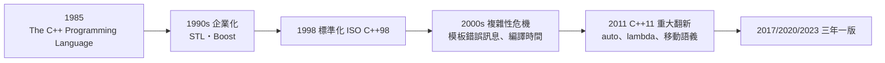

# 11.1 「帶類別的 C」：如何在不犧牲執行效率的前提下引入物件導向？

## Bjarne Stroustrup 的務實革命

Bjarne Stroustrup（1950–，丹麥人，劍橋大學博士）1979 年加入貝爾實驗室。他的問題來自實戰：為 UNIX 核心與分散式系統寫 C 時，他體會到 Simula 的類別對組織大型系統的威力，但 Simula 太慢、太不貼近機器。

他的解法是**妥協的藝術**：「C with Classes」（1980）→ C++（1983 命名，`++` 是 C 的遞增運算符）。鐵律有三：

1. **與 C 完全相容**（千萬行 C 遺產 + UNIX 生態不能拋棄）
2. **零額外開銷**：不用的特性不付成本（"You don't pay for what you don't use"）
3. **同種語言解決多層問題**：從驅動到應用

**這條路線與 Smalltalk 的對比**是兩種工程觀：Smalltalk 是「哲學先行，硬體遷就思想」；C++ 是「硬體先行，思想遷就硬體」。歷史裁決了兩者各有疆域——但 1980s–2000s 的工業界用鈔票投給了 C++（**遊戲、交易系統、瀏覽器、資料庫——一切效能敏感的領域**）。

## 效率是如何保住的：物件的機器碼成本

| 特性 | 零開銷？ | 實現機制 |
|------|---------|---------|
| 類別/成員函數 | ✅ 零成本 | 編譯期展開為 `this` 指標傳參的普通函數 |
| 封裝（private） | ✅ 零成本 | 純編譯期檢查，無執行期防護 |
| 靜態多型（模板/重載） | ✅ 零成本 | 編譯期解析 |
| 虛函式（動態多型） | ⚠️ 每呼叫一次間接跳轉 | 虛函式表（vtable）——需要才付費 |
| 繼承 | ✅ 零成本 | 記憶體佈局為子集拼接 |
| RTTI/動態轉型 | ⚠️ 選擇性 | 可關閉 |

**關鍵的設計哲學**：把 Smalltalk 的「一切皆動態」改為「**動態性是可選項**」。需要極速時用靜態繫結，需要彈性時才付虛函式的錢。這個「分級付費」思想後來成為零成本抽象的通用原則——Rust 完整繼承了它（15.2）。

## C++ 的三個關鍵發明

**1. 建構子/解構子**：物件誕生與死亡時自動執行的函數。看似小發明，實際是 **RAII**（11.2）的基礎——把「資源管理」寫進語言的第一次嘗試。

**2. 運算子重載與模板**：讓自訂型別融入語言原生語法（`matrixA * matrixB`）——**抽象的表現力**。模板（原意是泛型容器）後來異化為編譯期元程式設計的引擎（11.3）。

**3. 多重繼承與它的教訓**：C++ 支援多重繼承（含虛基類補丁），實務中證明是**複雜性重災區**（菱形問題）。Java 吸取教訓（單繼承+介面），Go 更激進（無繼承）。**C++ 的「什麼都給」成為後繼者的反面教材。**

## C++ 的社會史

- **效能敏感產業的標準語**：遊戲（Unreal）、高頻交易（微秒級競賽——**金融工程直接驅動語言特性**）、瀏覽器（Chrome 2008）、資料庫引擎
- **複雜性的反噬**：C++ 的「什麼都能做」造成「一個語言、十種方言」——團隊間代碼互讀困難。**語言的表達力與社群的統一性成反比**，這是 Go（15.1）刻意「刪減特性」的心理學根源
- **與 C 的曖昧關係**：C++ 從未在核心層取代 C（Linux 核心拒用 C++——Linus 的著名抨擊），但在「核心之上的效能層」全面勝出。**範式分層而非範式取代**

## 歷史定位：橋樑的功與過

C++ 是**物件範式與馮·諾伊曼機器之間的翻譯官**。功勞是讓百萬級的 C 程式員無痛進入 OOP（物件的普及化靠的是 C++ 而非 Smalltalk——**傳播靠的是連續性，不是純潔性**）；代價是為了相容性背上四十年的歷史包袱。

Stroustrup 的自我評價誠實：「C++ 讓它的好與壞都建立在『與 C 相容』上——這是它成功的唯一原因，也是它所有問題的唯一原因。」

**一個時代的規律**：凡是「移植遺產」優先的時代，妥協的語言勝出（C++、Java）；凡是「綠地重建」的時代，純粹的語言有機會（Rust、Go 對 C/C++ 的挑戰）。**語言的命運跟著遺產體量走。**

---
[下一節：11.2 RAII](11.2-RAII.md)
