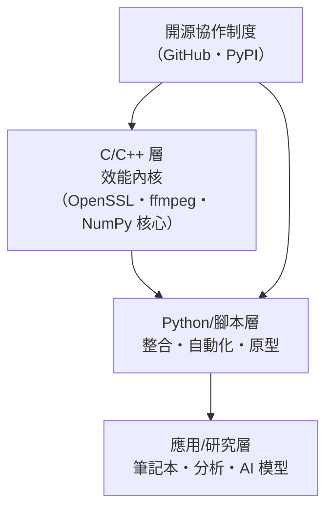

# 12.2 膠水語言的崛起：Python 如何成為連接底層與高層應用的橋樑

## 「膠水」的定位：不作戰，只統兵

1990s 的現實是：系統層被 C/C++ 佔據，腳本層有 Perl（文本處理之王）、Tcl（工具嵌入之王）、shell。Python 的策略定位：

> **Python 不與 C 競爭效能，它與 Perl 競爭可讀性；Python 不重寫高效能庫，它調用它們。**

「膠水語言」的含義：

- **向下**：透過 C API 與 C/C++ 庫無縫整合（`ctypes`、Cython、pybind11）
- **向上**：提供高層抽象與快速原型
- **橫向**：統一不同系統的工具鏈（測試、部署、自動化）

這個定位的智慧在於**順應比較優勢的經濟學**：解譯型語言的效能劣勢不可逆，但**整合能力與開發速度可以做到極致**。Python 把弱點（慢）轉化為架構原則（**效能關鍵部分外包給 C**），成為全系統的「指揮層」。

## 與競爭者的決定性分野

| 語言 | 1990s 強項 | 為何輸給 Python |
|------|-----------|----------------|
| Perl | 文本處理、系統管理 | 符號魔法過多，大型代碼不可讀；**「write-only language」的惡名** |
| Tcl | 應用嵌入（EDA 工具標配） | 一切皆字串，語法古怪 |
| Ruby | （2000s）優雅的物件系統 | 生態偏 Web；科學計算缺席（12.3 的分水嶺） |
| MATLAB | 數值計算（工程界標配） | **專有授權昂貴**——開源的 Python+NumPy 是制度性優勢 |

**Perl 的衰落特別值得記錄**：它是 1990s Web CGI 的實際統治者，卻在 2000s 迅速讓位。原因疊加：語言的符號複雜度、社群治理（Perl 6 重寫計畫 2000 年啟動後**難產十五年**）讓開發者遷離。**語言的死亡很少因為技術，多數因為治理與複雜性失控。** Python 押注「可讀性」在此獲得歷史驗證。

## CPython 的工程哲學：慢但可綁

- **C 語言寫成**：嵌入任何 C 程式（遊戲引擎腳本、CAD、電影特效——Industrial Light & Magic 早在 1996 就把 Python 納入生產線）
- **C 擴展介面**：NumPy 的陣列物件（連續記憶體 + C 迴圈）讓「Python 寫控制流、C 做數值迴圈」成為標準架構
- **GIL（全域直譯器鎖）**：簡化實現的權衡——多執行緒受限，但**多進程 + C 擴展繞過**。這個「缺陷」在 2010s 被資料科學的向量化範式完美繞過（GPU/C 核心不吃 GIL）——**架構級的補救消解了語言級的缺陷**

## 膠水模式的制度勝利：開源生態的標準分工

這個分工的社會學意義：**效能專家（少數）寫 C 核心，整合者（多數）寫 Python**——抽象層的勞動分工（5.3、9.3 的「抽象層生態學」）在開源世界制度化。PyPI（2003）讓「安裝一個 C 加速的庫」變成一行 `pip install`——**複雜性被徹底封裝**。

## 膠水的黃金驗證：Web 與自動化

- **Django（2005，報社而生）與 Flask（2010）**：Python 成為 Web 後端主力之一
- **DevOps 運動（2009+）**：Ansible、SaltStack 全用 Python——雲端時代的基礎設施自動化需要「人人能讀的腳本」
- **科學與工程的工作流統一**：測試、資料清理、繪圖、報告在一門語言內完成——**工具鏈統一本身就是生產力**

## 小結

| 能力 | 機制 | 戰略意義 |
|------|------|---------|
| C 綁定 | CPython API、ctypes | 效能弱點轉化為架構分工 |
| 生態打包 | PyPI、pip | 複雜性封裝為一行命令 |
| 可讀語法 | 縮排與統一哲學 | 成為團隊與教育的最大公約數 |
| 治理 | PEP、BDFL→委員會 | 長期演進的穩定性 |

---
[下一節：12.3 生態系紅利](12.3-生態系紅利.md)
