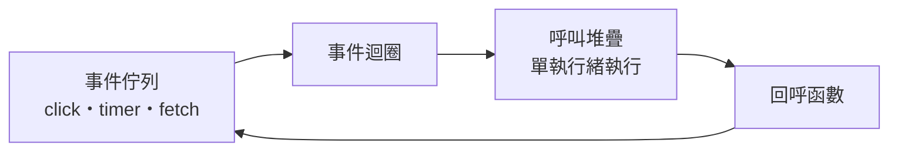
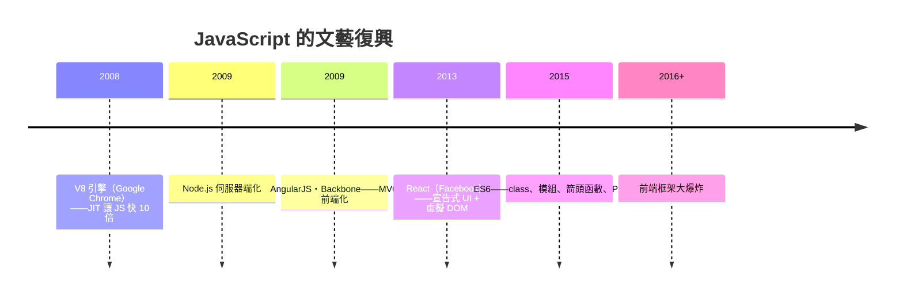

# 13.1 10 天內創造的網頁靈魂：JavaScript 的原型繼承與事件驅動模型

## 1995 年 5 月：十天、一個人、一場商業豪賭

1995 年，網景（Netscape）的瀏覽器佔有率約 80%，微軟的 IE 即將襲來。網景管理層判斷：**網頁需要腳本能力**，而且要「看起來像 Java」（當時 Java 正被炒作為未來）。Brendan Eich（1961–）被要求創造這門語言——**工期：十天**。

十天裡 Eich 做的決定，一部分是設計，一部分是被迫：

- **語法借 C/Java**——為了讓 Java 程式員不陌生（**商業的熟悉性要求**）
- **語義借 Scheme**（一等函數、閉包——Eich 在 Scheme 上長大）
- **物件模型借 Self**（原型繼承，無類別）——來不及做完整的類別系統，且他認為 Self 的原型更優雅
- **動態型別 + 弱型別**——腳本的寬容性

Java 命名是純粹的市場行銷（1995.12 網景與 Sun 合作，LiveScript 更名 JavaScript——**語言之間的血緣，有名無實**）。**這門語言從受孕起就承載著矛盾**：想抄 Scheme 的靈魂，卻被迫穿 Java 的外衣。

## 原型繼承：被誤會三十年的核心

JavaScript 的物件沒有類別，只有**原型鏈**：

```javascript
const animal = {
  speak() { return `${this.name} speaks`; }
};
const dog = Object.create(animal);
dog.name = "Rex";
dog.speak(); // "Rex speaks"
```

`dog` 找不到 `speak`，就沿原型鏈向 `animal` 委託——**物件從物件委託**（Self 的正統思想，10.1 的 Kay 哲學）。這其實比類別**更接近 Kay 的原意**：物件是行為的個體，類別只是事後的整理。

但歷史開了玩笑：**絕大多數 JS 開發者十年間用 `function + prototype` 手工模擬類別**（因為 Java 習慣的遷移），2015 年 ES6 乾脆加了 `class` 語法糖。**語言提供了反主流的模型，用戶用投票（習慣）把語言拉回主流模型**——語言演化中最強的力量是用戶的既有心智。

## 事件驅動：瀏覽器塑造的靈魂

瀏覽器的本質是**等待使用者與等待網路**——同步阻塞不可接受。JS 被設計成**單執行緒 + 事件迴圈（event loop）**：



單執行緒避免了鎖與競態（**心智模型簡單**），事件迴圈讓 IO 不阻塞。這個模型在 2009 年被 Ryan Dahl 抽出瀏覽器——**Node.js** 誕生：用 V8 引擎 + libuv 事件迴圈在伺服器端跑 JS。Node 的非同步 IO 模型恰好匹配 C10K 問題（萬級並發連線）的雲端時代需求——**語言的跨界靠的是執行模型而非語法**。

非同步風格的演化是一部「痛苦簡化史」：回呼地獄 → Promise（2012+）→ `async/await`（2017）。**執行模型不變，語法糖在不斷掩蓋它**——與 4.2「機器碼與語法糖」的歷史呼應。

## 「十天」的遺產：著名設計缺陷

| 缺陷 | 後果與補救 |
|------|-----------|
| `==` 強制型別轉換（`0 == ""` 為真） | ES5 加 `===`；lint 工具禁用 `==` |
| `null` 與 `undefined` 並存 | 兩種「沒有值」，永遠的混淆源 |
| 自動分號插入（ASI） | 隱藏的解析陷阱 |
| `typeof null === "object"` | 歷史 bug，無法修復（**向後相容的暴政**） |
| 缺少模組系統 | 社群自造：CommonJS → ES 模組 |
| 全域變數預設 | `"use strict"`（2009）事後立法 |

**教訓的兩面**：一方面，這些缺陷養活了整個工具產業（ESLint、TypeScript、Babel——**「修補語言的缺點」本身成為數十億美元的市場**）；另一方面，JS 證明了**語言的成功與設計品質幾乎無關**，只與**是否佔據了唯一且不可或缺的生態位**有關——瀏覽器只有一個 JS，別無選擇（2019 年 WASM 成熟前）。

## 生態的復興之路（2009–2015）



**React（2013）值得單獨一筆**：它把 $\lambda$ 演算的函數式思想（UI = f(state)、不可變性、單向資料流）灌回 JavaScript——回應了 OOP 式命令 UI（jQuery 時代）的可維護性危機。**2010s 前端的最大範式轉移是「從命令到宣告」，這是函數式血統的勝利**（7.1 與 10.3 的血統之爭）。

## 小結

| 特性 | 來源 | 歷史後果 |
|------|------|---------|
| 原型繼承 | Self（Kay 血統） | 反被用戶拉回類別語法 |
| 一等函數/閉包 | Scheme（$\lambda$ 血統） | 回調、Promise、React 的地基 |
| 事件迴圈 | 瀏覽器需求 | Node.js、非同步帝國 |
| 弱型別 + 十天工期 | 商業壓力 | TypeScript、工具產業 |

---
[下一節：13.2 JVM 與 Java](13.2-JVM與Java.md)
