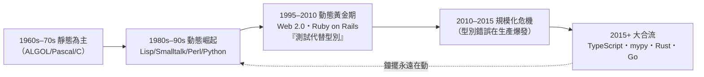

# 13.3 動態腳本 vs 靜態強型別：90 年代網際網路浪潮下的開發效率之爭

## 一場橫跨三十年的鐘擺運動

1995–2025，程式設計界最持久的論戰：**動態語言（Python、Ruby、JS）vs 靜態語言（Java、C#、Go、Rust）**。它的本質不是技術之爭，而是**兩種軟體生產制度之爭**：

| | 動態語言 | 靜態語言 |
|---|---------|---------|
| 核心承諾 | 快速迭代、少儀式 | 大規模協作、機器保證 |
| 型別資訊 | 執行期才確定 | 編譯期契約 |
| 假設的生產者 | 小團隊、專家、原型 | 大團隊、混合水平、長期維護 |
| 錯誤發現點 | 執行（測試/生產） | 編譯（寫碼當下） |

## 鐘擺的六十年軌跡

## 1995–2010：動態語言的黃金理由

1. **Web 2.0 的需求曲線**：網站要快速改版、試錯、上線——「以月計」的瀑布流程讓位給「以天計」的迭代。**需求不穩定時，型別契約是負債**
2. **硬體紅利**：CPU 免費了，開發人力貴了——5.3 的比價鐵律全力偏向動態
3. **「測試文化」的替代方案**：Ruby 社群提出「詳盡的單元測試可以替代型別檢查」——TDD（Kent Beck）與 Rails 的測試哲學
4. **Rails（2005）的示範效應**：DHH 用幾週做出過去數月的 Web 應用。**「程式員幸福感」被提出為正當的工程指標**

## 2010–2015：動態的規模化危機

- **重構成為高風險動作**：改名一個方法，靜態語言全網報錯；動態語言只能靠 grep 與祈禱
- **型別錯誤的生產事故**：`undefined is not a function` 與 `AttributeError: NoneType` 成為線上故障高頻詞
- **團隊規模擴大**：新創從 5 人長到 500 人——**沒有機器強制的契約，人類文檔必然失守**
- 工業界實證累積：靜態型別能預防 15% 級別的 bug（微軟/UC Davis 2014）——**「測試 vs 型別」從信仰之爭轉為證據之爭**

## 2015+：大合流——「漸進型別」的時代

| 合流產品 | 路線 |
|---------|------|
| **TypeScript（2012，Anders Hejlsberg）** | JS 的超集：型別可選、漸進採用、編譯後抹掉。2023 年成為前端事實標準——**動態生態接受了靜態的心臟** |
| **Python type hints（2014）+ mypy/pyright** | 同樣的漸進策略 |
| **Rust/Go（2010s）** | 反向合流：靜態語言吸收動態的體驗（快速編譯、fmt、友善錯誤訊息、包管理） |

**理論地位**：漸進型別（gradual typing，Jeremy Siek 2006）本質是**在「可靜態檢查」與「任意動態行為」之間架橋**——型別資訊可逐步加入。**「型別即文檔、文檔即契約」的觀念統一了兩個陣營的修辭。**

## 鐘擺的社會學解讀

| 驅動力 | 偏向動態 | 偏向靜態 |
|--------|---------|---------|
| 需求穩定性 | 低（新創、實驗） | 高（金融、基礎設施） |
| 團隊規模 | 小 | 大 |
| 代碼壽命 | 短 | 長 |
| **經濟週期** | 繁榮（試錯多） | 緊縮（求穩） |

**預測價值**：動態/靜態的偏好比例可以當作產業情緒的溫度計。AI 時代（17 章）又添新變數：**LLM 生成代碼時，靜態型別給了「機器驗證的抓手」**——型別錯誤可以在生成後立刻被檢出回饋給模型。動態/靜態之爭在 AI 時代有了第三種答案：**型別不再是人與人的契約，而是人—機器—機器（LLM→檢查器）迴圈的中介。**（16.3 伏筆）

## 小結

| 階段 | 主導信念 | 教訓 |
|------|---------|------|
| 1995–2010 | 測試可替代型別 | 小規模成立 |
| 2010–2015 | 規模化危機 | 契約需要機器執行 |
| 2015+ | 漸進型別大合流 | 範式之爭常以融合收場 |

第四篇的最後一章，我們看動態語言的巔峰時刻——Ruby on Rails 與元程式設計的極致，以及它如何預演了「框架即語言」的現代。

---
[下一節：14.1 敏捷與慣例優於配置](14.1-敏捷與慣例優於配置.md)
