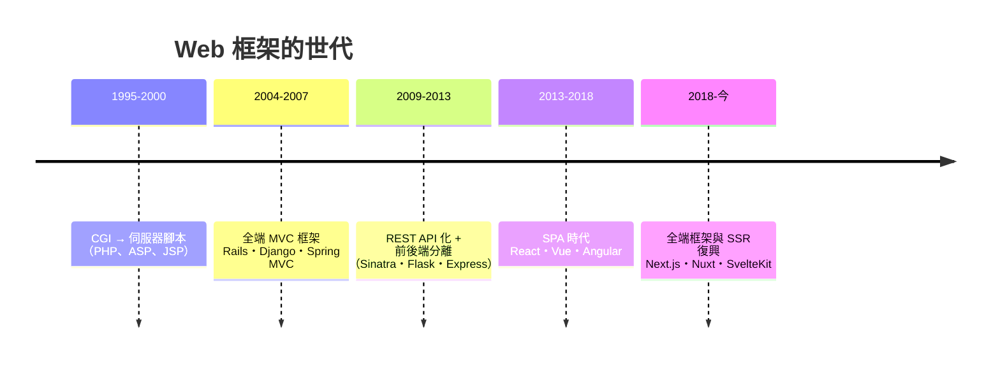

# 14.2 網頁伺服器端的繁榮：從 LAMP 架構到現代 Web 框架的演進

## LAMP：Web 2.0 的免費工作台

1990s 末–2000s，一個由開源組件構成的套裝成為 Web 的默認架構：

$$\textbf{L}inux + \textbf{A}pache + \textbf{M}ySQL + \textbf{P}HP/Perl/Python$$

它的歷史意義在於**成本結構的革命**：

| 對比 | 傳統企業棧 | LAMP |
|------|-----------|------|
| 作業系統 | Solaris/Windows（授權費） | Linux（免費） |
| 伺服器 | WebSphere/IIS（授權費） | Apache（免費） |
| 資料庫 | Oracle（數萬美元/核） | MySQL（免費） |
| 語言 | Java/JSP（人力貴） | PHP/Perl/Python（上線快） |

**一個 19 歲的創業者用每月幾十美元的虛擬主機就能建網站**——創業的資本門檻從數十萬美元降到數百美元。Web 2.0（Wikipedia 2001、Facebook 2004、YouTube 2005）的爆發直接建立在 LAMP 的低門檻上。**開源生態 + 廉價主機 = 平民化創新**，這是網際網路黃金年代的制度引擎。

PHP 值得專門記錄：Rasmus Lerdorf 1994 年為統計自己主頁訪客而寫的腳本工具，演化成「**HTML 裡嵌代碼**」的語言。設計粗糙，但**部署模型天才**：上傳檔案即上線。Facebook 的第一版就是 PHP 寫的（後來發明 HHVM 與 Hack 做效能與型別補救——13.3 的漸進型別又一例）。**「不完美但即時可用」的語言，常打敗「優雅但繁重」的語言。**

## 框架的世代演化

**第一代（CGI/腳本）**：每個請求起一個進程跑腳本——慢但簡單。歷史角色：證明「動態網頁」的市場存在。

**第二代（MVC 全端框架）**：Rails/Django 把「模型—視圖—控制器」（1979 年 Smalltalk 的發明！10.2）移植到 Web。**Web 開發從「手藝」變成「配置與填空」。** 同期誕生的 ORM 把關聯式資料庫包裝成物件圖——生產力巨大，也埋下 N+1 查詢、隱式 SQL 的效能陷阱（**抽象的永恆代價**）。

**第三代（API 化與微框架）**：智慧手機（2007 iPhone）帶來 App 需求——後端從「渲染 HTML」變成「提供 JSON API」。輕量框架（Flask、Express、Sinatra）順勢而起：**少魔法、顯式路由**。前後端分離成為組織分工的邊界——**康威定律：系統結構複製組織結構**。

**第四代（SPA 與單頁應用）**：React（2013）的虛擬 DOM + 組件化讓「應用跑在瀏覽器裡」——Web 從文檔變成作業系統。代價：bundle 膨脹、SEO 問題、複雜度暴漲——**前端自己的「軟體危機」**。

**第五代（SSR 復興與元框架）**：SPA 的問題讓伺服器渲染回流——Next.js 把「伺服器渲染 + 客戶端 hydration + API 路由」重新一體化。**歷史螺旋：從伺服器渲染（1990s）到客戶端渲染（2010s）再回到混合（2020s）**——每次回歸都帶著新工具。

## 基礎設施的同步革命

Web 框架的演化與部署基礎設施互為因果：

- **虛擬主機 → VPS（2005 EC2）→ 容器（Docker 2013）→ 編排（K8s 2014）→ Serverless（Lambda 2014）**
- 部署粒度：整機 → 虛擬機 → 容器 → **函數**
- 每次細化都降低「上線的單位成本」——**基礎設施抽象層的摩爾定律**
- 12 Factor App（2011，Heroku）把「雲原生應用的十二條配置原則」制度化——**環境一致性成為工程標準**

## 經濟與社會的後果

- **全端開發者的誕生**：一個人完成資料庫到 UI 的全部——**獨立開發者/indie hacker 運動的技術前提**
- **外包與全球化**：PHP/Rails 的低門檻讓全球勞動力進入軟體業
- **平台經濟**：Web 框架→API 經濟→SaaS——「軟體即服務」的訂閱商業模式（Salesforce 1999 開創）依賴 Web 技術棧的成熟。**技術棧與商業模式互相選擇**

## 小結

| 世代 | 代表 | 核心突破 | 代價 |
|------|------|---------|------|
| 腳本 | PHP | 部署即上線 | 結構混亂 |
| MVC 框架 | Rails/Django | 全套慣例 | 隱式魔法 |
| API/微框架 | Flask/Express | 前後端分離 | 組合成本 |
| SPA | React | 應用化 Web | bundle 與複雜度 |
| 元框架 | Next.js | SSR+SPA 融合 | 工具鏈厚重 |

---
[下一節：14.3 元程式設計](14.3-元程式設計.md)
