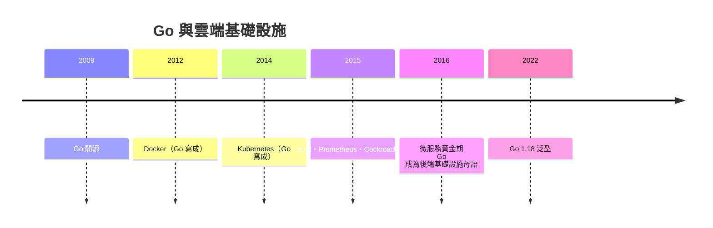

# 15.1 Go 語言：CSP 模型與協程如何化解雲端網路服務的並行危機？

## 2007 年的痛苦與 2009 年的答案

2007 年，Google 內部的工程師（Rob Pike、Ken Thompson、Robert Griesemer——**Thompson 是 UNIX 元老，Pike 是 Plan 9 與 UTF-8 的發明人**）面對一組具體的痛苦：

- **C++ 編譯太慢**（45 分鐘的構建時間——Google 級代碼庫的規模問題）
- **並發模型太難**：POSIX 執行緒 + 鎖的組合 bug 率居高不下
- **依賴管理混亂**：頭文件包含地獄
- 語言複雜度失控（C++ 的十種方言，11.1）

2009 年 Go 開源。它的設計哲學可以用一句話概括：

> **「少即是多」——刪除一切非必需的特性，把複雜性還給編譯器與工具鏈。**

| 特性 | Go 的選擇 | 理由 |
|------|----------|------|
| 泛型 | **沒有**（直到 2022） | 先驗證「簡單」夠不夠用 |
| 繼承 | **沒有**（只有組合與介面） | 10.3 的教訓直接落地 |
| 異常 | **沒有**（顯式 error 返回值） | 控制流必須可見 |
| 格式化 | **官方統一**（gofmt） | 終結風格戰爭 |
| 編譯速度 | **極快** | 構建時間本身是生產力 |

**Go 的「乏味」是設計目標**：Pike 說「Go 是為軟體工程而設計的語言」。它的成功第一次把「**可維護性的社會學**」（新人 30 分鐘讀懂 Go 代碼）變成語言的核心賣點。

## CSP：Tony Hoare 的 1978 年遺產

Go 的並發模型直接取自 **Tony Hoare 1978 年的〈Communicating Sequential Processes〉**——又一個「理論搶跑三十年」的案例（Hoare 也是 quicksort 發明者與 null 引用「十億美元錯誤」的自首者）。

CSP 的核心思想：**不要用共享記憶體來通訊，要用通訊來共享記憶體。**

```go
ch := make(chan int)          // 通道：協程間的傳輸帶

go worker(ch)                  // 啟動協程
ch <- 42                       // 發送（阻塞直到被接收）
v := <-ch                      // 接收
```

| 模型 | 心智圖 | 災難模式 |
|------|--------|---------|
| 共享記憶體 + 鎖 | 多人搶一張桌子 | 死鎖、競態 |
| **CSP（channel）** | 流水線/傳輸帶 | 阻塞可見、資料單向流動 |

**為什麼 CSP 適合網路服務**：伺服器的本質是「請求 → 處理 → 回應」的資料流——channel 天然映射為管線；goroutine 便宜（KB 級棧，可開百萬個），一個請求一個協程，**把「並發」從專家手藝變成直覺寫法**。

**goroutine 的工程奇蹟**：使用者態調度（M:N 排程）、棧按需增長、阻塞系統呼叫時自動讓出——**把 OS 執行緒的昂貴抽象掉**。這是 Erlang Actor（10.1）、Smalltalk 的訊息傳遞思想在工業上的成功會師：**並發的正解是「輕量執行單位 + 訊息傳遞」**——Kay 的生物學（10.1）在語言層的最終驗證。

## 雲端時代的天選之子



**雲原生運動（CNCF）幾乎是 Go 的殖民地**。原因完整閉環：

1. 靜態編譯單二進位 → 容器映像極小、部署極簡
2. goroutine → 高並發網路服務的天然模型
3. 編譯快 → 大型開源協作的迭代速度
4. 語法簡單 → 全球志工的低參與門檻

**「語言選擇塑造生態，生態反過來鎖定語言」**——Go 佔住了雲端基礎設施的生態位，正如 Python 佔住 AI（12.3）、JS 佔住瀏覽器（13.1）。

## Go 的教訓與局限

- **錯誤處理的爭議**：`if err != nil` 的重複噪音 vs 顯式控制流——**「冗長是誠實的價格」**
- **泛型的遲到**：社群分裂，2022 年才加入——**語言演化的民主成本**
- **表達力的天花板**：寫複雜抽象比 Java/Rust 費力——**Go 甘願放棄 10% 的高階場景換 90% 場景的統一**
- **GC 停頓的持續壓縮**（亞毫秒）證明 7.3 的技術進化路線

## 小結

| 概念 | 內容 | 歷史地位 |
|------|------|---------|
| CSP（1978→2009） | 通訊代替共享 | 並發模型的工業標準 |
| goroutine | 輕量協程 | 把並發平民化 |
| gofmt | 統一格式 | 風格戰爭的終結 |
| 少即是多 | 刪除特性 | 語言設計的「社會學轉向」 |

---
[下一節：15.2 Rust 所有權](15.2-Rust所有權.md)
