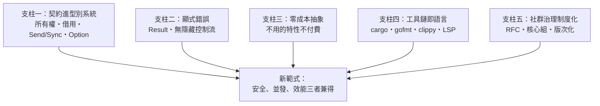

# 15.3 現代系統程式語言對安全與併發的重新定義

## 2010s 的三重危機催生的範式轉移

Go 與 Rust 不是孤立的發明，而是對三重危機的系統性回應：

**危機一：記憶體安全的產業賬單**（9.3 的 70% 漏洞統計）——C/C++ 的「相信程式員」哲學在互聯網規模下破產。

**危機二：多核的降臨**（2005 前後，主頻停止增長，核心數暴增）——Herb Sutter 的〈免費午餐結束了〉（2005）宣告：寫對並發代碼從「可選技能」變成「生存必需」，而鎖模型的複雜性註定大面積翻車。

**危機三：安全與效能的兼得訴求**——雲端基礎設施同時需要系統級效能與服務級安全，既有語言兩者兼備者無。

## 新範式的五個支柱

**支柱一：契約進型別系統**。Go 把並發協作做成語言原語（channel），Rust 把記憶體契約做成型別。**型別系統從「防筆誤」升級為「防架構級錯誤」**——Hoare 邏輯（5.2）思想的普及化。

**支柱二：顯式錯誤**。Go 的 `error` 返回值、Rust 的 `Result<T, E>`——**錯誤是值，不是控制流**。`Option<T>` 更直接消滅了 null（Hoare 自首的「十億美元錯誤」）——**「沒有值」成為型別而非陷阱**。

**支柱三：零成本抽象**（11.3 模板哲學的正名）：泛型單態化、迭代器惰性求值——**高層寫法，底層效能**。這條原則終結了「高階=慢」的六十年迷信（5.3 的劇本終章）。

**支柱四：工具鏈即語言**。**語言的競爭力 = 語言 + 包管理 + 格式化 + 文檔 + 測試 + LSP 的整體體驗**。Rust 的 cargo 成為所有新語言的標配模板。**「語言」的定義從語法擴展到了工程基礎設施。**

**支柱五：治理制度化**。Rust 的 RFC + 核心組 + edition、Go 的提案流程——**語言演進從「仁慈獨裁」（12.1）走向「有紀律的民主」**。

## 兩種哲學的殊途：Go vs Rust 的鏡像

| 維度 | Go | Rust |
|------|-----|------|
| 安全策略 | 運行期保護（GC、邊界檢查） | 編譯期契約（所有權） |
| 複雜性放置點 | **語言保持簡單，複雜性還給執行期** | **複雜性前移到類型與編譯期** |
| 目標程式員 | 大量平均水平的工程師 | 願意攀爬學習曲線的系統工程師 |
| 失敗模式 | 表達力天花板 | 學習懸崖 |

**鏡像的深意**：兩者都在回答同一個問題——**「複雜性應該放在系統的哪一層？」** Go 放在執行期與組織，Rust 放在編譯期與個體。**沒有正確答案，只有與產業場景的匹配。**

## 更廣的圖景：安全成為公共基礎設施

2020s 的制度層變化，標志著記憶體安全問題的「政治化」完成：

- **政府**：美國 CISA（2023）、白宮 ONCD 報告（2024）——國家級遷移路線圖
- **歐盟**《Cyber Resilience Act》（2024）把軟體安全責任立法化——**產品責任制延伸到代碼**
- **產業**：Google（Android 的 Rust 化使記憶體漏洞佔比逐年下降）、Microsoft、Linux 核心
- **教育**：形式化方法的「輕量版」進入主流課程

**歷史定位**：這是 1960s Dijkstra 結構化運動以來，**「正確性機制化」最大的一次制度躍遷**——從個人品味（8.3）到框架慣例（14.1）到語言型別（本章）再到國家政策。**軟體正確性的治理層級，用了六十年爬完這條階梯。**

## 下一章預告

當安全與並發被重新定義後，2020s 的問題變成了：**如果代碼大部分由 AI 生成，這些機制還夠嗎？** Go/Rust 型別系統恰好是 AI 代碼的最佳「驗證器」——但它們能跟得上統計生成器的產出速度嗎？生成語法與神經概率的對撞，就在下一章。

---
[下一節：16.1 規則與統計的對決](16.1-規則與統計的對決.md)
