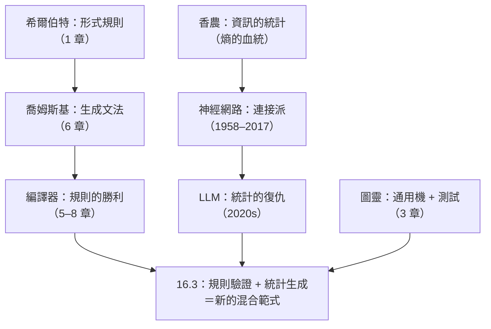

# 16.1 規則與統計的哲學對決：確定性語法樹（Rules）與高維向量概率（Probability）的本質差異

## 兩種「理解語言」的哲學

本書第 6 章與本章構成一座對稱的橋：**1956 年喬姆斯基用規則定義語言；2020 年代神經網路用統計生成語言**。兩者的哲學分野：

| | 生成語法 / 編譯器（規則派） | 大語言模型（統計派） |
|---|---------------------------|---------------------|
| 知識形式 | 顯式規則（文法、型別、推理規則） | 隱式統計（數十億參數的權重） |
| 行為保證 | **確定性**：同一輸入必得同一輸出 | **機率性**：同一輸入可能不同輸出 |
| 正確性 | 可證明（對照規則） | 只能統計評估（無保證） |
| 邊界 | 嚴格（文法定義什麼合法） | 模糊（一切皆可能，只是機率不同） |
| 錯誤模式 | 語法錯誤（明確報錯） | 幻覺（流暢但錯誤） |
| 學習方式 | 人類手工編寫/形式化 | 從資料中訓練 |

**哲學系譜**：規則派繼承萊布尼茨—希爾伯特的形式主義傳統；統計派繼承**香農的資訊論（1948）與圖靈的測試（1950）**。1950s 起兩派互有攻防：

- **1969**：Minsky–Papert《感知機》證明單層感知機的極限 → 符號派統治
- **1986**：反向傳播復興連接派
- **1980s–2000s**：符號派（專家系統→崩潰）vs 統計派（語音、機翻漸進蠶食）
- **2012–2017**：深度學習全面勝利（ImageNet、Transformer 2017）
- **2020–2022**：GPT-3/ChatGPT——**統計派首次在語言「生成」上碾壓符號派**

## LLM 的數學本質：下一個 token 的條件機率

$$P(x_{t+1} \mid x_1, \dots, x_t) = \text{softmax}(W \cdot \text{Transformer}(x_1, \dots, x_t))$$

生成 = 反覆採樣這個條件分布。**沒有文法樹、沒有符號表、沒有型別檢查——只有高維空間中的幾何鄰近與注意力權重。**

與喬姆斯基譜系的對照（第 6 章的線索在此引爆）：

- Transformer 可以**統計性地**處理一定深度的嵌套結構，但**沒有任何保證**——它在語言層級之間漂移
- **喬姆斯基的批評**（2023）：LLM 學的是人類文本的表面統計，沒有真正的語法與意義
- **實證的反駁**：LLM 能處理需要「深層結構」的現象——**即使沒有顯式文法，統計模型仍能習得結構的影子**

這場辯論的哲學核心：**結構是被「聲明」的（規則派）還是被「湧現」的（統計派）？** 與本書第 9 章（分形——局部規則湧現全局圖案）、第 11 章（網路——局部互動湧現全局結構）是同一問題的不同化身。

## 編譯器 vs LLM：能力的互補剖面

| 任務 | 編譯器/規則 | LLM/統計 |
|------|-----------|---------|
| 判斷語法是否合法 | ✅ 完美（CFG 層） | ⚠️ 大致正確但會犯錯 |
| 理解模糊的自然語言需求 | ❌ 無法處理 | ✅ 核心能力 |
| 保證型別正確 | ✅ 機制保證 | ❌ 無保證 |
| 寫出符合意圖的邏輯 | ❌ 需要人類 | ⚠️ 大致對但有幻覺 |
| 一致地重構萬行代碼 | ✅（基於 AST） | ⚠️ 局部優化，全局易破壞 |
| 解釋代碼在做什麼 | ⚠️ 只能報結構 | ✅ 自然語言解釋 |

**關鍵洞察**：

> **規則的強項在驗證（check），弱項在生成（create）；統計的強項在生成，弱項在驗證。**

回憶哥德爾/圖靈的遺產（2.3）：「檢查證明」是機械的，「尋找證明」是非機械的——**這個驗證/生成不對稱，在 LLM 時代獲得了新的工程化身**：LLM 負責「尋找」（生成候選），編譯器負責「檢查」（驗證正確）。

## 歷史的深層結構：本書線索的會師

**1950 年圖靈在〈計算機器與智能〉中預言了這一刻**：他設想的判定標準（對話不可區分）正是語言層面的統計測試——LLM 接近圖靈測試的那一刻，六十年前提出的問題獲得了第一個工程答案。

## 小結

| 對比軸 | 規則派 | 統計派 |
|--------|--------|--------|
| 認識論 | 理性主義（先天規則） | 經驗主義（資料湧現） |
| 數學 | CFG、型別論、自動機 | 梯度下降、注意力、高維幾何 |
| 錯誤 | 明確報錯 | 流暢的幻覺 |
| 未來 | 作為驗證層永生 | 作為生成層擴張 |

---
[下一節：16.2 LLM 為何寫出編譯不過的代碼](16.2-LLM為何寫出編譯不過的代碼.md)
