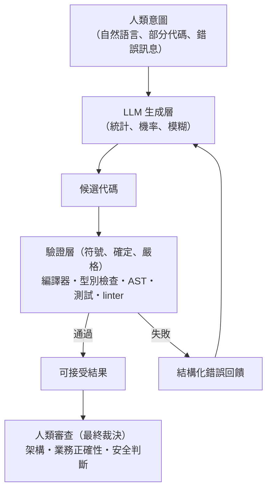

# 16.3 雙劍合璧：LLM 負責模糊意圖與代碼生成，傳統編譯器／靜態分析（AST）負責邏輯保底與驗證

## 新架構：一個雙層系統

2020s 中期的 AI Coding 逐漸穩定為一個混合架構：

**本質**：LLM 是一個**提議引擎**，符號系統是**裁決引擎**，人類是**最終審判**。三者的分工對應本書的三個理論層：

| 角色 | 對應的歷史理論 | 能力邊界 |
|------|---------------|---------|
| LLM（生成） | 香農資訊論、連接主義 | 無正確性保證，但覆蓋無限意圖空間 |
| 符號驗證（裁決） | 喬姆斯基譜系、型別論、Hoare 邏輯 | 只能驗證可判定的性質（停機問題邊界內） |
| 人類（審判） | —— | 意圖與價值的唯一來源 |

## 這個分工的理論必然性

**為什麼 LLM 不能同時做驗證？**

1. **驗證需要確定性**——「通過/不通過」必須二值且可重現
2. **語義正確性不可靜態判定**（Rice 定理）——驗證必須依賴受限形式系統（型別、CFG、契約），而這些恰恰是 LLM 內部沒有的
3. **對抗性**：若驗證也由統計模型完成，攻擊者可以優化輸入欺騙它——**驗證者必須站在攻擊模型的計算能力之外**（密碼學的基本原則）

**為什麼編譯器不能同時做生成？** 生成需要跨越「規格→實現」的鴻溝——搜尋空間指數爆炸的問題。規則系統只會窮舉，不會猜測。

**驗證/生成的不對稱**（2.3 的老主題）在此收成：**檢查容易生成難** → 讓機率系統做難的事（生成），讓確定系統做易的事（檢查）。

## 實現層的技術拼圖

| 技術 | 功能 | 前世 |
|------|------|------|
| **tree-sitter / LSP** | 給 LLM 與 agent 提供即時語法/符號視圖 | BNF 與 AST（第 6 章） |
| **LSP（2016 微軟）** | 統一的編輯器—語義服務介面 | 資訊隱藏（8.3） |
| **型別檢查器的錯誤訊息** | 給模型的結構化失敗回饋 | Rust 的錯誤訊息工程（15.2） |
| **測試框架** | 行為級驗證 | TDD（14.1） |
| **沙箱執行** | 安全地跑生成的代碼 | JVM 沙箱（13.2）、容器（14.2） |
| **AST-grep / codemod** | 大規模約束性修改 | 模板與重構（11.3） |
| **形式化規格** | 可驗證的生成目標 | Hoare 邏輯（5.2） |

**重要趨勢：為 AI 而設計的代碼基礎設施**——結構化註解、機器可讀文檔、顯式契約、強型別。**「寫給人讀」與「寫給機器驗證」的代碼正在合流**：最適合 AI 迴圈驗證的語言（TypeScript、Rust），恰好也是最適合人類長期維護的語言——**可驗證性與可讀性終於在同一方向上。**

## 經濟結構的變化

- **打字成本歸零**：語法、樣板、常規 CRUD 由模型承包——**重複性編碼勞動的商品化**
- **審查與架構升值**：判斷生成代碼的正確性成為核心技能——**驗證能力的市場價值上升**
- **規格書的復興**：把意圖寫清楚比寫實現更稀缺——**Hoare 的「先規格後實現」以新形式回歸**
- **量級效應**：一個工程師 + agent 可以維護過去十人規模的系統——**抽象化的人口擴容規律（5.3）在 AI 時代的最新一輪**

## 對「抽象層」的哲學再審

14.3 提出的問題在此給出初步答案：**抽象與生成正在重新比價**。

- 抽象（框架、模板、慣例）的成本：學習曲線、間接性、約束
- 生成的成本：即時、可丟棄、但無保證（需驗證）

當生成足夠便宜且驗證足夠自動，**部分抽象的價值會被「為情境定製的一次性代碼」侵蝕**；但**驗證型抽象（型別系統、契約、測試框架）的價值上升**——它們是迴圈中的裁判。**未來的框架可能更薄（生成替代膠水）但更硬（驗證層加厚）。**

## 小結

| 層 | 負責 | 對應理論 |
|----|------|---------|
| LLM | 模糊意圖 → 候選代碼 | 統計、資訊論 |
| 符號驗證 | 候選 → 裁決 | 文法、型別、邏輯 |
| 人類 | 意圖的來源與最終審判 | —— |

**一句話**：AI Coding 不是「AI 取代編譯器」，而是「**LLM 與編譯器組成一台新的複合機器——圖靈機與統計模型七十年來的首次合體**」。下一章，我們看這台複合機器如何改寫程式設計師的職業與程式語言的終極形態。

---
[下一節：17.1 AI 編程介面](17.1-AI編程介面.md)
