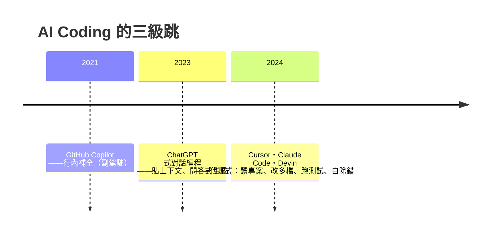
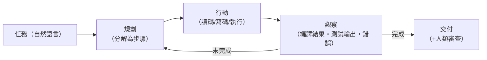

# 17.1 智慧型編程介面（Cursor / Copilot）與 Agentic Workflows：AI 如何自主讀取專案、除錯與重構？

## 從「自動補全」到「自主代理」的三級跳

AI Coding 的工具演化在五年內走完了三個階段：

**第一級（補全）**：LLM 讀取當前檔案的光標上下文，預測下一段代碼——**人的意圖，機器打字**。

**第二級（對話）**：人描述任務，模型生成整段代碼——**人描述，機器起草**。

**第三級（代理）**：模型獲得**工具權**——讀寫檔案、執行命令、跑測試——在**多輪迴圈**中自主推進：

這個「規劃—行動—觀察」迴圈（ReAct 範式，2022）的關鍵在於：**環境回饋（尤其是編譯器與測試的結構化錯誤）成為模型的「導航信標」**——16.3 的雙劍合璧在代理層的落實。

## Agentic Workflow 的工程學

**1. 上下文工程（context engineering）**：代理的品質取決於**餵給它什麼**——專案結構摘要、相關檔案、符號定義、過往錯誤。這催生了新基礎設施：代碼索引（向量檢索 + 符號圖）、倉庫地圖、記憶系統（把專案慣例寫成 agent 可讀的規則檔）。**「上下文是新的介面」**——正如 BNF 之於編譯器。

**2. 驗證前置**：成熟的工作流把測試寫在生成之前（TDD 的 AI 化）——**「先給裁決標準，再讓提議引擎跑」**。

**3. 分層授權**：讀代碼（自動）→ 改草稿（自動）→ 跑測試（自動）→ 提交/部署（人類批准）——**權限階梯對應風險等級**。

**4. 多代理分工**：規劃者/執行者/審查者——**康威定律的 AI 版**：代理組織結構複製人類團隊結構。

## 能力與邊界（2025 時點的誠實評估）

**代理已能可靠完成**：

- 有明確規格 + 有測試的任務（修 bug、寫功能、遷移框架）
- 大規模機械性改動（API 升級、型別補全）
- 代碼庫理解與解釋（**「閱讀」首次成為機器的強項**）

**代理仍不可靠的**：

- 模糊需求——意圖必須人類澄清
- 跨長時間的架構決策（技術債取捨）——需要業務記憶與價值判斷
- 安全關鍵代碼的最終背書（審計責任無法委託給機率系統）
- 對「錯誤回饋欺騙性」的處理——**當測試本身寫錯，agent 會高效地通向錯誤的目標**（目標函數錯，優化越快越糟——古德哈特定律的編程版）

**規律**：代理的能力邊界精確落在 16.3 的三層分工上——**意圖（人）、生成（模型）、裁決（符號）缺一不可**。

## 經濟與職業的即時效應

- **開發者人口再擴容**：不會寫代碼的人開始「造」軟體——**5.3 抽象化定律的最新一輪**
- **初級崗位的重塑**：「能描述清楚需求 + 能審查生成代碼」成為新的入門技能組合——**學徒制的內容改變，但學徒制本身更重要**
- **開源生態的衝擊**：貢獻門檻降低 vs 維護負擔上升（低品質 AI PR 洪水）——**治理能力的稀缺性凸顯**
- **基礎設施投資**：企業把「AI 可驗證性」（強型別、測試覆蓋、文檔結構化）當作代理化的前置條件

## 歷史的押韻

| 2020s 的現象 | 歷史先例 |
|--------------|---------|
| agent 迴圈（生成→驗證→修正） | 編譯—除錯循環（4.2 Wilkes 的覺醒） |
| 上下文工程 | 符號表與檔案系統（6.3、9.2） |
| 代理的角色分工 | 軟體工程的崗位分化（8.3） |
| 人類退到意圖與審判 | 每次抽象化後人類上移一層（5.3） |
| 「自然語言介面」 | 萊布尼茨的 Calculemus 之夢（1.2） |

**最大的歷史差異**：以往每次抽象化，**底層依然確定**；這一次，**最底層換成了機率過程**——確定性只存在於驗證層。這是本書第一章（希爾伯特的確定性之夢）與本章之間最深刻的斷裂。

---
[下一節：17.2 自然語言是終極程式語言嗎](17.2-自然語言是終極程式語言嗎.md)
