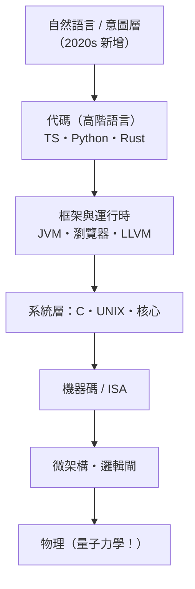

# 17.2 自然語言是否成了終極程式語言？當「會說話」就能寫軟體的未來，程式設計師的角色如何升維？

## 一個誘人的命題與它的三個漏洞

「自然語言是終極程式語言」——這是 2023 年後最流行的技術預言。它的直覺基礎：**既然 LLM 能把英文翻譯成可執行代碼，為什麼還要學中間表示？**

但這個命題有三個結構性漏洞：

**漏洞一：自然語言的歧義性是本質的，不是暫時的**。回憶 6.2：程式語言的進化方向恰恰是**消除歧義**（BNF 的唯一語法樹）。自然語言的歧義不是缺陷，是**它的功能**——人類溝通靠語境、默契與即時修錯補足。**歧義的語言無法承載需要機器精確執行的語義**——這是喬姆斯基譜系的數學裁定，LLM 沒有廢除它，只是用統計去「猜」意圖。

**漏洞二：意圖的精確化本身是工程**。寫出「機器能正確理解」的自然語言指令，需要的恰是程式設計的思維：分解、邊界條件、約束聲明、可驗證的驗收標準。實務中，高品質的 prompt 越來越像——**規格書**（14.1 的敏捷用戶故事、5.2 的 Hoare 前置條件）。**「會說話」遠遠不夠；「會把話說得無歧義」正是程式設計的核心。**

**漏洞三：驗證無法外包給生成者**。16.3 的鐵律：生成的裁決需要符號系統。自然語言無法充當裁決語言——**驗證層必須繼續使用形式化表示（代碼、型別、測試、契約）**。只要驗證層存在，就需要有人能讀懂它的語言。

## 更準確的判斷：自然語言是「新的最高層」，不是「終極的唯一層」

本書的抽象層模型可以擴充：

**各層不會消失，只會重新分工**：

- **意圖層（自然語言）**：需求探索、原型、一次性腳本——**新增的最上層**
- **代碼層**：成為**驗證與精確語義的載體**——不再主要「用手寫」，但必須「能被人讀與審」——**代碼從寫作對象變成審計對象**
- **底層（系統/硬體）**：效能、安全與成本的仲裁者——**更稀缺、更昂貴**

**程式設計師的升維路徑**：

| 舊角色 | 新角色 | 對應本書的技能 |
|--------|--------|---------------|
| 打字者（寫實現） | 意圖規格者 | 規格、契約（5.2、14.1） |
| 除錯者 | 審查者（判斷生成代碼） | 型別系統、測試（13.3、16.3） |
| 庫的調用者 | 驗證系統的設計者 | 編譯器、形式化（6、15） |
| 語法記憶者 | 系統思維者 | 本書全部 |

**教育史的對照**：每一層抽象化都曾被預言「不需要學底層了」。歷史每次都證明：**底層知識從「日常必需」變成「稀缺優勢」**——懂指標的人寫出更好的 Python，懂型別論的人駕馭更好的 TypeScript，懂編譯器的人設計更好的 agent 迴圈。**學習曲線從不消失，只會轉移。**

## 「會說話就能寫軟體」的真正意義

誠實的願景不是「工程師消失」，而是三重擴容：

1. **創作者擴容**：非工程師可以造工具——Kay 的 Dynabook 願景（10.1）以 LLM 形式部分實現
2. **迭代加速**：想法到可運行原型的時間從月縮到時——**敏捷（14.1）的終極加速**
3. **工程師上移**：從「如何實現」上移到「要什麼、如何驗證、代價何在」——**從工藝到工程的又一次躍遷**

**風險清單（與收益同等重要）**：

- **責任與審計**：AI 生成系統的事故責任鏈尚未制度化（歐盟 AI Act 2024 是第一次嘗試）
- **技能斷層**：如果一代人只學會「指揮 AI」而不懂底層，驗證層的人才池會枯竭——**形式化知識的傳承危機**
- **同質化**：模型傾向生成「語料中最常見」的解法——**生態多樣性下降**
- **安全**：幻覺引入的惡意包名（「slopsquatting」）是 2020s 新興供應鏈威脅

## 小結

| 問題 | 答案 |
|------|------|
| 自然語言是終極程式語言嗎？ | 是**新的最高層**，不是唯一層——歧義性使它無法承擔驗證 |
| 程式設計師會消失嗎？ | 角色升維：從打字者到規格者與審查者 |
| 什麼技能升值？ | 意圖精確化、驗證系統設計、跨層系統思維 |
| 最大的風險？ | 驗證人才池的傳承斷層 |

---
[下一節：17.3 終極抽象化](17.3-終極抽象化.md)
