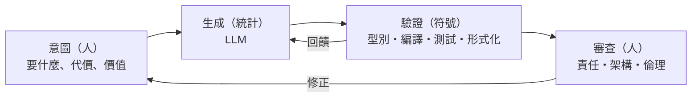

# 17.3 終極抽象化：意圖驅動開發（Intent-based Programming）的機遇與挑戰

## 抽象化的終點站：從「怎麼做」到「要什麼」

本書的隱藏主線至此可以顯式寫出——**軟體的歷史就是把「怎麼做」（how）逐層移交給機器，把人類留在「要什麼」（what）的歷史**：

| 時代 | 人類指定 | 機器負責 |
|------|---------|---------|
| 機器碼（4.2) | 每一個位元 | —— |
| 組語（4.3） | 助記符與暫存器 | 二進位編碼 |
| 高階語言（5.1） | 語句與演算法 | 暫存器分配與指令選擇 |
| 宣告式/SQL（5.3、11.3） | 要什麼資料/不變式 | 執行計畫/展開 |
| 框架（14.1） | 慣例與填空 | 流程與接線 |
| **LLM（17.1）** | **自然語言意圖** | **實現的絕大部分** |

**意圖驅動開發（Intent-based Programming）**是這條線的邏輯終點：人類只聲明**意圖 + 約束 + 驗證標準**，系統自我實現、自我驗證、自我維護。它已在局部存在：宣告式基礎設施（Kubernetes 的期望狀態聲明——「我要 3 個副本」，控制器負責維持）、策略即代碼、LLM 生成迴圈。

## 終點站的塞車問題：難度並未消失，而是轉移

抽象化守恆律：**被抽象掉的複雜性不會消失，只會轉移**。意圖驅動開發的複雜性轉移到三處：

**1. 意圖的完整性問題**（規格的哥德爾）：

> 自然語言意圖永遠不完備——你無法預先聲明所有情境的期望。

人類需求的本質是**開放世界**（敏捷存在的原因，14.1）。所以「純意圖驅動」注定是幻覺——**現實是「意圖—實現—觀察—修正意圖」的迭代螺旋**。CoC（14.1）的教訓再次適用：**機器填補的空白，必須由慣例（預先編碼的集體決策）來填**——於是「誰決定預設值，誰就擁有權力」。

**2. 驗證的表達力問題**：

$$\text{意圖越精確可驗證} \iff \text{越形式化} \iff \text{越逼近程式語言本身}$$

**悖論顯形**：把自然語言意圖「提升」到機器可驗證的精確度，過程恰恰是——**寫代碼/規格**。驗證層的需求保證了形式化表示的永生。**自然語言佔領生成層的同時，形式化語言佔領了驗證層——兩者共存於同一迴圈，誰也吃不掉誰。**

**3. 責任的歸屬問題**：

意圖驅動系統出錯時，「我只是說了要什麼」不構成免責——**專業判斷的責任不可委託給工具**（航空自動化的教訓：自動駕駛時代機長仍是責任主體）。**審查者（人類）對交付物負責，模型只是工具**。

## 機遇：三次壓縮正在同時發生

- **表達壓縮**：同樣的功能，人類的輸入量下降千倍以上——**開發者人口向「意圖提出者」擴容**（5.3 規律的終極版）
- **迭代壓縮**：意圖→原型的迴圈從月到分鐘——**敏捷的終極加速**
- **維護壓縮**：代碼可隨需求變化重新生成——**代碼從資產變為快取**：當再生成比修改更便宜且同樣可驗證，維護的意義徹底改變

**代碼作為快取**值得停留一秒：如果需求描述 + 驗證套件足以隨時再生成等價實現，那麼**真正需要版本控制的，是意圖與驗證，而非實現**。未來的核心工件：

> **規格 + 測試 + 契約**（機器可讀的意圖與裁決標準），實現代碼成為可再生成的衍生物。

## 挑戰：五道未解的牆

1. **長程一致性**：百萬行、十年、數百次再生成——狀態如何不漂移？（「架構的持久化表示」尚在萌芽）
2. **安全關鍵領域的准入**：可追溯的確定性要求——機率生成器的證照制度尚未存在
3. **經濟的再分配**：編碼勞動商品化的受益者與受害者——制度設計遠落後於技術
4. **生態單一化**：生成傾向同質解——軟體的多樣性是韌性的來源
5. **意圖的文化污染**：訓練資料的偏見會成為「預設慣例」——**誰的意圖被內建？**

## 回到起點：希爾伯特之夢的圓滿與翻轉

本書從希爾伯特計畫開始（1.1）：**「所有問題皆可機械判定」**。哥德爾與圖靈證明了它的不可能（1–2 章）。

歷史在此翻轉了一個世紀：

> 希爾伯特想要的是**確定性的判定機器**，得到了不可判定的證明；而 2020s 的人類恰恰造出了一台**不確定的生成機器**——它不能「判定」任何命題的真偽，卻能在實踐中生成看似無限的代碼與證明草稿。

**兩次遺憾的相互補償**：圖靈證明了機器無法自證全知；但人類也一樣無法（數學家的直覺同樣是機率式的猜測 + 邏輯式的驗證）。**LLM 的「猜 + 驗」迴圈，其實是對人類認知結構的工程模仿**——把「直覺生成」與「邏輯驗證」的分工機器化。這或許是希爾伯特之夢的正確版本：**不是機器全知，而是機器參與人類的知識生產迴圈。**

## 給讀者的最後一張地圖

如果本書只留下一張圖：

**程式的未來 = 意圖 × 生成 × 驗證 × 責任的平衡藝術。**

掌握了這四個角色各自的邊界——機率能做什麼、符號能保證什麼、人類必須決定什麼——你就擁有了在本書任何一章的技術浪潮中定位自己的羅盤。無論下一層抽象是什麼（量子軟體？生物計算？尚未命名之物），**「生成與驗證的分工、意圖與責任的歸屬」這兩條軸線，將繼續是所有變革的度量衡。**

---
[下一節：99 結語](99-結語-永無止境的抽象化之路.md)
