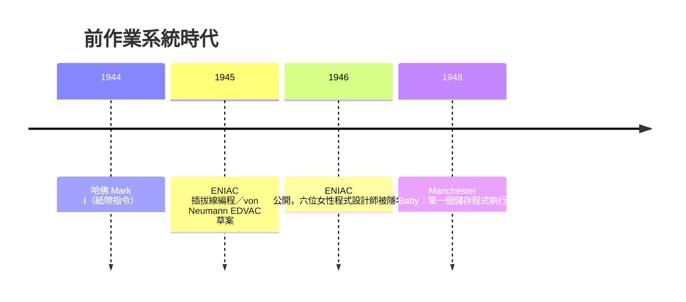

# 節標題：機器碼與插拔線——前作業系統時代的硬體直接控制

1945 年的賓州大學摩爾電機學院，ENIAC 剛剛點亮了它的一萬八千根真空管。這台重達三十噸的巨獸是為了替美國陸軍計算彈道表而生的，但它的使用者很快就發現一件令人沮喪的事：這台機器根本沒有「程式」可言——至少沒有今天我們所理解的、存在記憶體裡的程式。

ENIAC 的「程式設計」，意思是親手把機器上各個單元用電纜線接起來，再撥動上千個開關設定常數。想要它算拋物線彈道，你得把加法器、乘法器、函式表用線纏成一張三維的電路圖；想改算一題新的，就得拔掉所有線重插一遍。這不是幾分鐘的事——早期的紀錄顯示，重新設定一次程式往往要耗費一到兩天，甚至更久。機器本身算一發彈道只要幾十秒，但「告訴它算什麼」卻要花上幾天。這個荒謬的比例倒掛，正是推動整部系統軟體史的第一股力量。

而站在插拔線最前線的，是一群當時被稱為「計算員」（computer）的女性。戰前，「computer」是一種職業而非機器：一群受過數學訓練的人，用機械計算器和紙筆，日復一日地做加減乘除。軍方彈道實驗室僱用了大批女性計算員，因為戰爭把男性人力抽走了，也因為這份工作薪水低、地位低——儘管它需要相當的數學素養。ENIAC 的六位原始程式設計師——Kathleen McNulty、Frances Bilas、Betty Jennings、Ruth Lichterman、Elizabeth Snyder 與 Marlyn Wescoff——正是從計算員轉調而來。她們沒有教科書、沒有手冊，只有電路圖，靠著拆開機器逆向理解硬體，才摸索出如何讓 ENIAC 跑起來。她們的程式設計是與硬體同義的：知道每一根管線、每一個開關，就像鐘錶匠知道每一顆齒輪。諷刺的是，1946 年 ENIAC 對外公開那場著名的記者會上，這六位女性的名字完全沒有出現——那個時代的人們認為，操作機器的是「技工」，而榮光屬於設計機器的工程師。性別與階層，從運算資源誕生的第一天起就刻在制度裡：數學家與男性工程師定義問題、設計硬體；女性計算員負責讓它運轉。這個分工的幽靈，要到幾十年後才慢慢消散。

真正的轉折發生在觀念上。數學家 John von Neumann 在 1945 年寫下《EDVAC 報告書的第一份草案》，提出「儲存程式」（stored-program）概念：把程式和資料一樣，以數字的形式放進記憶體。這個看似簡單的想法威力驚人——程式不再是插拔的線，而是可以被讀寫、被修改、被當成資料處理的東西。修改程式從「重新接線兩天」變成「改幾個記憶體位置」。

同一時期，哈佛的 Howard Aiken 在 IBM 支持下完成了 Mark I（1944），它用打孔紙帶存放指令序列，算是往自動化執行邁了一步；但真正實現儲存程式的，是 1948 年 6 月英國曼徹斯特大學的「Baby」（Manchester Small-Scale Experimental Machine）。Frederic Williams、Tom Kilburn 與 Geoff Tootill 用陰極射線管做出可讀寫的主記憶體，並在 1948 年 6 月 21 日成功跑出第一個儲存於記憶體中的程式——用 17 條指令求一個數的最大公因數。那一刻，程式第一次真正「活在」機器裡。

但「活在機器裡」不代表好寫。沒有組合語言、沒有載入器、更沒有作業系統——這些都還要再等幾年。早期程式設計師把機器碼以二進制形式直接輸入：撥前面板的一排開關，一位元一位元地按進去；或者先在紙帶上打孔，再讓機器讀入。曼徹斯特 Baby 的輸入就是靠紙帶讀孔機，而它的「輸出」是一台電傳打字機。每條指令都是一個二進制數字，位址要用人工算好、填進指令的位元欄位；程式一改，後面所有位址都要跟著重算。這種勞動枯燥而容易出錯，於是數學素養好的人用「程式設計師」的頭銜自居，而輸入開關與維護機器的粗活，又落在操作員身上——階層分工換了一種形式延續。

經濟制度同樣殘酷。ENIAC 每天耗電一百五十千瓦，真空管平均幾天就燒一根，工程師輪班守著機器找故障。機時是按小時計價的稀缺資源，必須事先申請、排定時段；美國陸軍彈道研究實驗室為了配合氫彈計算，甚至讓 ENIAC 在 1945 年底被 Los Alamos 的科學家長期占用。大學裡的機器同樣如此：機時分配是一場學術政治，誰有門路、誰的計畫重要，誰就能摸到開關。沒有作業系統的時代，機器的「排程」是靠一本登記簿和一個拿鑰匙的管理員完成的。

回頭看這段前作業系統時代，有三件事值得記住。第一，抽象化的需求是被痛苦逼出來的：改程式要兩天的 ENIAC，直接催生了儲存程式概念。第二，軟體與硬體的分離是漸進的：最初「寫程式」就是「接線」，兩者徹底分手花了好幾年。第三，運算從第一天起就是制度性資源——誰能使用機器、如何計價、由誰管理，這些問題先於任何技術發明存在，而作業系統的整部歷史，其實就是把這本機時登記簿與那位拿鑰匙的管理員，一步一步自動化的歷史。

