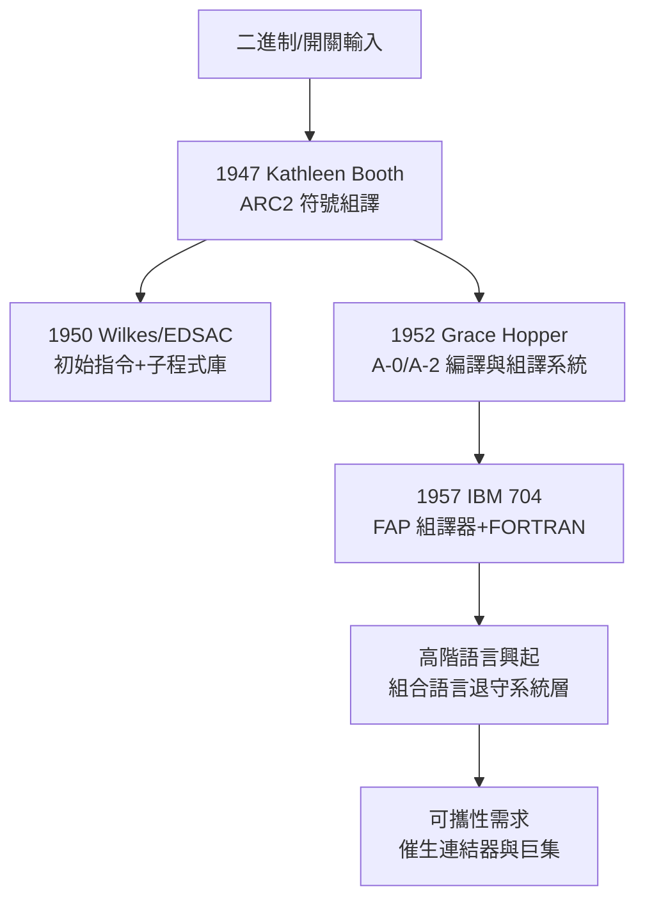

# 節標題：組合語言與符號記憶碼——從二進制解放

Manchester Baby 證明了儲存程式可行之後，新的痛苦立刻浮上檯面：用二進制寫程式是一場災難。指令是數字、位址是數字、資料也是數字，程式設計師得在紙上畫滿表格，人工計算每一條指令該落在哪個記憶體位置，一旦插入或刪除一行，後面所有位址全部重算。人們很快意識到：既然機器能算數字，為什麼不讓機器幫忙翻譯程式？

第一個關鍵步驟發生在 1947 年的英國倫敦。Kathleen Booth——數學家出身，與丈夫 Andrew Booth 一起建造 ARC2（Automatic Relay Calculator）這台繼電器電腦——為這台機器寫出了最早的組譯器（assembler）之一。她的洞察是：與其讓人類記「0101 代表載入」，不如直接寫符號化的指令與位址，再寫一個小程式把符號翻譯成機器碼。她後來在 1950 年與 Andrew Booth 合寫的論文《General considerations in the design of an all-purpose electronic digital computer》中，明確描述了這種以符號位址書寫、由程式自動組譯的方法。這是「人寫人話、機器譯機話」這條路的起點。順帶一提，Kathleen Booth 也是最早寫出組合語言教科書的人之一，並設計了早期的高階語言 BACL；但在男性主導的電腦史敘事裡，她的名字長期被遺忘，直到近年才被重新挖掘。

概念再往前推半步，就要把「符號指令」推廣到「助記碼」（mnemonic）。1950 年前後，ENIAC 的共同發明人 John Mauchly 寫出了 Short Code——一種用簡短符號表示數學式、再由直譯程式轉換的語言，可視為高階語言的胚胎。而真正把符號化組譯變成系統性方法的，是海軍出身的數學家 Grace Hopper。她在哈佛 Mark I 上寫程式的經歷讓她深深體會：人類不該被迫用機器的語言思考。1949 年她加入 Eckert–Mauchly 公司參與 UNIVAC，1952 年寫出 A-0 編譯器，之後的 A-2 系統則發展出完整的符號組譯與子程式庫機制。Hopper 堅信「電腦應該能編寫自己的程式」，當時多數人嘲笑這是痴人說夢——「電腦只會算術，怎麼可能懂英文？」——但她的固執最終催生了 FLOW-MATIC 與 COBOL，也讓「翻譯程式」（compiler/assembler）從異端變成正統。她的性格是理解這段歷史的鑰匙：一位退役海軍中校，用軍官的紀律與傳教士的執著，在每一場會議、每一次演講裡推銷「讓程式可讀」的信念，甚至到晚年還隨身帶著奈秒（一尺長的電線）到處演示「光走一奈秒有多遠」。

英國這邊，劍橋的 Maurice Wilkes——EDSAC 的建造者——把符號組譯做成了嚴謹的工程系統。EDSAC 在 1949 年上線時就配有「初始指令」（initial orders），一段常駐的程式能把紙帶上的符號位址與助記指令自動組譯、載入記憶體；Wilkes 更進一步建立了子程式庫（subroutine library），連使用手冊都印好每一個子程式的進出參數。Wilkes 的想法很清楚：程式設計應該建立在可重用的積木上，而不是每次從零開始。這套「符號組譯＋標準化子程式庫」的組合，成為 1950 年代英國學派的方法論典範。

大洋彼岸的商業戰場則是另一番景象。IBM 在 1950 年代推出 700 系列大型主機——701（科學用）、702（商用）、704、705……每一台機器指令集不同，每一台就配一套自己的組譯器。IBM 704 因為有硬體浮點運算與索引暫存器，其組譯器成為後來 FAP 等組譯系統的基礎；1957 年 FORTRAN 在 704 上問世後，科學界湧向高階語言，但系統程式、編譯器本身、作業系統核心，仍然清一色用組合語言寫——FORTRAN 編譯器自己就是用 704 組合語言寫的。這形成一個耐人尋味的階層結構：高階語言服務「使用者」，組合語言服務「系統建造者」，兩種文化的分野在 1950 年代末的大學課程裡逐漸定型——MIT、CMU 等校把組合語言與機器結構列為系統方向的核心訓練，因為不摸機器，就寫不出編譯器與監控程式。

組合語言的本質，是把機器碼做一次「一對一的符號映射」：`mov` 對應一個載入指令的位元樣式，`jmp` 對應一個跳躍碼，`label` 則把「第 37 個記憶體位置」這種反覆重算的數字，交給組譯器去分配。這是一次徹底的抽象——但它是最薄的一層抽象，底下仍是該機器的指令集。這就引出組合語言的宿命：它是「可攜性的反義」。每台機器一套語言，意味著程式資產被鎖死在硬體上。1950 年代的電腦市場機型更迭頻繁，客戶換機器就得把幾萬行組合語言重寫一遍，這筆商業成本成為巨大的痛點——痛點正是創新之母。當使用者在各種研討會上抱怨「我的投資跟著機器一起報廢」，呼喊「機器無關的語言」的聲音越來越響，FORTRAN、COBOL 這類跨越機型的高階語言才獲得商業動力。可以說，組合語言的不可攜，親手孕育了消滅自己的力量。

但故事沒有就此結束。組譯過程中暴露的兩個問題——符號位址如何在不同模組之間互相引用、程式如何裝進任意記憶體位置——催生了下一代的工具：重定位載入器、連結器與巨集組譯器。符號解放了人類的書寫，而模組化將解放人類的組織方式。

