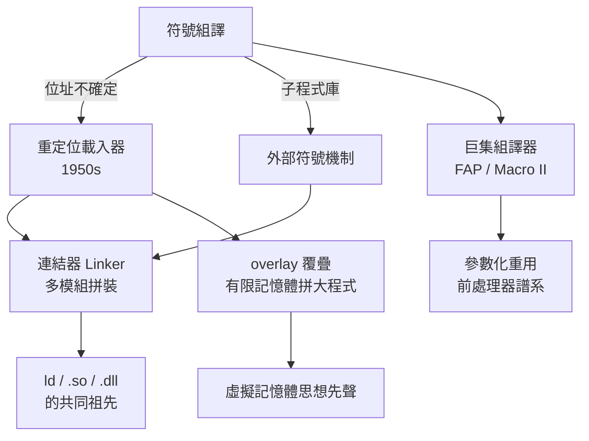

# 節標題：巨集處理器與連結器的萌芽——模組化與重定位

組合語言解決了「怎麼寫」，卻沒解決「怎麼拼」。當程式從幾百行長到幾萬行，兩個新問題浮出水面：第一，程式要用到的子程式散落在程式庫的各個角落，組譯時根本不知道它們會被放在記憶體的哪個位置，符號位址怎麼對得上？第二，每個人都在重寫同樣的程式碼片段——讀一張卡片、除錯時印出一行數值——能不能「寫一次、到處用」？

第一個問題的答案叫「重定位」（relocation）。早期的載入器只會把組譯好的機器碼原封不動放進固定位置；如果程式被裝到別的位址，所有內部位址全部失效。1950 年代中期，重定位載入器（relocating loader）登場：組譯器輸出時，把位址分成「相對於程式起點」與「絕對位址」兩類，並附上一張重定位表，標明哪些位置需要修正；載入器把程式放進記憶體後，自動把「程式起點」加到所有相對位址上。這個機制看起來樸素，卻是一個劃時代的觀念：程式從此不再綁死某塊記憶體——它是「浮動」的。今天 Linux 上的 `.so`、Windows 上的 `.dll`、每一顆晶片韌體的位置無關程式碼（PIC），血統都能追溯到 1950 年代的這張重定位表。

重定位打開的門裡，走出來的是連結器（linker）。一旦程式可以浮動，就可以拆成多個模組分別組譯：每個模組對外宣告「我提供這些符號」（entry/external symbol），對內聲明「我需要這些符號」（external reference）。連結器的工作就是把所有模組的符號表攤開比對，把甲模組呼叫的 `SQRT` 位址填進乙模組的跳躍指令裡，再把全部模組重定位、拼成一個可執行映像。這正是劍橋學派子程式庫思想的直接延伸：Maurice Wilkes 在 EDSAC 上建立的程式庫，讓數值分析的方法——解線性方程組、算三角函數、做數值積分——第一次被「標準化」成人人可呼叫的套裝積木。美國這邊，RAND 公司的 JOHNNIAC（以 von Neumann 命名，1953 年完工）與洛杉磯一帶的科學計算社群，也發展出成熟的子程式庫文化：飛彈軌道、核子物理、空氣動力學的計算，都建立在一批經過驗證的數值子程式上，共享程式庫甚至透過 SHARE（1955 年成立的 IBM 用戶互助組織）這類使用者社群流通——「開源共享」的胚胎，比 Linux 早了整整四十年。數值分析的學術標準化（後來的 Algol 傳統、ACM 的演算法論文、NIST 的數學程式庫）與系統工具的連結能力，是一體兩面：先有「把演算法寫成標準模組」的文化，才有「把模組連起來」的工具需求。

第二個問題——程式碼重用——由「巨集」（macro）回答。巨集組譯器的想法是：把一段常用的指令序列定義成一個名字，之後寫這個名字，組譯器就自動把整段展開，還能代入參數。1950 年代後期，IBM 704/709 上的 FAP（FORTRAN Assembly Program，1958）與道格拉斯飛機公司為 IBM 705 開發的 Macro Assembly、後來的 SAP/Macro 系統，都內建了強大的巨集功能；IBM 7090 時代的組譯器讓系統程式師能用 `CALL` 一個巨集就展開一整段 I/O 控制序列。值得注意的是，巨集不只是省字：它讓「參數化的程式片段」成為一種新的抽象層——位於高階語言與裸機碼之間。這個觀念後來開枝散葉：C 語言的前處理器、組譯器裡的條件組譯與迴圈巨集、乃至 PL/I 與 MVS 系統裡的巨型巨集程式庫，都是 1950 年代巨集組譯器的直系後裔。而更廣義的「巨集處理」思想，則通向文字處理與程式產生器——TRAC、m4、乃至 Lex/Yacc 這類工具生態，都在這條譜系上。

連結、載入與巨集合流之後，1950 年代末的程式師面對的仍然是那個致命的物理限制：記憶體太小。IBM 709 的核心記憶體只有幾萬字元，而使用者想算的問題越來越大——矩陣階數更高、模擬步數更長。解法是一種帶著強烈時代印記的技術：overlay（覆疊）。程式師把程式切成許多「覆疊段」，這些段不會同時使用，於是可以輪流共用同一塊記憶體：段 A 用完，由覆疊管理程式從磁帶或磁鼓把段 B 載進同一塊區域，覆蓋掉 A。程式師必須親手畫覆疊結構圖、宣告每段大小與載入時機——這是把「記憶體管理」的責任硬塞回人類肩上的苦役，但它是後來虛擬記憶體與分頁系統的思想先聲：既然程式可以分段覆蓋，為什麼不能讓系統自動、細粒度地做這件事？IBM 的 IBSYS/IBJOB 系統為此提供了標準的 overlay 產生器，把這份苦役半自動化。

把這段歷史的因果鏈攤開來看，是一件值得回味的事。儲存程式電腦讓「機器幫忙翻譯程式」成為可能；組合語言引入符號位址；符號位址逼出了重定位與外部符號機制；重定位與子程式庫文化催生連結器；連結器讓模組化程式設計成立；巨集處理器在組譯層提供參數化重用；overlay 則在記憶體層面拼裝大程式。每一層都是為了解上一層遺留的痛。而這一整套「模組化＋重定位」的方法論，正是後來一切連結/載入系統的共同祖先：Unix 的 `ld`（1970 年代，貝爾實驗室）、共享程式庫 `.so`、微軟的動態連結 `.dll`（1990 年代）、乃至現代程式語言的模組系統與 JIT 的即時重定位，全部都是 1950 年代那個念頭的延續——程式不該綁死在位址上，正如思想不該綁死在一台機器上。

