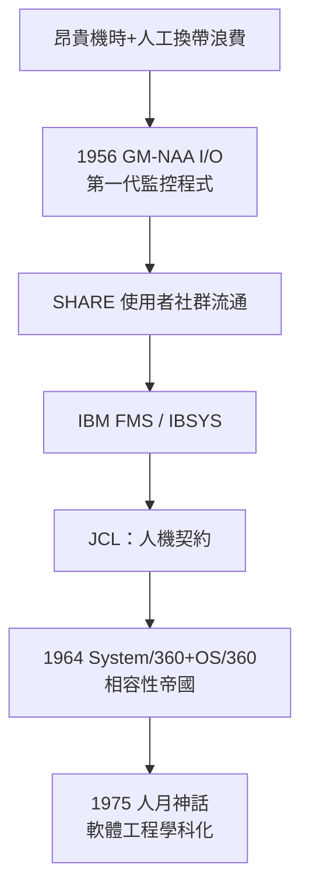

# 節標題：批次處理系統——從人工換磁帶到自動排程

1950 年代中期的電腦中心，最值錢的不是程式師，而是時間。一台 IBM 704 每小時租金以數百美元計，而它大部分時間在等——等操作員換磁帶、等卡片讀入、等下一個使用者走進機房擺好他的卡片疊。機時登記簿上，每個預約時段之間常空出十幾分鐘的縫隙，那是操作員收拾紙卡、繞磁帶、按下面板重置的時間。積少成多，昂貴的 CPU 有一半生命在發呆。前作業系統時代遺留的問題，至此被翻譯成經濟語言：浪費。

第一個系統性的回應，來自最痛的客戶。1956 年，通用汽車（GM）與北美航空（North American Aviation）的研究部門合作，為 IBM 704 開發了 GM-NAA I/O——一般公認是最早的作業系統之一。這兩家公司都是 704 的大用戶，工程師要跑的計算一個接一個，與其讓操作員每換一個程式就重新啟動一次，不如寫一個常駐的監控程式（monitor）：它開機後一直留在記憶體的固定區域，每當前一個程式結束，就自動從磁帶讀入下一個程式、載入、執行。操作員的角色從「每小時手動接生數十個程式」變成「換換磁帶就好」。GM-NAA I/O 的想法很快在用戶社群傳開，透過 SHARE 這個 1955 年成立的 IBM 用戶組織自由流通、各家修改——作業系統的第一批程式碼，居然是以社群共享軟體的姿態傳播的。

IBM 自己很快跟上，推出 FORTRAN Monitor System（FMS，約 1957-58），把監控程式與 FORTRAN 編譯環境綁在一起；1960 年代初又推出更完整的 IBSYS／IBJOB 系統，成為 7090/7094 上的標準配置。這些系統的本質，值得用一句話講清楚：批次監控程式，就是一個「永久駐留的載入器加排程器」。它沒有分時、沒有多工，甚至沒有真正保護自己——使用者程式若寫壞了，照樣能把監控程式蓋掉，機器當機，操作員重來。它解決的只是排程的自動化：把那本機時登記簿與拿鑰匙的管理員，固化成一段駐留記憶體的程式碼。

但自動排程需要一個契約：使用者得告訴系統「我這疊卡片是什麼、要用哪些裝置、編譯還是執行」。這個契約就是工作控制語言（Job Control Language, JCL）。在卡片時代，JCL 是一疊以特殊字元（如 `$`）開頭的控制卡，夾在使用者的資料卡之間：「我這裡有一個 FORTRAN 編譯工作」「編譯結果放到磁帶機三」「接著執行、資料從讀卡機來」。JCL 是人與機器的分工界線——使用者交出控制權的一瞬，也是「作業系統」作為一個管理者概念的誕生時刻。JCL 的難用後來成了傳奇：IBM 的 JCL 冗長、易錯、語法古怪，程式師之間流傳一句自嘲——「JCL 的意思是 Just Can't Laugh」。但沒有人能否認它的重要性：它把「程序性知識」（怎麼跑一個程式）從操作員的腦子裡，外化成一份機器可讀的合約，這是制度技術化、技術制度化的典型一刻。

真正把批次處理變成帝國的，是 IBM System/360。1964 年 4 月，IBM 董事長 Thomas Watson Jr. 宣布了這個豪賭：一整個家族、數十種型號的相容電腦，從小型商用機到頂級科學機，共用同一套指令集——這在當年是革命性的商業構想，意味著客戶升級機器不必重寫程式，「軟體資產可攜」第一次被寫進產品策略。而為 360 配套的作業系統 OS/360，成為史上最著名的軟體工程悲喜劇。專案由 Frederick Brooks 主持，五百多人參與開發，後來擴充到上千人；進度一再延誤、成本暴增，Brooks 自己事後估算，OS/360 所耗的人年遠超預期數倍。1965 年 OS/360 倉促上線，仍在趕工修補。Brooks 隨後把整個過程的教訓寫成 1975 年的《人月神話》，書中兩條定律至今仍被引用：「在一個延誤的專案裡加入人手，只會讓它更加延誤」（Brooks 定律），以及「沒有銀彈」——軟體的複雜性沒有一擊必殺的解藥。書名則來自他對工作組織的觀察：把人月當單位計價，就像用人數除以工期，天真地假設人力可以無限線性疊加。

OS/360 之後的十年，批次帝國席捲世界：銀行、保險、航空、政府，全在批次的節奏下運轉——白天收集交易，夜裡跑整批的結帳與報表，磁帶櫃像圖書館一樣排滿牆邊。這不是技術惰性，而是經濟理性：批次讓昂貴的 CPU 滿載，把「昂貴時間」的浪費壓到最低。制度的邏輯塑造了技術的形狀——批次處理之所以長成「一疊卡片、一張 JCL、一個監控程式」的樣子，是因為那個年代的稀缺資源是機時，而不是使用者的耐心。

當然，硬幣的另一面很快顯形：使用者把卡片疊交出去後，只能等數小時看結果，一個逗號打錯，就要再等一輪。工程師們開始在咖啡機旁抱怨：與其等一批，不如讓我直接坐在終端機前面。這種不耐煩，將在下兩章的故事裡，藉由硬體中斷與分時系統，把計算從「排隊領號碼牌」改寫成「對話」。

