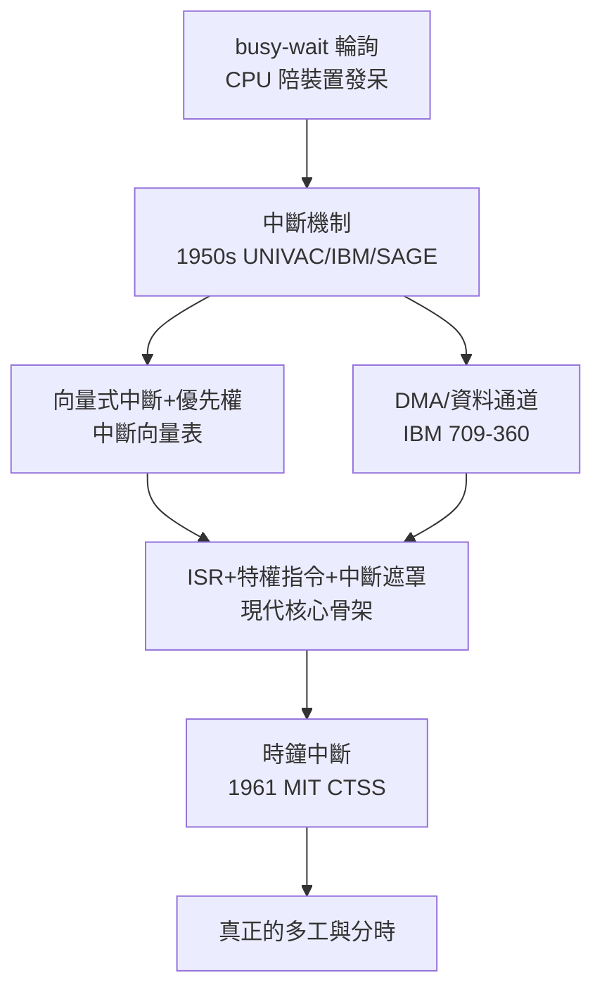

# 節標題：硬體中斷與 I/O 控制——擺脫輪詢的極限

設想你是一台 1950 年代初的電腦，正在替一位物理學家算流體方程，途中需要從磁帶機讀一筆資料。你唯一的辦法是：停在那裡，反覆問磁帶機「好了沒？好了沒？好了沒？」——直到它說好。這叫輪詢（polling）或忙等待（busy-wait），而它的代價慘烈：磁帶機回應一次要幾十毫秒，這段時間裡，每秒能做幾萬次加法的 CPU 什麼都不做。CPU 的時間以分秒計價，卻被浪費在「等待」這種最不值錢的事情上。

解法是一個至今仍在每台電腦裡跳動的機制：中斷（interrupt）。其構想優雅得近乎簡單：裝置完成工作時，由硬體主動通知 CPU——發一個電氣訊號，CPU 暫停手邊指令，跳到一個預先約定的位址執行處理常式，處理完再回來繼續。CPU 從「不斷追問」變成「被動接聽電話」，等待的時間還給了計算。這個觀念在 1950 年代逐步成形：UNIVAC 1103 與 IBM 早期的機器已具備某種形式的程式中斷或檢查指示，用於偵測溢位等異常；1950 年代中後期，隨著磁帶、磁鼓等非同步裝置普及，裝置完成信號的中斷成為大型機的標準配備。傳播這個觀念的重要推手之一，是 MIT Lincoln Laboratory 的人們：他們在為防空系統 SAGE 打造 AN/FSQ-7 時，面對數十部雷達與通訊裝置必須「即時」回應的局面，中斷驅動不是最佳化，而是唯一可行的設計。SAGE 是第一個真正意義上的即時系統——敵機不會等你換磁帶。

中斷一多，新的設計問題隨之而來：十幾個裝置都可能發中斷，CPU 怎麼知道是誰在敲門？怎麼決定先理誰？答案是「向量式中斷」（vectored interrupt）：每個裝置（或每類中斷）對應一個編號，硬體據此從一張「中斷向量表」裡查到該裝置專屬的處理常式位址，直接跳過去。這省去了逐個詢問的軟體開銷，也把「誰的事件由誰處理」制度化成一張表。優先權則解決衝突：電源故障、記憶體錯誤這類生死攸關的中斷，必須能插隊；而慢速裝置的中斷排在後面。IBM 7000 系列與後來 System/360 的 I/O 系統，把優先權、遮罩、向量，冶煉成一整套嚴密的體系。

與中斷相輔相成的，是 DMA（Direct Memory Access，直接記憶體存取）。中斷解決了「完成時通知」，但若每次傳一個字元都要打擾 CPU 一次，高速裝置照樣把 CPU 綁死。DMA 的做法是設一個獨立的硬體通道，讓裝置與記憶體之間直接搬資料，CPU 只在整塊資料搬完後收到一次中斷。1950 年代末到 1960 年代，這種技術以各種名字出現：IBM 709 的資料同步裝置、7090 的資料通道（data channel）、System/360 的通道架構——IBM 甚至把通道做成一個有自己指令集的簡易處理器，CPU 下達一條「啟動 I/O」指令後就撒手不管，通道自行照著通道程式搬資料、處理狀況，完事再發中斷。這其實是「把 I/O 交給另一台小電腦」——分散式思想在單一機櫃內的最早實踐之一。

有了中斷與 DMA，作業系統的內部結構被徹底改寫。從前監控程式只是個載入器加排程器，現代它必須有一套「事件驅動的骨架」：中斷發生時，硬體切換到核心狀態、保存現場、跳入中斷處理常式（ISR，Interrupt Service Routine）；ISR 完成後恢復現場或觸發排程切換。這帶來三個全新的系統概念。其一是特權等級：使用者程式若能隨意關掉中斷，整個系統就任人宰割，於是「特權指令」的概念出現——只有核心能碰中斷遮罩與 I/O 指令，這是硬體保護的核心濫觴（System/360 把它做成兩態架構）。其二是可重入（reentrant）：中斷可能在任何一條指令之間插進來，核心程式碼必須設計成可以中途被打斷、被重入而不出錯——這在程式設計史上是一種全新的紀律，也是後來所有並行程式的先聲。其三是中斷遮罩（mask）：關鍵程式區段可以暫時遮住部分中斷，做完再開——臨界區的概念由此而生。

但中斷最深的歷史意義，在於它是一顆引爆的火種：沒有中斷，就沒有真正的多工程式設計。想想看，要讓兩個程式共用一台機器，關鍵是 CPU 能夠「強行」從甲程式手上把控制權收走，交給乙程式——而這正是時鐘中斷做的事。輪詢時代，控制權只在程式自己手裡，它不放手，系統就動不了；中斷時代，控制權第一次被硬體機制收歸系統所有。1961 年，MIT 的 Fernando Corbató 團隊在 CTSS（Compatible Time-Sharing System）上，用一顆時鐘中斷定期打斷正在執行的程式，把 CPU 切給下一位使用者——幾十個人在打字機終端機前，同時感覺機器是自己的。這顆每秒響幾十次的時鐘，敲開了分時時代的大門，也把「作業系統」從一個排程載入器，升格為所有計算資源的絕對管理者。

