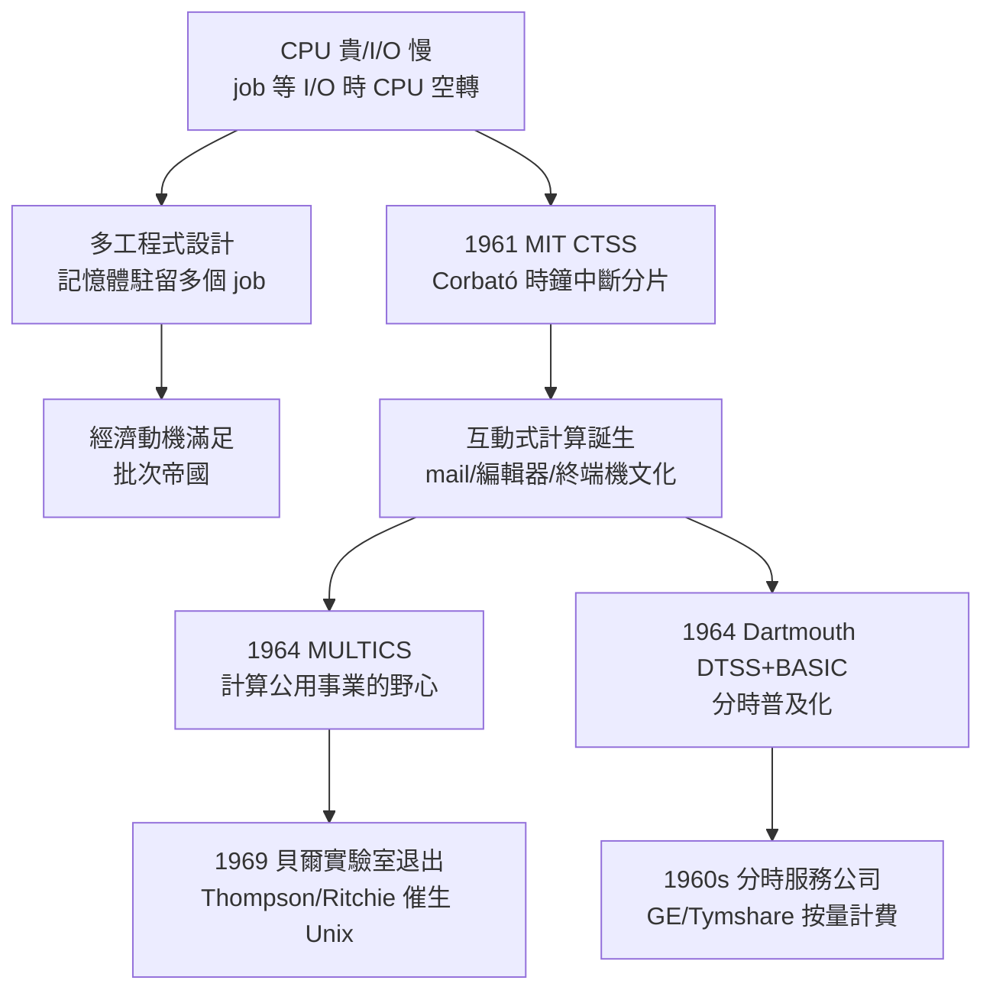

# 節標題：多工程式設計與 CPU 時間分片

批次處理把 CPU 餵飽了嗎？沒有。1960 年代的系統分析師拿著硬體計數器發現一個尷尬的事實：即便有 JCL 與監控程式，CPU 仍有大段時間閒置。原因是結構性的——一個 job 跑到一半要讀磁帶、查磁鼓、印報表，I/O 一啟動，CPU 只能乾等。CPU 很貴，I/O 很慢，兩者速度差了幾個數量級；單一 job 再怎麼緊湊，也填不滿這條鴻溝。

多工程式設計（multiprogramming）的解法冷靜得像一道算術題：既然單一 job 會因等 I/O 而讓 CPU 空轉，那就讓記憶體同時駐留好幾個 job——甲在等磁帶時，CPU 立刻切去跑乙；乙去等印表機時，切回丙。CPU 利用率從三成拉到八成以上，機器的投資報酬率直接翻倍。這是純粹的經濟動機：多工不是為了讓人類方便而發明，而是為了讓昂貴的矽不浪費而發明。當然，多工需要一系列支撐：記憶體必須分割保護（甲不能踩到乙），中斷必須能強制收回控制權（上一章的時鐘），還需要一套排程演算法決定下一個跑誰。IBM System/360 的作業系統家族正是沿著這條邏輯分化：OS/360 PCP（單一 job）之外，MFT 與 MVT 提供固定／可變分割的多工程式設計，讓銀行與保險公司的夜間批次吞吐量倍增。

但多工對使用者體驗的幫助是零——卡片疊交出去，照樣排隊等幾小時。真正改變人機關係的，是一群 MIT 的工程師與心理學家的野心：讓每個人「直接」跟電腦對話。這個想法在當年近乎異端。主流觀點認為電腦是批量的、昂貴的，人坐在終端機前打字，只會讓機器在等你想下一個指令時白白閒置——這是經濟上的荒謬。MIT 的 Fernando Corbató（人稱 Corby）不這麼看：如果機器切得夠快，快到每個使用者都感覺不到別人的存在，那麼一台機器可以「同時」服務幾十個人，每個人都得到互動的體驗，而機器總利用率不降反升——因為人在思考、打字的空檔，CPU 正在服務別人。使用者的閒暇，恰好填補 CPU 的閒暇；分時是「人的時間」與「機器的時間」的一次套利。

1961 年，Corbató 團隊在 IBM 709 上推出 CTSS（Compatible Time-Sharing System）——名字裡的「相容」是精心設計的：它與既有的 FMS 批次系統共存於同一台機器，批次照跑，分時的使用者則透過幾十台 Flexowriter 電傳打字機接入。CTSS 的核心機制正是上一章那顆時鐘中斷：每隔一段時間，硬體時鐘中斷打斷當前程式，系統把它的狀態存起來（當時記憶體小到無法切換完整映像，CTSS 用磁鼓做交換——swap），把下一個使用者載入，繼續跑。時間被切成薄片，輪流分發。1963 年的一次示範中，CTSS 同時服務了多位使用者，其中一位還用它寫出了史上第一個電腦「表情符號」式的笑話程式。CTSS 也孕育了 mail（最早的電子郵件系統之一）與後來影響深遠的 text 編輯文化——互動式計算不只是快，它創造了全新的軟體形態：編輯器、郵件、除錯器，全部因為「即時回應」而誕生。

CTSS 的成功點燃了更大的野心：MULTICS（MULTiplexed Information and Computing Service）。這個由 MIT、奇異公司（GE）與貝爾實驗室在 1964 年前後結盟的專案，想把分時做成「計算公用事業」——像電力與自來水一樣，從機房透過網路送到每張辦公桌。MULTICS 引入了分層保護環、動態連結、階層式檔案系統、虛擬記憶體，野心大到近乎傲慢：系統複雜度失控、進度延誤，貝爾實驗室在 1969 年黯然退出——退出後，實驗室裡兩位失落的參與者 Ken Thompson 與 Dennis Ritchie，在一台閒置的 PDP-7 上，用「把 MULTICS 縮小、簡化」的心態寫出了 Unix。MULTICS 是商業上的失敗，思想上的勝利：它示範了分時系統能走多遠，也用自身的臃腫教會下一代「簡單」的價值。

分時的普及化則由一個意想不到的角落完成：達特茅斯學院。1964 年，數學系的 John Kemeny 與 Thomas Kurtz 推出 Dartmouth Time-Sharing System（DTSS），並設計了專為新手打造的 BASIC 語言。他們的信念是教育性的：電腦不該是少數專家的祭器，每個大學生——文科生也一樣——都該學會寫程式。DTSS 讓成百上千名學生同時在終端機前敲下 `PRINT 2+2`，機器立刻回答。BASIC 與分時的組合，把互動式計算從 MIT 的實驗室推向美國的中學與大眾文化，比個人電腦早了十年，培養了一整代在終端機前長大的程式設計師——比爾．蓋茲與保羅．艾倫的少年時代，就是在湖濱中學的分時終端機上度過的。

商業界迅速聞風而至。奇異公司把分時服務商業化，1965 年前後開始對外販售「計算時間」；1966 年成立的 Tymshare 等公司更把分時做成真正的公用事業：客戶租用終端機，按連線小時與 CPU 秒數計費，透過電話線接進遠方的機房。這是雲端計算最早的原型——六十年後「按用量計費、遠端存取運算」的商業模式，在 1960 年代的電話線上已經完整演練過一遍。分時服務公司在 1970 年代達到高峰，隨後被廉價的迷你電腦與個人電腦蠶食；但分時留下的遺產深植今日：時間分片是每一個現代作業系統排程器的骨幹，而「互動」——那個由時鐘中斷敲出來的對話式世界——已成為人與機器關係的預設形態。

