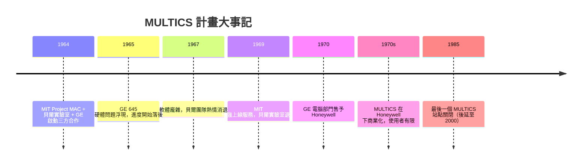

# MULTICS 的壯烈失敗：貝爾實驗室的撤資與教訓

## 一個像水電一樣供應計算能力的夢

1960 年代中期，計算是一種昂貴的稀缺資源。一部大型主機動輒數百萬美元，只有少數機構買得起，而買得起的人也捨不得讓機器閒置。分時（time-sharing）技術在 MIT 的 CTSS 專案上初試啼聲之後，一個更大的夢想開始發酵：既然電力可以透過電網像公用事業一樣隨插隨用，為什麼計算能力不行？

1964 年，MIT Project MAC 的 Fernando Corbató（人稱 Corby）聯合貝爾實驗室與奇異公司（GE），啟動了 MULTICS 計畫——MULTiplexed Information and Computing Service。這個名字本身就宣示了野心：要把計算做成「資訊公用事業」。三方分工看似完美：MIT 負責學術領導與系統設計，GE 提供 Hardwell 645 主機硬體，貝爾實驗室派出一批頂尖的系統程式人才。後來參與計畫的 Peter Neumann 回憶，當年這是「整個業界最令人興奮的計畫」，沒有之一。

## 前所未有的技術野心

MULTICS 幾乎把當代作業系統的每個核心概念都往前推了一大步：

- **階層式檔案系統**：目錄底下還可以有目錄，這是我們今天在 Linux、Windows 裡視為理所當然的樹狀檔案結構的起源。
- **動態連結**：程式執行到一半才把所需的程式碼段載入並接上，概念上極為先進。
- **環保護（rings of protection）**：把系統的特權分成八個同心圓，核心在最內環，使用者程式在外環，環與環之間的跨越需要受控的閘門。這是現代處理器特權階層的思想源頭。
- **單一階層記憶體**：用分頁式虛擬記憶體把記憶體與磁碟統一成一個大的位址空間，程式設計師不必再操心「這筆資料在主記憶體還是磁鼓上」。

以 1965 年的硬體水準，這些目標每一項都是硬仗，而 MULTICS 想一次全部達成。

## 為什麼延宕、為什麼超支

第一個問題出在硬體。GE 645 為了配合 MULTICS 的需求大幅修改（加入分頁硬體、環保護指令），但修改後的機器效能不理想、交貨一再延誤。第二個問題是軟體規模：MULTICS 以 PL/I 撰寫，程式碼膨脹到數十萬行，在那個記憶體以 KB 計的年代，光是讓系統「跑起來」就耗費數年。原訂 1965-66 年上線的系統，拖到 1969 年才勉強在 MIT 提供有限的服務，GE 的 MULTICS 產品線更是遲遲無法獲利，1970 年 GE 乾脆把電腦部門整個賣給 Honeywell。

貝爾實驗室這邊，最初的熱情逐漸被現實消磨。參與者眼看著承諾的日期一再跳票，系統龐大到難以理解與修改。1969 年，貝爾實驗室正式退出 MULTICS。多年後 Neumann 以自嘲的口吻說，他們當年是「從一個二流的分時系統上撤資」——這句玩笑話後來還被写進歷史，成為那段歲月的註腳。

## 失敗的教訓：簡單 vs 全面

MULTICS 的挫折發生在一個「大計畫」的年代。美蘇太空競賽把 Apollo 計畫推上月球，IBM 的 OS/360 以千人團隊打造（Fred Brooks 後來在《人月神話》中痛切反省），整個時代相信「更大的團隊、更全面的設計」就是正解。MULTICS 正是這種工程哲學的極致：什麼都要、什麼都做進核心。

但另一種聲音開始浮現。KISS 原則（Keep It Simple, Stupid）、由小而大的漸進建造、讓工具組合而非讓系統膨脹——這些想法在 MULTICS 的廢墟旁悄然萌芽。歷史的弔詭在於：正是從退出 MULTICS 的貝爾實驗室裡，走出了這條「簡單哲學」的路線，那就是下一章的主角 UNIX。MULTICS 與 UNIX，一個是過度設計的殷鑑，一個是減法設計的經典，兩者構成系統軟體史上最著名的對照組。

## 烈士不死：MULTICS 的遺產

然而稱 MULTICS 為「失敗」需要更細膩的衡量。它的分頁虛擬記憶體設計直接影響了後來所有處理器的 MMU；它的保護環概念活在 x86 的 ring 0 到 ring 3 裡；它的階層檔案系統、動態連結概念被 UNIX 與其後所有現代作業系統繼承。學術界更受惠至深：1960 到 70 年代，MULTICS 論文是作業系統課程的標準教材，培養了整整一代系統研究者。

最關鍵的遺產也許是人。從 MULTICS 撤退的貝爾實驗室團隊裡，有一位年輕人 Ken Thompson——他沒有放棄分時系統的夢想，只是決定換一種截然不同的方式去實現它。他在一張紙上寫下了對一個小型、單使用者分時系統的設計構想。那張紙，就是 UNIX 的起點。

壯烈的失敗，往往比平庸的成功更能推動歷史。MULTICS 教會了世界作業系統該做什麼、也教會了世界什麼不該做——而這份教訓的價格，由 AT&T 的壟斷利潤慷慨買單。
