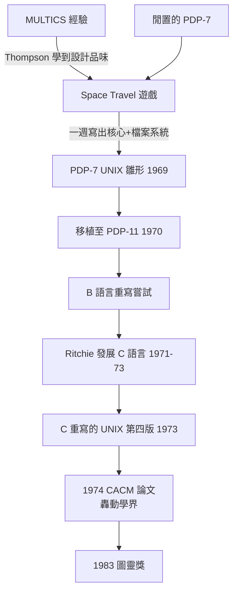

# 湯普森與里奇：PDP-7 上的 UNIX 雛形

## 一台閒置的機器與一款太空遊戲

1969 年春天，貝爾實驗室退出 MULTICS 之後，計算中心的政治氣氛變了。實驗室不再願意花大錢支持一個「又一個分時系統」的夢。年輕的 Ken Thompson 失去了他寫程式的機器——他曾參與 MULTICS，品味已被那套優雅的分時環境養刁，如今卻只能在批處理系統上排隊交作業。

Thompson 手上有一款自己寫的遊戲：Space Travel。這是他在 MULTICS 之後移植到 Fortran 與 GECOS 系統上的太陽系模擬程式，玩家操縱太空船在各行星間航行。但 GECOS 機器又貴又慢，玩一局遊戲的成本驚人，而且操作延遲令人難耐。他打聽到實驗室角落有一台被閒置的 PDP-7——一台原本買來給音響與聲學實驗用的迷你電腦，記憶體只有 4K words（18 位元字組）。這台機器幾乎沒人要，正好成為他的實驗場。

傳奇由此展開。Thompson 後來自述：他先在紙上設計了一個精簡的分時作業系統，然後在一週之內寫出了三樣東西——作業系統核心、檔案系統，以及給 PDP-7 用的組譯器。有了組譯器，他寫了一個簡單的編輯器；系統逐漸自我滋生，就像大自然一樣。幾個月內，Space Travel 在 PDP-7 上跑起來了，而那個為遊戲而生的作業系統，也悄悄長出了自己的生命。

## 從 Unics 到 UNIX：一個雙關語的誕生

1970 年，同事 Brian Kernighan 給這個系統起了個名字：Unics——Uniplexed Information and Computing Service，故意把 MULTICS 的 "MULTi"（多方）改成 "UNi"（單一），笑稱它是「閹割版的 MULTICS」。這個雙關語後來拼寫成 UNIX，成為軟體史上最響亮的名字。命名本身透露了設計立場：MULTICS 想服務所有人的一切需求，UNIX 只想把一件事做好——給一兩個程式設計師一個舒服的工作環境。

同年，實驗室買進 PDP-11，UNIX 隨硬體遷移。1972 年起，Thompson 與 Dennis Ritchie 決定用 B 語言（後來由 Ritchie 發展為 C）重寫系統，1973 年完成。這步棋深遠影響了整個產業——一個用高階語言寫成的核心，原則上可以搬到任何機器上。第四版 UNIX（1973）已是純 C 的系統。

## Ritchie 的角色：優雅的另一半

Dennis Ritchie 常被 Thompson 的鋒芒掩蓋，但他的貢獻同樣關鍵。Thompson 是閃電式的建構者，憑直覺一週造出系統；Ritchie 則是深思熟慮的設計師，把直覺的成果提煉成原則。兩人在檔案系統設計上密切合作，而 Ritchie 最重要的作品是 C 語言本身——把 Thompson 無型態的 B 語言改造成能表達 PDP-11 硬體、又能跨機器可攜的語言。沒有 C，UNIX 永遠只是 PDP-11 上的實驗品；有了 C，UNIX 成了可移植的作業系統，也是可學習、可改寫的公開教材。Ritchie 後來說過一句話，道盡 UNIX 的精神：UNIX 的簡單性不是起點的簡陋，而是「把每個部件做得夠簡單，簡單到能被理解、被信任」。

## 制度的意外恩惠：壟斷與 1956 年協議

UNIX 的誕生離不開一個奇怪的歷史條件：AT&T 的壟斷地位。1956 年，AT&T 為了了結反壟斷訴訟，與美國司法部簽下同意判決（consent decree），其中規定 AT&T 不得經營電話業務之外的商業——包括賣軟體。這意味著貝爾實驗室的科學家可以自由研究，但研究成果不能拿去賣錢。

對 Thompson 和 Ritchie 來說，這反而是天賜良機。既然 UNIX 不能商品化，貝爾實驗室便以象徵性的授權費把它送給大學：附上完整的原始碼，歡迎修改。1970 年代的美國大學生於是能直接閱讀一個真實作業系統的每一行原始碼——在 OS/360 原始碼視為商業機密的年代，這簡直是傳燈。John Lions 的 UNIX 原始碼註解在澳洲以油印本流傳，各校的系統課程都用 UNIX 當活體教材。免費、可讀、可改，UNIX 以病毒般的速度占領學術界。

AT&T 養出的自由研究文化同樣關鍵。貝爾實驗室在 1960 年代如日中天：有江崎二極體、有宇宙微波背景輻射的發現，也有讓工程師玩自己遊戲的寬容。Thompson 借走閒置機器沒人管，這在以產能考核的企業裡幾乎不可想像。歷史學者後來感嘆：UNIX 是壟斷利潤、反壟斷法律與開放文化三方合力下的意外結晶。

## 1974 年論文：學術界的轟動

1974 年，Thompson 與 Ritchie 在《Communications of the ACM》發表《The UNIX Time-Sharing System》。這篇論文冷靜地列出系統的設計取捨：階層檔案系統、可掛載的檔案裝置、統一的 I/O 介面、可組合的命令。文末附了一句廣告詞般的聲明：UNIX 在多種任務上都比當時流行的分時系統更省錢。學界反應熱烈，授權請求如雪片般飛來——UNIX 從此不再是實驗室的私房玩具，而是全球系統研究的共同平台。

1983 年，Thompson 與 Ritchie 因「對通用作業系統理論的貢獻，特別是 UNIX 作業系統的實作」共同獲得圖靈獎。頒獎辭中特別讚揚他們證明了一件當年無人相信的事：一個由極少數人撰寫、設計精簡的系統，可以同時具備強大的功能與優雅的結構。

回頭看 1969 年那個春天：一台被閒置的 PDP-7、一個想玩太空遊戲的工程師、一個不准賣軟體的壟斷巨頭。三個看似無關的歷史碎片，拼成了改變運算世界的第一塊拼圖。
