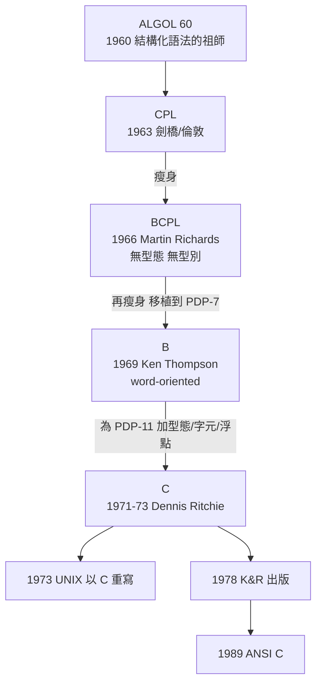

# 從 B 語言到 C 語言：為重寫 UNIX 而生

## 語言的族譜：一條歐洲血統的鏈

C 語言不是憑空出現的，它是一條清晰的血緣鏈上的一環。這條鏈始於 1960 年的 ALGOL 60——第一個認真講究語法結構與區塊結構的國際化語言，雖然在商業上不算成功，卻是此後所有主流語言的思想父親。ALGOL 60 太純粹，缺乏系統程式所需的低階能力，於是英國劍橋與倫敦大學在 1963 年推出 CPL（Combined Programming Language），企圖兼顧高階表達力與機器控制——結果過於龐雜，難以實作。

劍橋的 Martin Richards 在 1966 年把 CPL 瘦身為 BCPL（Basic CPL）：拿掉型態，一切資料都是機器字，只保留編譯器好寫、程式好用的核心。BCPL 的關鍵創新之一是「指標」觀念的簡潔處理。1969 年，Ken Thompson 在 PDP-7 上把 BCPL 再度精簡，造出 B 語言：無型態、面向機器字（word-oriented）、編譯器小到能塞進幾 KB 記憶體。B 之名取自 BCPL 的首字母（也有人戲稱是 Thompson 的中間名 "Bon" 的縮寫，此說被 Kernighan 否認）。

## B 的困境：PDP-11 的硬體不服從

B 在 PDP-7 上如魚得水，因為 PDP-7 是以 18 位元字組定址的機器——一個字就是一個可定址單位，無型態的語言與硬體天衣無縫。但 1970 年 UNIX 遷移到 PDP-11 之後，B 遇到了麻煩：PDP-11 是位元組定址（byte-addressed）機器，記憶體以 8 位元字元為最小單位，還有單精度浮點運算硬體。

用 B 寫字元處理程式變得笨拙：一個機器字裝四個字元，讀一個字母要額外的位址計算；浮點數要呼叫函式庫模擬；int 的大小與字組綁定，無法表達「一個位元組」這個概念。語言與硬體之間出現了裂縫。

## Ritchie 的改造：讓型態服務硬體

從 1971 年起，Dennis Ritchie 展開「NB」（New B）計畫，後來更名為 C。他的改造哲學極為明確：不是從學術的型態理論出發，而是從 PDP-11 的硬體出發。C 加入的型態——char 對應位元組、short/int/long 對應不同長度的整數、float/double 對應浮點硬體、陣列與指標對應記憶體定址——每一種都直接對映到機器層次的概念。Ritchie 自己的說法是：C 的型態系統的目的是「描述硬體行為」，而非「證明程式正確」。

這個取捨讓 C 有了雙重身分：它是高階語言（有函式、控制結構、編譯期型態檢查），又幾乎是可攜的組語（能操作位址、能對映任何記憶體布局）。1973 年，UNIX 的核心用 C 重寫完成，成為第五版（依內部版本計數為第四版之後的系統，一般文獻稱第三版起部分以 C 撰寫、第四版全面 C 化；確切版本疆界在史料中略有出入，但 1973 年 C 重寫完成是公認的里程碑）。

## 「OS 必須用組語」信條的崩塌

這件事在當年是異端。1970 年代的主流信念是：作業系統必須用組合語言寫，因為 OS 要操作硬體、要榨乾效能，高階語言「太慢、太不受控」。IBM 是個半例外——它內部用 PL/S 寫 OS/360 的後續版本，但 PL/S 是 IBM 私有語言，外界無從學習，業界觀念並未因此改變。

UNIX 用 C 重寫的成功，以公開、可驗證的方式推翻了信條：C 寫的核心只比組語慢百分之幾，卻帶來壓倒性的好處——可讀、可維護、可移植。1978 年，Thompson 與 Ritchie 的《The C Programming Language》（俗稱 K&R）出版，薄薄一冊不到 250 頁，兼做 C 的定義文件與入門教材，文風簡潔一如 UNIX 本身。K&R 加上隨 UNIX 散布的編譯器，讓 C 在十年內成為系統程式領域的世界語。

## 語言為系統而生，系統因語言而活

回顧這條演化鏈，最深刻的教訓是語言與系統的共生關係。B 為了在 4KB 記憶體的 PDP-7 上寫 UNIX 而生；C 為了讓 UNIX 活在 PDP-11 上而改造；而 C 化的 UNIX 又反過來讓語言獲得傳播的載體——每一份 UNIX 授權都附帶 C 編譯器，學 UNIX 的人順便學會 C，寫 C 的人自然替 UNIX 生態添磚加瓦。

ALGOL 60 想當學術的完美語言，CPL 想當無所不能的語言，結果都不如 BCPL—B—C 這條「每次只解決眼前問題」的務實路線活得長。又一次，減法設計戰勝了加法設計。這條血緣鏈的影響延續至今：C++、Objective-C、Java、C#、Go 的語法骨幹，全都來自 1973 年那個為了重寫 UNIX 而誕生的語言。
