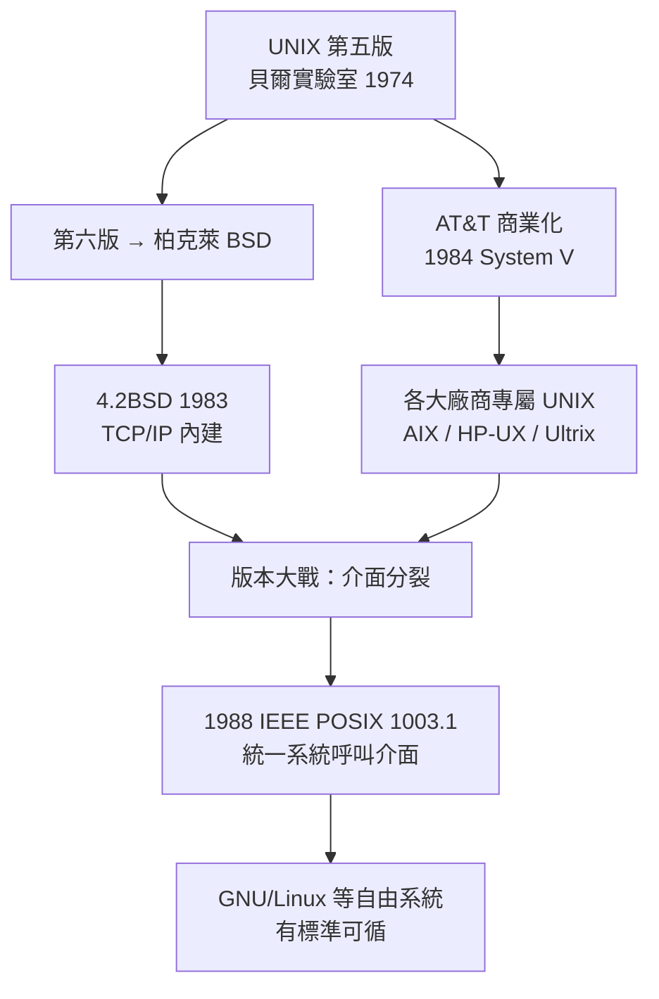

# libc 與 POSIX：跨平台統一規格

## 版本大戰：BSD vs System V

UNIX 在 1970 年代以學術禮物之姿流傳，1980 年代卻變成戰場。故事有兩條線。

第一條線在加州柏克萊。Ken Thompson 於 1975 年休假到柏克萊任教，把第六版 UNIX 原始碼帶進校園；研究生 Bill Joy 等人隨後建立 BSD（Berkeley Software Distribution）系列。BSD 加入了 vi 編輯器、C shell、虛擬記憶體，而最具戰略意義的是 DARPA 資助的 4.2BSD（1983）：它內建 TCP/IP 網路堆疊。當 ARPANET 轉型為網際網路之際，4.xBSD 是唯一原生支援 TCP/IP 的作業系統，全世界的網路研究站幾乎都是 BSD 站。網際網路的早期地基，一大半澆灌自柏克萊。

第二條線在 AT&T。1984 年，美國司法部的反壟斷訴訟落幕，AT&T 被拆分為多家「小貝爾」公司，1956 年同意判決失效——AT&T 終於可以賣軟體了。這件 28 年前「促成 UNIX 免費傳播」的法律，如今反過來終結了免費時代。AT&T 立刻將 UNIX 商業化為 System V，向所有使用者收費，並推出統一品牌。

產業於是分裂成兩大陣營：BSD 系（Sun OS、Ultrix、4.xBSD 衍生）與 System V 系（HP-UX、AIX、各大廠商版本），加上 Xenix 等微軟授權版本，最多時有數十種「UNIX」，彼此的系統呼叫、程式庫、工具行為各不相同。一份軟體要在十幾種 UNIX 上編譯成功，是 1980 年代軟體工程師的共同噩夢。

## POSIX：把戰場變成規格

分裂的痛催生了統一的企圖。1980 年代中期，業界終於體認到：UNIX 的價值不在某一家的版本，而在「UNIX 介面」這個抽象層。1988 年，IEEE 發布 POSIX 1003.1（Portable Operating System Interface），由電腦廠商、學界與使用者共同制定，定義了統一的作業系統介面規格：`open`/`read`/`write`/`close`、`fork`/`exec`/`wait`、訊號、檔案屬性——凡符合 POSIX 的系統，同一份原始碼原則上都能編譯執行。

POSIX 的巧妙在於政治學：它不是誰打敗誰，而是把 BSD 與 System V 的共同子集（大致就是貝爾實驗室 UNIX 的經典介面）定為標準。AT&T 與柏克萊多年廝殺的結果，是雙方共有的遺產成為人人必守的憲法。後來的 Single UNIX Specification 與 UNIX 認證制度（付費通過測試套件才能掛 UNIX 商標）更把標準推進到認證經濟的層次，但對開放生態而言，真正重要的一直是免費公開的 POSIX 介面本身。

## libc：規格的血肉

標準是紙上的契約，程式庫是契約的血肉。libc（C 標準函式庫）居於應用程式與核心之間，扮演兩個角色：一是系統呼叫的包裝層——`fork`、`read` 在 Linux 上以軟體中斷觸發核心服務，這段組語細節由 libc 代管；二是提供不對應任何單一系統呼叫的通用服務，如 `malloc`（記憶體配置）、`stdio`（緩衝式 I/O）與字串處理。

stdio 源遠流長：K&R 於 1978 年在《The C Programming Language》中定義了 `fopen`/`fread`/`printf` 等介面，成為 ANSI C（1989）標準函式庫的藍本。它的緩衝設計讓字元輸出的系統呼叫成本從「每字元一次」降為「每區塊一次」，是語言函式庫改善系統效率的經典案例。而 `malloc` 的實作——從簡單的 free list 到 1980 年代 Doug Lea 的 dlmalloc 及其衍生的複雜演算法——本身寫成了一部記憶體管理演化的歷史。

GNU 專案在 1980 年代末發展出 glibc，1990 年代由 Ulrich Drepper 長期主導。Drepper 以激進的效能優化聞名（也以強悍的溝通風格聞名），他讓 glibc 支援 POSIX、本地化（locale）、執行緒、動態載入等全套現代需求，使 GNU/Linux 成為 POSIX 相容的完整系統。

## POSIX 的戰略意義：Linux 的地基

POSIX 對自由軟體運動的意義怎麼估計都不為過。1991 年，芬蘭學生 Linus Torvalds 開始寫 Linux 核心時，目標不是發明新介面，而是實作既有標準：他照著 POSIX 介面寫系統呼叫，配搭 GNU 的 glibc 與工具鏈，於是全世界為 POSIX 寫的軟體幾乎直接可用。沒有 POSIX，Linux 只是一個學生作業；有了 POSIX，Linux 是一個即插即用的「免費 UNIX」。標準的公開性（任何人都能免費讀到規格）是自由軟體得以崛起的制度前提——反壟斷法造就的 UNIX 傳統介面，三十年後以另一種方式回饋了開放世界。

## 制度創新：標準的勝利

回望這段歷史，「標準化」是系統軟體史上比任何演算法都深遠的制度創新。它證明了三件事：其一，介面可以脫離實作而獨立存在，成為公眾財產；其二，標準不扼殺創新，反而把競爭從「誰的介面」轉移到「誰的實作更好」——此後二十年的 Linux 發行版大戰、Google 的 Android 生態，都在 POSIX 式的邏輯上運作；其三，開放標準是後進者与自由軟體對抗專利封閉體系的武器。

BSD 與 System V 的恩怨早已雲散：Berkeley 的程式碼化身 BSD 授權，AT&T 的 UNIX 商標在 1990 年代輾轉落入 SCO 與開放集團手中，而存活至今、執掌社群者，是當年誰都沒想到的第三者——以 POSIX 為憲法、以 libc 為血肉的 Linux 世界。1988 年那份文件，是 UNIX 交給人類的最重要遺囑。
