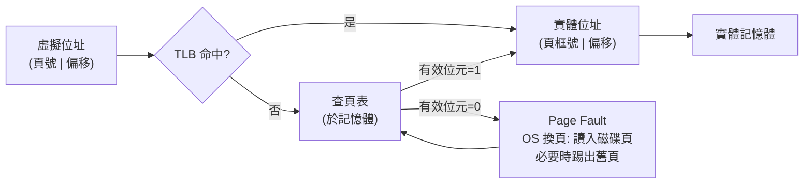

# 05.1 MMU 與頁表：虛擬位址空間的分離

## 記憶體昂貴年代的難題

1960 年代初期，電腦主記憶體是以磁芯（core memory）構成的，每一個位元都是一枚穿有導線的小磁環，成本以「每 KB 多少英鎊」計價。一台 IBM 7090 的記憶體可能只有 32K 字組，價格卻足以買下一棟房子。在那個年代，程式設計師最痛苦的問題不是演算法，而是「程式放不進記憶體怎麼辦」。

最早的解法是覆蓋（overlay）：程式設計師自己把程式切成幾塊，手動決定哪一塊何時載入、哪一塊可以被別塊覆蓋。這極度繁瑣又容易出錯。之後出現了更自動化的方案——多程式共用記憶體，每個程式佔用一個「分區」（partition）。固定分區會產生嚴重的內部與外部碎片：小程式塞進大分區浪費空間，大小不一的程式進進出出後，記憶體被切成許多無法使用的小塊。

Burroughs B5000（1961）代表了另一條路線：分段（segmentation）。它以 ALGOL 編譯器為中心設計，程式以邏輯單位（程式段、資料段）呈現，硬體提供段描述符完成位址轉換。B5000 的分段設計優雅地貼近程式的邏輯結構，甚至支援後來被稱為「CISC 之祖」的高階語言直接執行架構。但分段有個根本麻煩：段的大小不一，分配仍然是「連續空間」問題，碎片化只是被緩解而未被消滅。

## Manchester Atlas：分頁的誕生

真正的革命發生在英國曼徹斯特。Tom Kilburn 率領的團隊——這個團隊早在 1948 年就打造出世界第一批存儲程式電腦之一的小型實驗機 Baby——在 1962 年完成的 Atlas 電腦上，首次實現了以「分頁」（paging）為基礎的虛擬記憶體。Kilburn 的學生團隊（包括後來對作業系統理論貢獻卓著的學者們）把記憶體切成固定大小的頁框（page frame），把程式的位址空間切成同樣大小的頁（page），並用一張頁表（page table）記錄虛擬頁到實體頁框的映射。

分頁的天才之處在於一個簡單的數學分解：

$$\text{虛擬位址} = (\text{頁號} \times \text{頁大小}) + \text{頁內偏移}$$

頁號拿去查頁表得到實體頁框號，偏移原封不動地接在後面。因為頁大小固定，分配問題徹底簡化：任何一頁都能放進任何一個空閒頁框，外部碎片不復存在，內部碎片至多浪費不到一頁。

Atlas 的頁表還有一位「已使用」位元，硬體在存取時設定它，作業系統據此挑選最久未用的頁換出——這就是史學公認的第一個 page replacement 演算法的實作。當程式存取一個不在記憶體的頁時，硬體觸發中斷，作業系統把頁從磁鼓調進來，這就是 page fault。這個機制帶來了劃時代的後果：**程式可以比實體記憶體更大**。程式設計師從此不必再寫覆蓋程式，不必再為記憶體斤斤計較。

## TLB：讓轉換快起來

分頁的代價是每次記憶體存取都要多查一次頁表——這會讓速度慢一倍，令人難以接受。Atlas 用了快速的特別暫存器快取最近的映射；到了 1970 年代，這個想法被固化为硬體快取，即「轉譯後備緩衝區」（TLB, Translation Lookaside Buffer）。IBM 在 System/370 系列（1970 年起）的處理器中實作了 TLB，使位址轉換幾乎不增加延遲。TLB 命中率通常超過 99%，因為程式的區域性（locality）遠比人們想像的強。今天每一顆 CPU 裡都有多層 TLB，這個 1960 年代曼徹斯特實驗室的點子成了半導體的固定配置。

## Working Set：理論追上實務

換頁帶來了新的災難：如果同時跑太多程式，每個程式都搶不到足夠的頁框，系統會陷入「抖動」（thrashing）——磁碟忙個不停，CPU 卻閒著。1968 年，Peter Denning 在 MIT 的博士研究中提出「工作集模型」（working set model）：一個程式在時間窗口 $\Delta$ 內實際引用的頁集合是它的工作集 $W(t, \Delta)$，作業系統應保證每個活動行程的工作集都留在記憶體中，否則不讓它執行。這條簡潔的原則把虛擬記憶體從「碰運氣的工程」變成「有理論根據的資源管理」，Denning 後來也成為作業系統領域最重要的教育家之一。

## Demand paging 改寫了作業系統

虛擬記憶體不只改了硬體，它整個重寫了作業系統的結構。分頁錯誤處理器成了核心最忙碌的路徑之一；排程器必須與記憶體管理器合作；「行程」的意義也變了——行程不再等於「載入記憶體的程式」，而是「擁有一個虛擬位址空間的執行單位」。UNIX 的成長正搭上了這班車：1970 年代的 PDP-11 記憶體有限，UNIX 的 swap 系統；到 VAX 與 4.2BSD（1983），demand paging 成為標配。

從經濟學看，虛擬記憶體是記憶體昂貴年代的生存之道：用廉價的磁碟換取昂貴的磁芯，用「時間換空間」。它也體現了一種深刻的工程哲學——**把稀缺資源的分配從程式設計師手中拿走，交給系統自動化**。這個哲學與高階語言的 garbage collection、與編譯器優化一脈相承，構成了系統軟體半世紀以來最重要的思想主線。今天雲端主機上每一個行程，都還活在那個 1962 年曼徹斯特之夜所開闢的虛擬位址空間裡。
