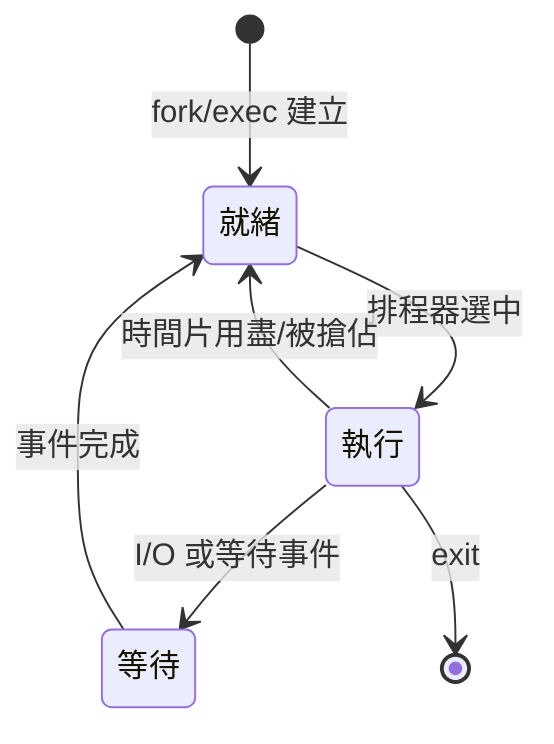
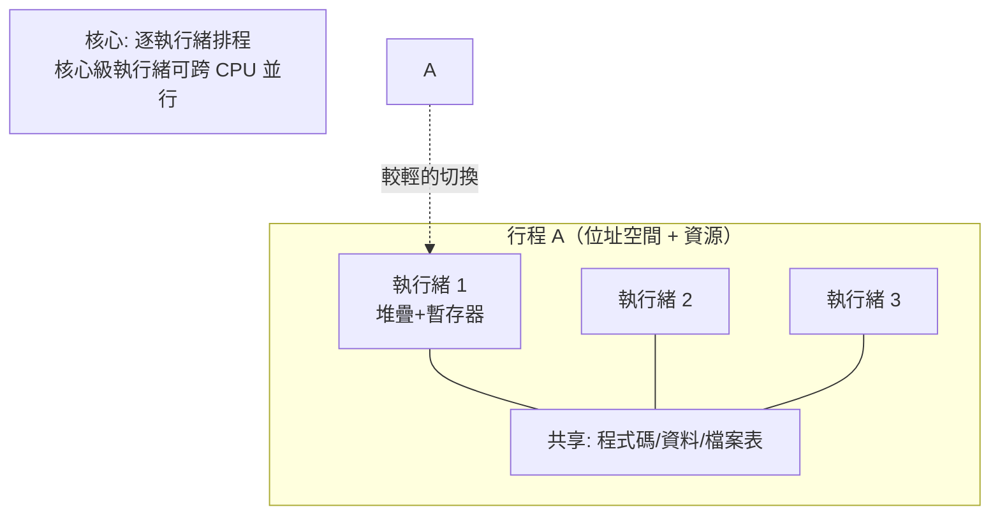

# 05.2 行程執行緒與上下文切換：保護模式的隔離

## 「行程」這個詞的誕生

1960 年代的系統軟體面臨一個命名危機：當一個程式可以被載入、暫停、換出、再恢復，甚至多份同時存在，「程式」這個詞已經不夠用了。MIT 的 MULTICS 計畫（1964 年起，與 GE、Bell Labs 合作）把這個概念正式化為 **process（行程）**：一個位址空間加上一組在該空間中執行的控制狀態。Jerome Saltzer 在 1966 年的博士論文《Traffic Control in a Multiplexed Computer System》中，系統地闡述了行程的建立、切換與控制，這篇論文與後續的整理，成為「行程」作為作業系統核心抽象的學術基石。Saltzer 的貢獻不止於此——他與 Daniel Schroeder 合著的《電腦系統的安全與防護》後來成為資安領域的聖經。

## PCB 與上下文切換

作業系統要管理行程，就需要替每個行程記帳，這本帳就是 **行程控制塊**（PCB, Process Control Block）：行程編號、狀態、暫存器內容、頁表指標、開啟檔案表、排程資訊。當排程器決定把 CPU 從行程 A 交給行程 B，就發生**上下文切換**（context switch）：把 A 的暫存器、程式計數器、堆疊指標存進 A 的 PCB，把 B 的值裝回 CPU，切換位址空間，然後跳進 B 上次離開的地方。

行程的狀態機本身十分簡單：

機制簡單，成本可不低：一次切換涉及數百奈秒到數微秒的暫存器保存與恢復、TLB 沖刷、快取污染，還有排程決策的時間。這個成本決定了之後五十年的架構演化方向。

## x86 覺醒：保護模式降臨個人電腦

理論再美，沒有硬體支援也只能是學校作業。UNIX 在 PDP-11 與 VAX 上如魚得水，但那些是幾萬美元的小型機。個人電腦要跑真正的多工保護作業系統，需要 CPU 有位址轉譯與特權等級——Intel 直到 **80286（1982）** 才補上這一課。286 的保護模式提供了段選擇子與特權級（ring 0–3），讓作業系統與應用程式得以隔離；可惜它的段式管理只能用 16 位元偏移，段最大 64KB，且切回真實模式需要重開機，被譏為「大腦死亡的晶片」。

真正的轉折是 **80386（1985）**：32 位元暫存器、4GB 定址空間，更重要的是——它在段式保護之外**加上了分頁**。Bill Gates 曾說 640KB 對任何人都夠用（這句話是否真說過有爭議），但 386 的分頁讓 PC 第一次能夠運行 demand paging 與虛擬記憶體。1980 年代末，Compaq、IBM 相容機大量出貨，而 386 保護模式介面最初還是 Intel 的機密——開發 32 位元 DOS 擴充套件的廠商得簽 NDA。1991 年，一個芬蘭學生正是透過 386 的保護模式與分頁，寫出了 Linux。x86 的保護模式，讓「真正的作業系統」從大公司的小型機專利，變成人人桌上的現實。

## 執行緒：更輕的並行單位

1980 年代，研究者開始反思：切換行程太重了——要換位址空間、沖 TLB。可是共享位址空間的並行執行常常正是應用需要的。於是 **thread（執行緒）** 的概念興起：同一行程內多個執行流，共享位址空間但各有自己的堆疊與暫存器。CMU 的 Mach 系統、Sun 的研究與後來的 Solaris thread library，把執行緒從論文帶進產品。

執行緒有兩條實作路線：**使用者級執行緒**（函式庫自己排程，切換極快，但一個執行緒呼叫阻塞系統呼叫會卡死整個行程，且無法利用多核心）與**核心級執行緒**（核心看得見每個執行緒，能搶佔、能並行，但切換要陷入核心）。1995 年，**POSIX threads（pthread）** 標準誕生，統一了混亂的介面，讓多執行程式得以跨平台移植。執行緒切換比行程切換便宜一個數量級，這個差異說明了為什麼網頁伺服器、資料庫都擁抱多執行緒。

## 從 Round-robin 到 O(1) 與 CFS

UNIX 早期的排程器簡單而有效：每個行程有時間片，用完就輪到下一個（round-robin），再輔以優先級與「nice 值」。隨著 CPU 數目增加，這種 O(n) 掃描全部行程的排程器成了瓶頸。2003 年，Ingo Molnar 為 Linux 2.6 寫出 **O(1) 排程器**：用位元圖與優先級佇列，挑下一個行程只要常數時間，並為每個 CPU 維護獨立執行佇列。2007 年他又推出 **CFS（Completely Fair Scheduler）**，捨棄時間片，改用紅黑樹依「虛擬執行時間」排序，追求統計意義上的完全公平。

從 MULTICS 的行程抽象、Saltzer 的流量控制，到 386 保護模式、pthread、CFS，這條脈絡的主題只有一個：**隔離**——讓多個執行流互不踐踏，同時讓切換的成本儘可能低。個人電腦革命把硬體帶到每張桌上，而行程與執行緒的演化，則確保那顆 CPU 能公平而安全地分給每一個程式。
