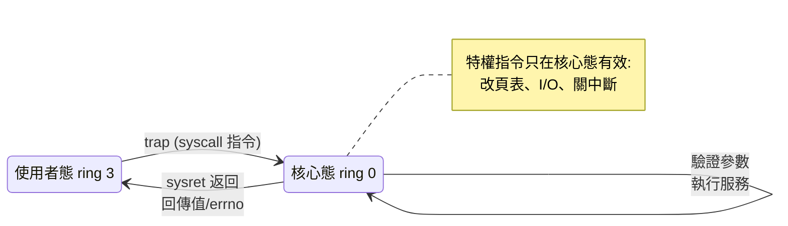

# 05.3 系統呼叫與使用者態核心態的分界

## 特權等級的硬體根源

作業系統最根本的問題是：如何防止一個（或一個出錯的）程式毀掉整台機器？軟體的檢查終究能被軟體繞過，真正的答案必須刻在硬體裡。IBM System/370（1970）在 CPU 狀態中區分 **supervisor state** 與 **problem state**：特權指令（I/O、改頁表、停機）只在 supervisor state 有效，一般程式跑在 problem state，碰特權指令就觸發硬體例外。這個設計沿襲自更早的 IBM System/360。

x86 陣營則把這個想法精緻化為 **保護環**（protection rings）：Intel 80286（1982）與 80386（1985）提供 ring 0 到 ring 3 四個特權級。作業系統核心住在 ring 0（最高特權），應用程式住在 ring 3（最低特權）；ring 1、2 設計上留給驅動程式，實務上幾乎無人使用——Windows 與 Linux 都只用 0 與 3 兩環。硬體特權等級加上分頁/段保護，構成了現代計算的**信任邊界**。

## System Call：跨越邊界的唯一正門

使用者程式需要核心的服務——讀檔案、要記憶體、發網路封包——但它在 ring 3 無權直接做這些事。唯一的通道是 **系統呼叫**：程式執行一條陷入（trap）指令（x86 上是 `int 0x80`，後來是更快的 `syscall`/`sysenter`），CPU 特權級提升到 ring 0，跳到核心預先註冊的處理常式；核心驗證參數、執行服務、把結果放好，再以特權指令返回 ring 3。參數透過暫存器或堆疊傳遞，系統呼叫號決定叫用哪個服務。

這道門檻設計得極其嚴謹：**每個指標參數都必須驗證**。1982 年的經典教訓是 UNIX 的 `memcpy` 之類核心函式若直接信任使用者指標，惡意程式可以把指標指向核心記憶體。Linux 等系統因此設有 `copy_from_user`/`copy_to_user` 之類的邊界函式，安全檢查成為每次系統呼叫的固定開場。

## UNIX 的最小呼叫集

1974 年 Ritchie 與 Thompson 在 CACM 發表的 UNIX 論文，展示了一套驚人精簡的系統呼叫：`open`/`read`/`write`/`close` 處理一切 I/O（「一切皆檔案」的統一抽象），`fork`/`exec`/`exit`/`wait` 處理行程生命週期。整個 UNIX 大廈就建立在這十幾個呼叫上。其中最富爭議、也最富美感的是 `fork`。

## fork 的哲學辯論

`fork` 把目前行程原封不動地複製一份——連執行點、開啟檔案、記憶體內容（寫時複製）都一樣——子行程再呼叫 `exec` 把自己換成新程式。「複製自己再變身」看起來繞路，為什麼不直接一個 `spawn(program, args)` 完事？1980 年代以來這場辯論從未停歇：Windows 選了 `CreateProcess`（spawn 式），UNIX 堅守 `fork+exec`。UNIX 陣營的理由很優雅：fork 與 exec 之間可以插入任意程式碼——重新導向檔案描述符、設定環境、關閉檔案、改權限——shell 的管線與重導向因此變得輕而易舉；而 spawn 式介面每加一種新需求就要擴充參數，最後長出幾十個參數的怪物介面。批評者則說 fork 的寫時複製在多執行緒程式裡語義混亂、成本不低。這場辯論沒有勝負，但它展現了系統設計的一個真理：**正交的小原語，往往勝過包山包海的大函式**。

## 一切安全模型的基石

使用者態/核心態的分界，是現代計算幾乎一切安全機制的地基：

- **權限系統**：UID/GID 的檢查發生在核心，使用者態無法偽造。
- **虛擬化**：hypervisor 讓客體作業系統以非最高特權執行，敏感指令被陷阱攔截——1974 年 Popek 與 Goldberg 的虛擬化定理早已刻畫了何謂「可虛擬化的指令集」。
- **容器**：Docker 等容器其實就是被 namespaces 與 cgroups 隔離的普通行程，靠的仍是系統呼叫這道關卡的不可逾越。
- **瀏覽器沙箱、JIT、App Store 權限**：全是同一思想的變奏。

邊界的代價是效能——每次跨越都有數十至數百個時脈週期。於是 Linux 開發者發明了 **vsyscall** 與 **vDSO**（virtual dynamic shared object）：把 `gettimeofday` 這類不需特權、只需讀核心準備好的資料的呼叫，映射成使用者態記憶體中的小函式，程式呼叫時根本不陷入核心。這是同一條原則的精妙反轉：**能不過邊界就不過，但邊界的威嚴一分不减**。

半世紀過去，CPU 的指令集換了好幾代，這道 1960 年代畫下的分界線卻始終矗立。當你按下一個鍵、點擊一次滑鼠，訊號穿越使用者態與核心態的邊界數十次而一絲不亂——這是系統軟體史上最成功、也最低調的發明。
