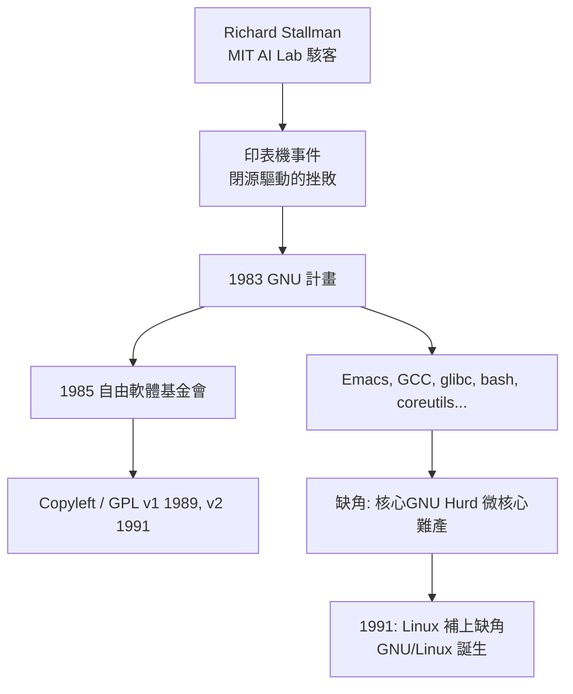

# 06.1 斯托曼與GNU計畫：自由軟體運動

## MIT AI Lab 的黃金年代

1970 年代的 MIT 人工智慧實驗室，是駭客文化的聖殿。那時「駭客」（hacker）還是榮耀之詞：指癡迷於鑽研系統細節、以精巧程式為美的人。實驗室的電腦（PDP-6、PDP-10 上的 ITS 系統）原始碼完全開放，任何人都可以修改、分享、改進；軟體被視為知識，如同數學定理，理應自由流通。年輕的 Richard Stallman（RMS）在這個環境中如魚得水——他 1971 年加入實驗室時還是哈佛學生，後來成為 ITS 與 Emacs 編輯器的主要維護者。 Emacs 本身就是駭客文化的結晶：一個用 LISP 寫成、任何人都能動手改造的編輯器，改造後的版本習慣性傳回實驗室分享。

## 印表機與文化的崩塌

1980 年前後，實驗室社群開始瓦解。商業電腦公司挖走駭客，MIT 辦了 Symbolics 的授權，創業公司 LMI 也來了，實驗室的 PDP-10 原始碼共享文化被授權條款撕裂——Stallman 一人面對兩家公司修改後的閉源版本，獨力維護系統，這段「與 Symbolics 的戰爭」讓他筋疲力盡。

壓垮駱駝的最後一根稻草是一台 Xerox 雷射印表機。實驗室拿到機器，但 Xerox 只給了編譯過的二進位驅動程式，不給原始碼。以前實驗室的印表機卡紙時，駭客會修改驅動程式讓它通知使用者；這台新機器屢屢卡紙，Stallman 想改程式，卻無碼可改。他後來說，他曾在 CMU 遇到一位有 Xerox 原始碼的朋友，請求分享，對方因簽了保密協議而拒絕——那一刻他意識到：**被朋友拒絕分享軟體，比機器故障更傷害社群**。他決定再也不參與這種事情，並且要終結這種制度。

## 1983：GNU 宣言與四大自由

1983 年 9 月，Stallman 在 Usenet 宣布 GNU 計畫（GNU's Not Unix，遞迴縮寫正是駭客幽默），目標是做出一個**完全自由的類 Unix 作業系統**。1985 年他成立自由軟體基金會（FSF），並發表《GNU 宣言》。他給「自由軟體」下了嚴格定義——四大自由：

0. 任何目的執行程式的自由；
1. 研究並修改程式的自由（需要原始碼）；
2. 重分發拷貝的自由；
3. 分發修改版的自由。

他著名的口號是「think free as in free speech, not free beer」（自由如言論自由，而非免費啤酒）——這是對「free」雙關的著名澄清。

## Copyleft：以版權對抗版權

自由軟體最大的法律難題是：別人拿走你的自由軟體改一改，加上限制再發布，自由就死了。Stallman 的解法是 **Copyleft**（著作左）——一個法律上的以毒攻毒：用版權法宣告「你可以自由使用、修改、分發，**但任何衍生作品必須以同樣條款發布**」。1989 年的 GPL v1、1991 年的 GPL v2 把這個思想寫成條款。這是智識上的妙手：不求助於推翻版權制度，而是在版權制度**之內**，利用版權的排他權來保證自由永不流失。GPL 有如一場級聯：每個下游都必須帶著同樣的自由繼續走下去。

## 成就與缺角

GNU 計畫的工程成就驚人：Emacs（1975 年誕生於 MIT、1985 年 GNU 版發布）、GCC 編譯器（1987）、glibc、bash shell、coreutils——幾乎補齊了 Unix 使用者環境的全部。唯獨核心難產：GNU 選了 CMU 的 Mach 微核心起步，稱為 GNU Hurd，微核心的複雜度與開發瓶頸讓它拖了二十多年仍不敷實用。1991 年 Linus Torvalds 的 Linux 補上了這塊缺角，與 GNU 工具鏈合體，成為今天數十億設備的基礎。Stallman 堅持稱之為 GNU/Linux——這個命名堅持曾引發爭論，卻也提醒世人自由軟體思想的出處。

## 理想主義者的人格與爭議

Stallman 是個極端人物：不使用手機、拒絕非自由軟體、演講時以「聖伊格納修斯」自嘲天主教背景、堅持用詞精確（拒絕「開源」一詞，認為它抹去了自由的道德核心）。1998 年「開放原始碼」運動（Eric Raymond、OSI）刻意與他的道德論述切割，主張務實的商業價值，兩條路線自此並行也互相張力。他的言論亦多次引發重大爭議，2024 年更辭去 FSF 職務。無論毀譽，歷史地位難以撼動：他證明了一種可能——**軟體可以是自由的，而且自由的軟體可以打敗商業帝國**。1970 年代 AI Lab 那間開放的機房，透過這個固執的駭客，把駭客倫理寫進了法律與整個產業。
