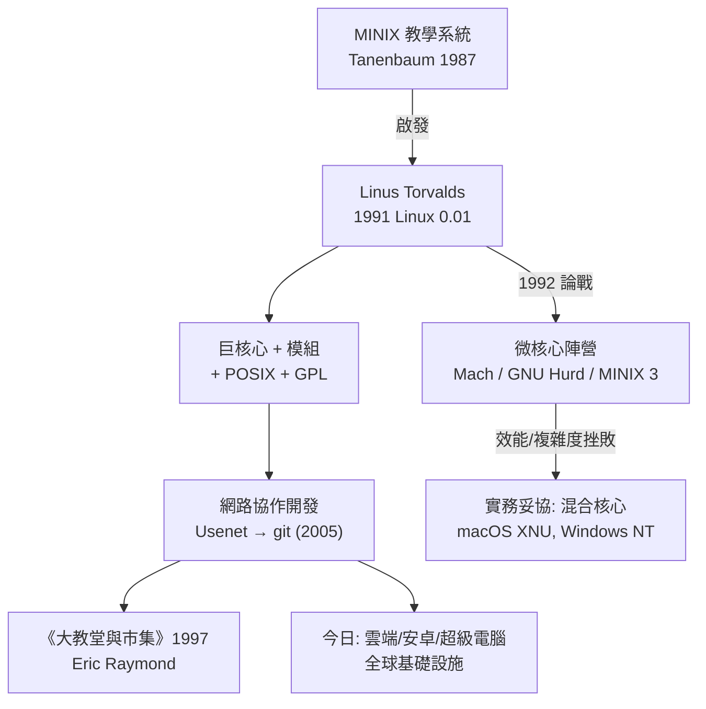

# 06.3 Linus與Linux：微核心巨核心大戰

## 赫爾辛基的 386

1991 年的芬蘭，21 歲的赫爾辛基大學學生 Linus Torvalds 在大學的 微興趣班上接觸了 MINIX——阿姆斯特丹自由大學 Andrew Tanenbaum 為教學寫的類 Unix 系統。Linus 家裡那台 386 PC（他分期買來的，一度拿它當終端機連上大學機器）有 4MB 記憶體，但 386 的保護模式與分頁硬體是免費的寶藏。他先是寫了兩個行程交替在螢幕上印 AAAA/BBBB 的測試程式，玩轉了任務切換與分頁；接著想讓它印字給終端機、讀磁碟，於是需要驅動程式；再下來需要檔案系統——1991 年 8 月 25 日，他在 comp.os.minix 發出那封著名的貼文：

> 「我正在做一個（自由的）作業系統（只是個嗜好，不會大到像 gnu 那樣專業）……」

這句「just a hobby, won't be big and professional like gnu」成了科技史上最著名的失言——溫和的自貶，映襯著日後無可挽回的成功。9 月，Linux 0.01 上網；他用的是當時 GNU 已備好的工具鏈：GCC 編譯、bash 操作、Emacs 寫碼——Linux 與 GNU 的合體幾乎是天作之合，RMS 缺的核心被一個學生補上了。

## 戰略選擇：巨核心 + POSIX + GPL

Linux 的勝利不只是程式碼，更是三個戰略決定。第一，**POSIX 相容**：遵從 IEEE 的 Unix 標準介面，讓 GNU 軟體幾乎不用改就能移植過來，也讓既有 Unix 使用者無痛遷移。第二，**GPL 授權**：採納 Stallman 的 Copyleft，保證程式碼永遠自由，同時藉 GPL 的網路效應匯聚全球貢獻者。第三，也是引爆論戰的——**巨核心**（monolithic kernel）：檔案系統、驅動程式、網路堆疊全在同一核心位址空間，函式直接呼叫，效率極高。

## Tanenbaum–Torvalds 論戰

1992 年 1 月，Tanenbaum 在 comp.os.minix 發文〈LINUX is obsolete〉，直批巨核心是 1970 年代的過時設計，微核心才是未來；還補了一句：「如果 Linus 是我在一班上寫作業系統，他這門課不會及格。」Tanenbaum 是教育界巨擘，他的《作業系統：設計與實現》影響了整整一代人。Linus 的回覆冷靜而有理有據：MINIX 是教學用、 portable 性有限；Linux 針對 386 寫，正是因為要「做真正有用的東西」；微核心的理論優雅要付出 IPC 與上下文切換的實際代價。他還嘲諷地補了一句對 portable 的辯護——「如果 386 是近年最通用的晶片，那針對它寫就是 portable」。

2006 年，Tanenbaum 又發表〈Some Notes on the "Who wrote Linux" Issue〉再論微核心，並推出 MINIX 3（強調可靠性、驅動程式跑在使用者態）；Linus 簡短回應「日子過得好好的，別吵」。兩人最終互相尊重，Tanenbaum 甚至承認當年「課堂不及格」之說只是玩笑。

## 微核心陣營的歷史與挫敗

微核心的理論根基紮實：1980 年代 CMU 的 **Mach**（Rick Rashid 領導）把驅動與檔案系統移出核心、以訊息傳遞通訊，Mach 成為 NEXTSTEP 與 GNU Hurd 的基礎，其遺緒至今仍活在 macOS 的 XNU 核心裡（XNU 是 Mach + BSD 的混合體）。但純微核心在實務上連連挫敗：跨位址空間的 IPC 比函式呼叫慢一個數量級，系統愈複雜、訊息愈多、效能愈糟；GNU Hurd 自 1990 年啟動，因多伺服器架構的除錯與設計難度，遲遲無法自舉可用系統。Tanenbaum 的 MINIX 3 證明了微核心可以做小而可靠，但已無法撼動 Linux 的版圖。

## 務實的勝利與市集模式

Linux 並非死守教條：1990 年代中引入**可載入模組**（loadable kernel module），驅動程式可以動態掛載，部分回應了微核心的可維護性訴求；又以 SMP 支援、細粒度鎖迎戰多處理器時代。1997 年，Eric Raymond 發表《大教堂與市集》，把 Linux 的開發模式理論化：大教堂（封閉團隊、精心設計）對比市集（大量鬆散貢獻者、快速迭代），並提出名言「只要有夠多的眼睛，所有 bug 都顯淺」。這篇文章成了開源運動的宣言，直接促成了 Netscape 釋出原始碼（1998）與「open source」一詞的流行。2005 年，BitKeeper 授權糾紛逼 Linus 親手寫出分散式版本控制系統 **git**——開發工具本身也市集化了。

## 從嗜好到基礎設施

今天，Linux 跑在世界上幾乎所有的超級電腦、大多數的雲端伺服器，以及二十多億台 Android 設備上；核心由 Linux Foundation 與各大企業（Intel、Red Hat、Google、華為等）全職工程師共同維護。那個「不會大到哪裡去的嗜好」證明了幾件事：**務實勝於純粹理論**（巨核心赢了效能戰，再以模組化補可維護性）；**協作模式本身就是技術**（網路把數萬人變成一個編譯器）；**自由授權是最佳的招募令**。1992 年那場 comp.os.minix 的論戰，最後以一個誰都沒料到的方式收場：微核心的理想，被巨核心的務實——以及市集上無數雙眼睛——吸收、轉化，寫進了每一台手機的深處。
