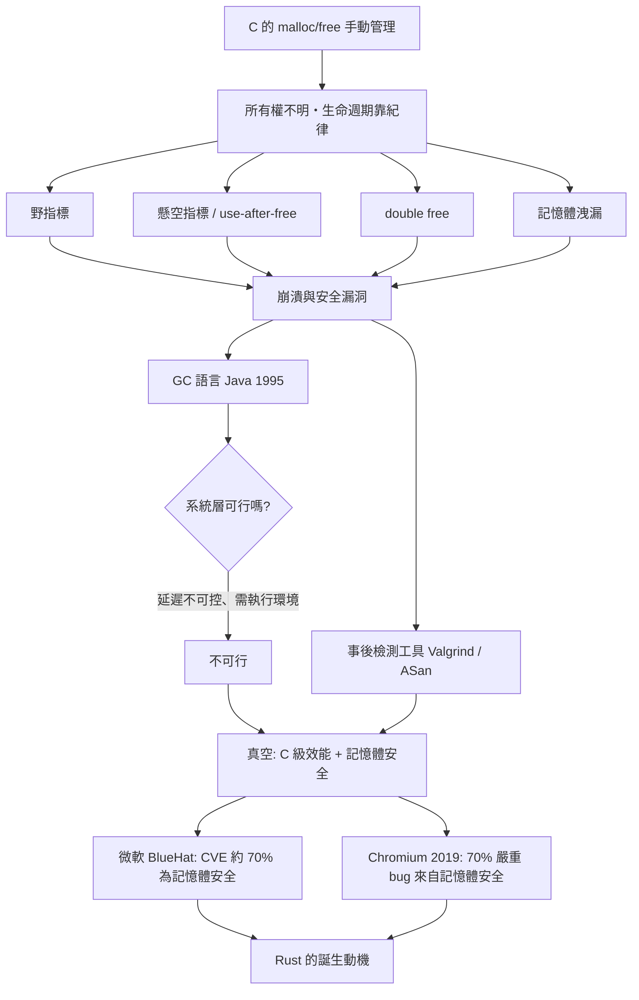

# 野指標與記憶體洩漏：無聲的崩潰

1972 年，Dennis Ritchie 在貝爾實驗室写下 C 語言的第一版編譯器時，做了一個影響此後半世紀的決定：把記憶體位址的操作權，直接交給程式設計師。指標可以任意運算、任意轉型，`malloc` 與 `free` 之間的鴻溝完全靠人的紀律填補。這個選擇成就了 UNIX 的可攜性與效能，也埋下了系統軟體史上最漫長的一場危機。

## 四種經典死法

C 的記憶體問題可以歸納成四類。第一類是**野指標**（wild pointer）：指標從未被初始化就使用，指向的是堆疊或堆裡的隨機殘渣，讀寫它如同矇眼開車。第二類是**懸空指標**（dangling pointer）：記憶體已經 `free`，指標卻還留著舊位址，之後再碰它就是臭名昭著的 use-after-free——被釋放的記憶體可能已被重新配置給別的資料，攻擊者於是可以「偷樑換柱」，讓程式在錯誤的物件上呼叫函式。第三類是 **double free**：同一塊記憶體釋放兩次，堆積（heap）的鏈結結構被破壞，分配器的內部狀態從此錯亂，這在 glibc 的歷史上催生了無數個 CVE。第四類是**記憶體洩漏**（memory leak）：`malloc` 之後忘了 `free`，伺服器跑三天記憶體耗盡，無聲無息地死掉。

這四種問題的共同根源是：**所有權不明**。一塊記憶體到底歸誰管、什麼時候釋放、誰還握有指標——C 語言裡沒有任何機制回答這些問題，答案只存在工程師的腦子裡和註解裡。生命週期靠紀律，而紀律會隨著程式碼行數、人員流動與期限壓力而崩潰。當 Linux 核心在 1990 年代急速成長時，`kmalloc`/`kfree` 配對錯誤造成的崩潰與路徑上漏掉釋放的洩漏，成為核心開發者郵件列表的日常話題；早期核心曾因 slab 分配器周邊的錯誤而飽受隨機 panic 之苦，除錯往往要靠 `printk` 一行行圍堵，因為崩潰點與犯錯點常常相距十萬八千里。

## 瀏覽器：洩漏的重災區

到了 1990 年代末，記憶體問題的舞台從作業系統轉移到瀏覽器。Netscape 開源後誕生的 Mozilla Suite（Firefox 的前身）是當時世界上最龐大的 C++ 應用程式之一，必須長時間開著且載入任意網頁——這正是洩漏的完美風暴。Mozilla 團隊被使用者抱怨「開越久越慢、記憶體吃越兇」，工程師們建立了洩漏偵測工具、程式碼審查規則，卻始終追不上 bug 產生的速度。多年後 Rust 的催生者 Graydon Hoare 回顧：他親眼目睹的是一群全世界最優秀的系統工程師，用盡測試、工具與紀律，仍然無法馴服大型 C++ 程式的記憶體問題。這個無力感，正是 Rust 誕生的直接動機。

## GC 的成功與邊界

1995 年，Java 帶著垃圾回收（GC）問世，在應用層大獲成功：企業伺服器、網頁後端從此告別手動釋放。但 GC 在系統層撞了牆。垃圾回收需要追蹤指標、週期性掃描堆積，帶來不可預測的暫停；核心、驅動、即時系統、資料庫引擎不可能接受「不知何時會停十毫秒」的代價，更遑論 GC 執行緒與虛擬機器本身需要執行環境。UNIX 哲學裡「語言不該挾帶執行環境」的傳統，也讓 C 程式設計師本能地排斥 JVM。於是出現了一個真空地帶：**需要 C 級效能與控制、又需要記憶體安全的語言**——整整二十年，這個位子是空的。

## 統計數字說出的真相

「記憶體安全」逐漸從經驗之談凝結為工程概念，靠的是統計。微軟在 BlueHat 大會上公布的資料顯示，其產品的 CVE 漏洞中約七成屬於記憶體安全問題。2019 年，Google Chromium 專案的工程師分析歷年資料，得出同樣的結論：**約 70% 的嚴重安全 bug 是記憶體安全問題**（use-after-free 是最大宗）。這個「七成定律」不是巧合，而是行為模式：人類寫指標，就會以穩定的機率犯錯。過去業界用教育、審查、靜態分析去壓低這個機率，三十年後發現壓不下去——問題不在人，在機制。

歷史在這裡寫下伏筆：當「七成定律」成為產業共識，當 Mozilla 的洩漏危機證明紀律有其極限，一場把記憶體安全從「事後檢測」前移到「編譯期保證」的革命，已經在醞釀之中。
