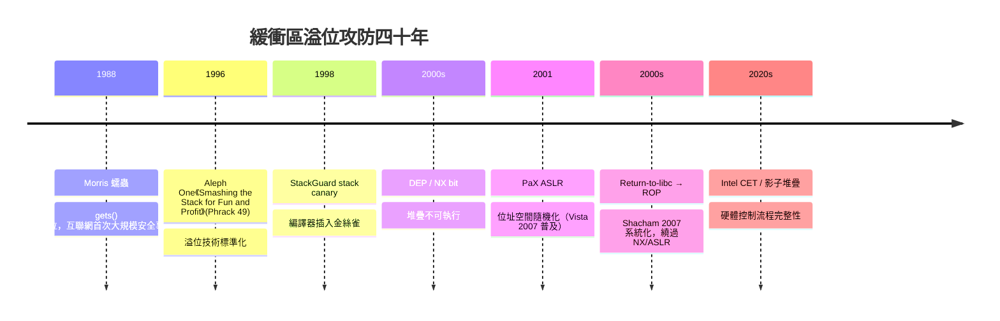

# 緩衝區溢位與 ROP 攻擊：漏洞的根源

1988 年 11 月 2 日晚，康乃爾大學研究生 Robert Tappan Morris 放出了史上第一隻大規模互聯網蠕蟲。幾天內，數千台 VAX 與 Sun 工作站癱瘓，占當時連網機器的十分之一。Morris 蠕蟲使用的漏洞之一，正是 `fingerd` 服務裡 `gets()` 的緩衝區溢位——`gets()` 根本不檢查輸入長度，輸入超過緩衝區，就一路漫過堆疊。Morris 本來只想測量網路規模，程式邏輯的失誤卻讓它疯狂自我複製。這次事件催生了 CERT 協調中心，也讓全世界第一次意識到：**記憶體錯誤不只是崩潰，是可被武器化的攻擊面**。

## 堆疊的機理

要理解溢位為何致命，得看函式呼叫的堆疊佈局。x86 上每次呼叫函式，會把返回位址（return address）壓入堆疊，函式再用 frame pointer 定位區域變數。區域變數放在堆疊低位，返回位址在高處——如果變數是個沒檢查長度的緩衝區，多出來的資料就會漫過保存的暫存器，蓋掉返回位址。攻擊者把返回位址改指向自己塞進緩衝區的機器碼（shellcode），函式返回時就跳去執行攻擊者的程式。

```mermaid
graph TD
    subgraph 堆疊高處
        RA[返回位址 return address] -->|被溢位覆蓋| RA2[指向 shellcode 的位址]
    end
    subgraph 堆疊低處
        BUF[區域緩衝區 buf[64]] -->|輸入 200 位元組| PAY[填充字元 + shellcode + 新返回位址]
    end
    PAY -->|函式 ret| EXEC[跳到 shellcode 執行]
```

1996 年，署名 Aleph One（Elias Levy）的文章〈Smashing the Stack for Fun and Profit〉登上駭客雜誌 Phrack 第 49 期，用教學口吻完整拆解了這套機理：從 `gcc -S` 的組語、`gdb` 觀察堆疊，到寫出第一個 exploit。這篇文章把原本口耳相傳的黑技術標準化，是資訊安全史上的轉捩點——防禦者與攻擊者從此看同一本教科書。

## 防禦的三道牆

產業界的反擊分三波。第一波是 **stack canary**：1998 年 Crispan Cowan 等人的 StackGuard 在編譯時於返回位址前插入一個「金絲雀」值，函式返回前檢查它是否被改動，被改就終止程式。第二波是硬體的 **NX/DEP**：2000 年代，處理器加入不可執行位元（AMD/NX、Intel/XD），作業系統把堆疊與堆標記為不可執行，shellcode 放上去也跑不了。第三波是 **ASLR**（位址空間隨機化）：PaX 計畫在 2001 年提出把堆疊、程式庫的載入位址隨機化，讓攻擊者猜不準要跳到哪裡；微軟在 2007 年的 Windows Vista 導入，蘋果與 Linux 隨後跟進。

## 攻擊者的反擊：ROP

但攻擊從未停止。堆疊不可執行？攻擊者發明 **return-to-libc**：不注入程式碼，直接讓返回位址指向 `system()` 之類的現有函式。ASLR 隨機化？靠資訊洩漏漏洞先洩出位址，或用未隨機化的位址碎片。2007 年，Hovav Shacham 發表論文，系統化了 **ROP**（Return-Oriented Programming）：把程式庫裡以 `ret` 結尾的短指令序列（gadget）像積木一樣串成一條鏈，用一連串偽造的返回位址驅動——**不用注入任何一行程式碼，就實現圖靈完全的攻擊**。NX 與 ASLR 被 ROP 同時繞過，防禦方再推出影子堆疊與 Intel CET（Control-flow Enforcement Technology）的硬體防護，戰線繼續向前延伸。



## 軍備競賽的教訓

回顧這場三十年的軍備競賽，會發現一個殘酷的規律：**防禦是點狀修補，攻擊是系統性重組**。canary 擋得住直線溢位，擋不住間接寫入；NX 擋得住注入，擋不住 ROP；ASLR 提高成本，卻被資訊洩漏瓦解。每一道防禦都只把攻擊成本墊高一些，從未真正關門。原因很簡單：只要語言層允許緩衝區寫越界，允許把資料當指標跳轉，攻擊面就永遠存在，防禦只是在攻擊面上加鎖。

真正的教訓是：**治本必須修在語言層**。如果緩衝區的邊界在編譯期就被檢查，如果一塊記憶體在釋放後根本不可能再被引用，那麼 shellcode、ROP、CET 這一整座攻防大廈都失去地基。1990 年代已有人意識到這一點——Cornell 的 Cyclone 語言、各種安全 C 方言都試過，卻始終不成氣候。要等到有人把「記憶體安全」重新設計成一門有型別系統背書的主流語言，這場軍備競賽才真正出現釜底抽薪的選項。那就是下一章的主角：Rust。
