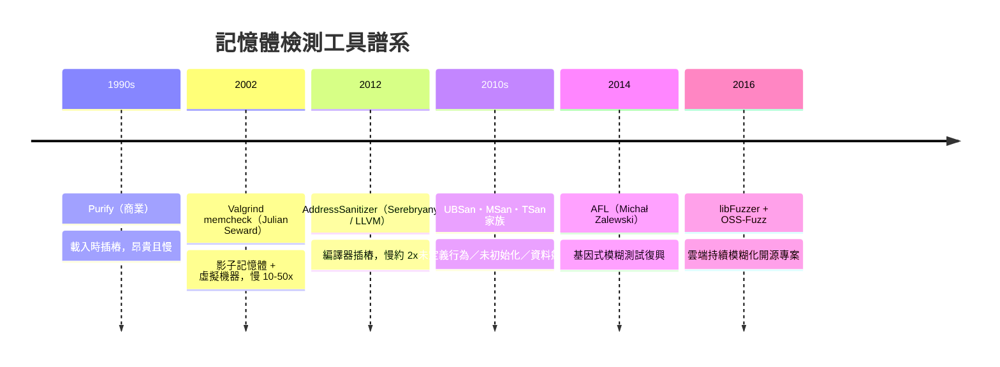

# Valgrind 與 ASan：Rust 誕生前的困境

在 Rust 出現之前，世界對付 C/C++ 記憶體錯誤的手段，是「不動語言、事後抓蟲」。這條路線發展了三十多年，工具越來越精良，卻始終沒能解決根本問題。回顧這段工具史，才能理解 Rust 把安全前移到編譯期，是多麼大的典範轉移。

## 商業先驅：Purify

1990 年代，記憶體除錯的第一批工具是商業軟體。IBM 的 Rational Purify 能在執行期偵測未初始化讀取、越界與洩漏，是當年大型企業開發的標準配備。但 Purify 有兩個硬傷：貴，而且慢。它需要在載入時重寫程式碼、插入檢查，效能開銷數倍起跳，只能用在測試環境。對開源社群而言，這是一個付不起也改不了的封閉工具。

## Valgrind：開源的精密儀器

2002 年，英國工程師 Julian Seward 釋出 Valgrind，改變了這一切。Valgrind 的殺手級應用是 memcheck，其核心是**影子記憶體**（shadow memory）技術：為程式的每一個位元組，另配一組「影子」位元組記錄其狀態——可否讀、可否寫、是否初始化。程式的每個 load/store 都被 Valgrind 的虛擬機器攔截、插樁檢查。這讓 Valgrind 能抓到極刁鑽的 bug：未初始化值的傳遞鏈、越界讀一個位元組、使用已釋放記憶體，全都能精確定位。

代價是速度。Valgrind 是在模擬的 CPU 上跑你的程式，典型慢 10 到 50 倍，記憶體占用也數倍膨脹。它成了「深夜除錯神器」——你懷疑有記憶體 bug 時才開它跑一輪，絕不可能常駐在正式環境。Seward 也因此獲得 2006 年 ACM 首屆軟體系統獎的提名級聲譽（他早因 bzip2 聞名），Valgrind 至今仍是 C/C++ 世界最精密的記憶體顯微鏡。

## ASan：編譯器接手

2012 年，Google 的 Konstantin Serebryany 與 LLVM 團隊推出 **AddressSanitizer（ASan）**，把檢測從外部虛擬機器搬進編譯器。ASan 的思路同樣是影子記憶體，但用編譯器插樁加上精簡的執行期函式庫實現：編譯時在每個記憶體操作前插入檢查碼，把影子記憶體管理直接建在位址空間裡。結果是偵測能力接近 Valgrind，開銷卻降到約 2 倍——快了一個數量級。這個跨越讓「每個測試都開 ASan」成為可能，Google 內部與 Chromium 專案正是靠它清剿了成千上萬的記憶體 bug。隨後 sanitizer 家族壯大：**UBSan** 抓未定義行為、**MSan** 抓未初始化讀取、**TSan** 抓資料競爭，LLVM 與 GCC 都內建支援。

## Fuzzing 的復興

工具譜系的另一支是模糊測試（fuzzing）。2014 年，Google 的 Michał Zalewski 釋出 **AFL**（American Fuzzy Lop），用基因式回饋——追蹤覆蓋率、突變有效輸入——讓廉價的隨機測試變成 bug 機器。LLVM 的 libFuzzer 讓模糊化內建到編譯器裡，2016 年 Google 啟動 **OSS-Fuzz**，持續對上百個開源專案狂轟濫炸，至今回報了上萬個 bug。AFL 與 ASan 是天作之合：fuzzer 製造異常輸入，ASan 在崩潰瞬間精確定位。

## 工具的極限

這些工具偉大，卻有三個無法逾越的極限。**第一，事後性**：工具抓的是「已經執行到」的錯誤，程式沒測過的路徑上的 bug 依然沉睡。**第二，覆蓋率依賴輸入**：fuzzer 再聰明，也只在它探索到的狀態空間裡有效，而狀態空間是指數級的。**第三，開銷與生產環境的矛盾**：即便 ASan 只要 2 倍，也沒有任何線上服務開著 sanitizer 對付真實流量——於是 bug 在測試期躲過，就在生產環境引爆。

歸納起來，「組合語言級紀律 + 事後工具」這套模式的根本困境是：**安全依賴人的紀律而非機制**。Valgrind 和 ASan 是顯微鏡，顯微鏡不能阻止病菌入侵，只能告訴你已經感染了。Mozilla 的工程師們用盡這些工具，Firefox 的記憶體漏洞依然源源不絕——他們缺的不是工具，而是一種讓錯誤程式「根本編譯不過」的機制。

這正是 Rust 的設計出發點：**把安全從測試期前移到編譯期**。不是更快地抓到 use-after-free，而是讓 use-after-free 成為型別錯誤，在按下編譯鍵的那一刻就被拒絕。檢測工具的時代不會結束——Rust 依然需要 fuzzing、需要測試——但記憶體安全這一類問題，即將從「執行期發現的 bug」變成「編譯期不可能發生的錯誤」。
