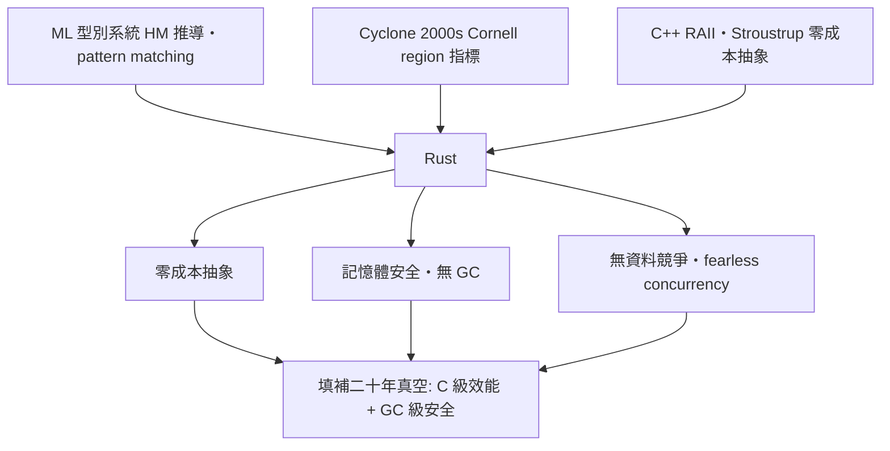

# Mozilla 的野心：無 GC 的記憶體安全

2006 年，Mozilla 的工程師 Graydon Hoare 在下班後開始了一門新語言的設計。這不是公司任務，而是私人專案——起因是他親歷的一連串挫折：他在自家的電梯系統上看到軟體崩潰，而那是一部用 C++ 寫的系統；回到 Mozilla，他又看著全世界最龐大的瀏覽器之一被記憶體洩漏與安全漏洞反覆折磨。Hoare 的洞察是：問題不在工程師不夠好，而在 C++ 的記憶體模型把安全建立在人的紀律上。他想要一門語言，讓「記憶體安全」成為型別系統的數學性質，而不是 code review 的祈禱。2009 年，Mozilla 正式贊助這個專案，Rust 從個人側寫變成公司賭注。

## 血統：站在巨人肩上

Rust 不是憑空發明，而是一次深思熟慮的綜合。第一支血統是 **ML 家族的型別系統**：Hindley-Milner 型別推導、代數資料型別、pattern matching——這些源自 1970 年代 Robin Milner 的 ML 語言、經 Haskell 發揚的函數式傳統，讓 Rust 在系統語言裡擁有罕見的表達力。第二支是 **Cyclone**：2000 年代 Cornell 大學 Trevor Jim 與 Greg Morrisett 等人開發的 C 方言，用「區域」（region）標註指標的有效範圍——這正是 Rust 借用與生命週期概念的直系先驅。Morrisett 後來親口說，Rust 實現了 Cyclone 想做而未能普及的事。第三支是 **C++ 的 RAII**：資源獲取即初始化、解構子自動釋放，這套 Bjarne Stroustrup 的遺產在 Rust 裡被升級為 Drop trait 與所有權系統的核心。

## 三大設計目標

Rust 的野心可以濃縮成三個互相咬合的目標。**零成本抽象**（zero-cost abstractions）——這個口號直接借自 Stroustrup 對 C++ 的承諾：抽象不該付出執行期代價，泛型單態化、迭代器最佳化到零開銷。**無 GC 的記憶體安全**——記憶體安全不靠垃圾回收的執行期支援，靠編譯期驗證所有權；這是 Rust 與 Java、Go 劃清界線的關鍵，也是它能進入核心與嵌入式世界的通行證。**無資料競爭**——多執行緒共用可變狀態被型別系統直接拒絕，工程師稱之為 fearless concurrency。三者的交集處，正是二十年來系統語言的真空地帶：C 級的控制與效能，加 GC 語言級的安全。

## 公開、孵化與 1.0

2010 年，Rust 公開首個版本，當時的編譯器還是用 OCaml 寫的；2011 年自舉（用 Rust 寫 Rust 編譯器）。同年，Mozilla 啟動 **Servo** 瀏覽器引擎計畫，作為 Rust 的試煉場——一門新語言最需要的是一個大到會暴露所有設計缺陷的真實專案。經過數年的語言演進（借用檢查器重寫了不止一次），2015 年 5 月，Rust 1.0 發布。1.0 承諾的核心是**穩定性**：此後所有已合法編譯的程式碼，未來版本保證繼續編譯。這對系統語言是生死攸關的承諾——人們要放心把十年不動的基礎設施押在你身上。

支撐這個承諾的是制度創新。Rust 的演進透過公開的 **RFC 流程**：任何語言變更都要寫提案、公開辯論、由團隊表決，重大決策的討論紀錄完全開放。這種治理讓 Rust 吸收了大量來自實務界的意見，也塑造了它重視文件、重視社群共識的文化。

## Graydon Hoare 的退場

有趣而重要的一筆是創造者的退場。2013 年，Graydon Hoare 悄然離開了 Rust 專案的領導位置，之後也離開 Mozilla。他從不把自己塑造成「Rust 之父」的教主形象，極少受訪，轉身離開聚光燈。他後來加入蘋果的語言團隊，繼續做程式語言的研究。這種退場在某種程度上成全了 Rust：沒有 BDFL（終身仁慈獨裁者）的語言，被迫更早建立**社群治理**——core team 分工管理語言、編譯器、函式庫、社群等領域，年度會議 RustConf 與歐洲起家的 RustFest 維繫社群，2021 年更成立 **Rust Foundation** 承接商標與基礎設施，AWS、Google、Microsoft、Meta、Huawei 都是創始成員。語言的生命超越了創造者，這在程式語言史上並不常見。

Mozilla 的這場賭注，最初的理由只是「救救我們的瀏覽器」，最終卻為整個系統軟體世界提供了四十年來第一個走出 C 陰影的選項。而 Rust 的核心機制——所有權與借用檢查器——正是這場革命真正的心臟。
