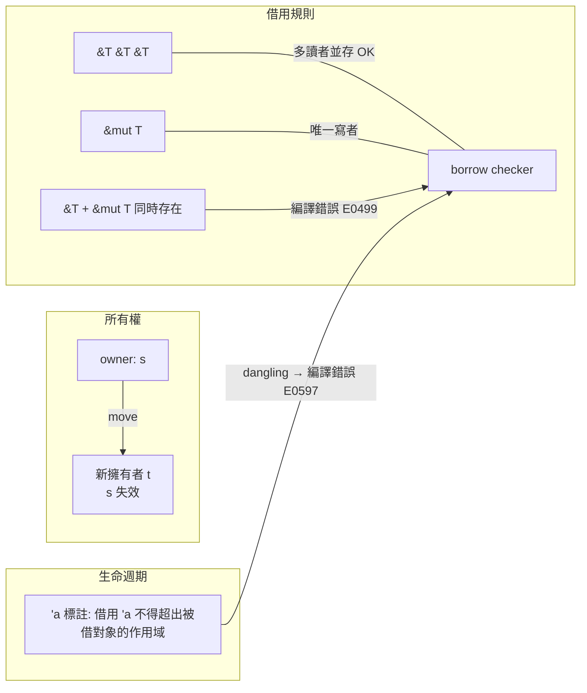

# 所有權與借用檢查器：編譯期保證

Rust 的全部魔法，濃縮在一條規則裡：**每個值在任何時刻都有唯一的擁有者**。這條規則看似簡單，卻是四十年 C 記憶體危機的總答案。本章深入這台機器的內部。

## 所有權：移動的語意

在 Rust 裡，`let s = String::from("hello");` 之後，`s` 擁有這塊堆積記憶體；當 `s` 離開作用域，編譯器自動插入釋放程式碼——這就是 **Drop trait** 與 RAII：資源管理不是靠 `free` 的紀律，而是靠作用域的數學性質。當你把 `s` 賦值給另一個變數 `t`，預設行為不是複製而是**移動**（move）：所有權從 `s` 轉到 `t`，`s` 從此不可再用。C++ 裡 use-after-free 的經典場景——兩個指標以為自己管同一塊記憶體、雙重釋放——在 Rust 裡根本不是 bug，而是**編譯錯誤**。因為「唯一擁有者」這個不變式由型別系統在編譯期維護，double free 與懸空指標在語意上不可能成立。

## 借用：不拿走，只借用

如果每次使用都得移走所有權，程式會寫得非常笨拙。Rust 的答案是**借用**（borrow）：`&T` 是不可變借用（多個讀者可並存），`&mut T` 是可變借用。借用檢查器（borrow checker）執行兩條鐵律：**任意時刻，一個值要嘛只有多個 `&T`，要嘛只有一個 `&mut T`**——讀寫互斥，消滅資料競爭的土壤；**借用的存活不得超過被借對象**——消滅懸空指標。

## 生命週期：型別裡的時間

借用檢查器怎麼知道「借用不超過被借對象」？靠**生命週期**（lifetime）標註。`fn longest<'a>(x: &'a str, y: &'a str) -> &'a str` 這個簽名宣告：返回的引用，存活期不超過 `x`、`y` 中較短的那個。多數情況下編譯器能自行推導（lifetime elision），只在歧義處要求工程師寫出 `'a`。生命週期本質上把「時間」變成了型別的一部分——C 語言裡只能在執行期炸掉的懸空指標，在 Rust 裡變成編譯期可以驗證的命題。這正是 Cyclone 的 region 概念的成熟形態。

## 零成本：與 GC 對比

這一切都發生在編譯期。借用檢查器是一個靜態分析器，產出的機器碼與手寫的嚴謹 C 幾乎相同——沒有引用計數、沒有 GC 執行緒、沒有寫入屏障。對比 GC 語言：Java 的記憶體安全是用執行期追蹤換來的，代價是 $O(1)$ 不可預測的 GC 暫停與堆積開銷；Rust 的記憶體安全開銷是**零**（更嚴格地說：編譯時間）。RAII 的釋放時機也是確定性的——函式返回的瞬間資源就釋放，不像 GC 語言裡檔案、鎖要等 finalizer 或手動 `close`。這就是 Rust 敢進入核心、驅動、嵌入式領域的底氣。

## Fearless Concurrency

借用規則在多執行緒下火力全開。Rust 用兩個標記 trait 擴充：**Send** 表示型別可以安全地轉移到另一執行緒，**Sync** 表示 `&T` 可以跨執行緒共享。編譯器根據型別結構自動推導這兩個標記，而不安全的型別（例如裸指標）會被排除。結果是：**資料競爭在編譯期被拒絕**——你不可能把一個非同步安全的物件用 `std::thread::spawn` 傳出去，編譯器直接報錯。這是「fearless concurrency」一詞的由來：並行不再是踩雷的賭博。

## 與借用檢查器搏鬥

這套機制的代價是學習曲線。「Fighting the borrow checker」（與借用檢查器搏鬥）是 Rust 社群的著名文化笑話：初學者發現自己寫了十年的鏈結串列、樹狀結構、雙向引用，突然全部「編譯不過」——因為這些結構的 C 寫法本身就依賴多個可變別名。社群發展出新的設計語彙：用 `Rc<RefCell<T>>` 表達共享所有權、用索引或 arena 代替指標互指、把資料所有權下沉到結構讓方法借用自己。許多工程師經歷了先憤怒、後頓悟的過程：借用檢查器逼你問的問題——「這塊資料到底歸誰、誰在讀、誰在寫」——正是 C 程式設計師腦中本該有卻從未被強制的問題。

## 對照 C++：聰明指標的極限

C++ 陣營也有回應：智慧指標。C++11 的 `unique_ptr` 表達唯一所有權、`shared_ptr` 用引用計數共享——路線上與 Rust 高度相似（兩者互相影響）。但 C++ 的根本差異是**這些只是程式庫約定，不是語言強制**：你隨時可以拿裸指標、可以 `release()`、可以不小心複製了指標，編譯器一律放行；`shared_ptr` 的引用計數更是執行期開銷，且無法解決循環引用與資料競爭。Rust 的差別只有一句話：**規則由編譯器強制，不安全需要寫 `unsafe` 並自己背書**。安全程式碼裡，所有權規則是不可繞過的公理；不安全的責任被隔離、被顯式標記，可以逐一審計。

這台機器寫進語言之後，剩下的問題只有一個：真實世界會不會接受它？第一個大考場，是 Linux 核心那座由 C 統治了三十年的堡壘。
