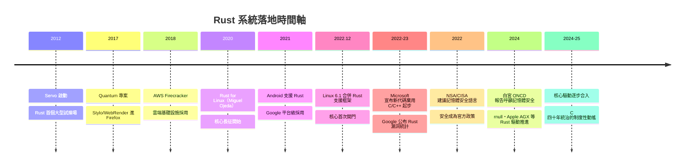

# Rust 進入 Linux 核心：C 的統治動搖

任何新語言都要過三關：有沒有殺手級應用、有沒有大廠背書、有沒有攻下最頑固的堡壘。Rust 的這三關，在 2012 到 2025 年之間一一上演。

## Servo：語言的試煉場

Rust 的第一個戰場是瀏覽器——這正是它誕生的動機所在。2012 年，Mozilla 啟動 **Servo** 瀏覽器引擎，目標是用 Rust 重寫一個可並行化的現代引擎。Servo 產出了兩件影響深遠的遺產：一是 **WebRender**，用 GPU 繪製管線重造網頁渲染；二是 **Stylo**，Rust 寫的 CSS 樣式計算引擎，多執行緒並行解析樣式。2017 年，Mozilla 的 **Quantum 專案**把 Stylo 與 WebRender 整合回 Firefox——這是第一批以 Rust 撰寫、進入億級使用者產品的核心元件。Mozilla 從此證明：Rust 不只是研究玩具，能在全世界最複雜的應用軟體裡取代 C++。

## 雲端巨頭的跟進

接著是平台級背書。**AWS** 早期的火記是 firecracker microVM（2018）以 Rust 打造，之後把 Rust 列為長期投資的核心語言並成為 Rust Foundation 創始成員。**Microsoft** 的態度轉變最具象徵性：2023 年，其 Azure 官方部落格明言——過往統計中約 70% 的 CVE 屬於記憶體安全問題，因此微軟的新程式碼將不再以 C/C++ 起步，Rust 是首選替代。**Google** 則給出了量化證據：Android 自 2021 年起在 AOSP 支援 Rust，2022 年公布報告——Rust 新代碼的記憶體安全漏洞占比遠低於 C/C++，且隨著 Rust 佔比上升，Android 整體記憶體安全漏洞數逐年下降。這是「七成定律」第一次被政策性反轉。

## Linux 核心的長征

然後是最頑固的堡壘。Linux 核心自 1991 年以來是 C 的絕對領地，核心開發社群對新語言有著近乎宗教的保守。2020 年，開發者 **Miguel Ojeda** 發起 **Rust for Linux** 專案，提出在核心中支援用 Rust 撰寫驅動等模組。這場長征的艱難超出技術本身：GCC 與 Rust 編譯器（rustc，基於 LLVM）的工具鏈整合、核心 ABI 的互操作、數百位維護者的疑慮——C 維護者們擔心要同時理解兩種語言才能審核子系統、擔心 Rust 的演進速度與核心的百年穩定性要求衝突。郵件列表上多次爆發激烈論戰，部分維護者一度以退出相抗。

但證據站在 Rust 一邊：核心崩潰的主因之一正是驅動的記憶體錯誤，而 Rust 的編譯期保證恰好切中要害。2022 年 12 月，Linux 6.1 首度合併 Rust 支援框架（在 Linus Torvalds 的謹慎支持下）——這是核心三十一年歷史上第一次為第二門語言開門。此後逐步推進：2024 年前後，以 Rust 撰寫的 NVMe 區塊驅動 **rnull**、以及 Asahi Linux 團隊用 Rust 寫的 Apple AGX GPU 驅動等真實驅動陸續合入或展示，Rust 核心抽象層（核心 API 綁定）持續擴充。到 2025 年，Rust 驅動從實驗走向制度化，儘管爭論仍未平息——但「核心裡可以有 C 以外的語言」這件事本身，已經是制度性突破。

## 核心之外

同一時期，Rust 在其他系統戰場同步推進。Microsoft 開始用 Rust 重寫 Windows 的部分核心元件（如 win32k 的關鍵模組）， Android 平台中 Rust 占新原生代碼的比例持續攀升（2022 年起新代碼以 Rust 為主）、Google 亦在 Android 的藍牙堆疊（Gabeldorsche）等關鍵模組採用 Rust。FreeBSD 探討 Rust 支援，嵌入式與物聯網世界快速接受 no_std 的 Rust。

## 安全成為政策

最後，記憶體安全走出了工程界，走進了政府。2022 年起，美國 **NSA** 與 **CISA** 先後發布指南，明確建議軟體開發改用記憶體安全語言，CISA 更列出 Rust 在內的建議清單；2024 年 2 月，白宮國家網路總監辦公室（ONCD）發布報告，呼籲產業界採用記憶體安全語言，並以統計數據指出這是國家級網路安全議題。當一個工程判斷被寫進國家政策，它的性質就變了——如同當年的加密標準與漏洞通報制度，記憶體安全成了制度與規格書的一部分，逆向的阻力被制度力量接管。

## 結語：四十年統治的裂縫

C 自 1972 年起統治系統軟體超過四十年，靠的不是行銷而是無可替代：需要極致效能與控制的地方，只有它。Rust 沒有推翻這個王國——今天 Linux 核心的絕大多數仍是 C，C 仍將存續數十年。但它砸出了第一道**制度性的裂縫**：最保守的專案（核心）、最大的平台（Windows、Android）、最強的雲（AWS、Google）都已在制度層面接納了一門記憶體安全、無 GC 的系統語言。歷史的走向因此改寫：下一代系統工程師學的第一門系統語言，很可能不再是 C。這場從 1972 年 Dennis Ritchie 交出指標鑰匙開始的漫長故事，終於在編譯器裡找到了第一個真正的出口。
