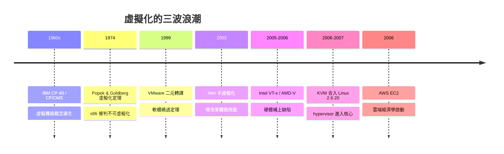

# 硬體輔助虛擬化與 KVM：雲端基石

一九六〇年代的 IBM，面對的是一個昂貴到必須「分享」的時代。System/360 大型主機一臺要價數百萬美元，但批處理系統讓機器大部分時間在等待磁帶與操作員。IBM 位於劍橋科學中心的團隊——包括 Robert Creasy 等人——在 CP-40 專案中提出一個驚人的想法：讓每一個使用者都擁有一臺「完整的機器」，即使那臺機器只是軟體模擬出來的幻影。這個概念後來演進為 CP/CMS，跑在 System/360-67 與後續的 System/370 上，一九七二年 IBM 正式將 VM/370 推向市場。「虛擬機器」就此誕生：hypervisor 創造一層假象，讓客體作業系統以為自己獨占硬體。有趣的是，這條技術線有兩個源頭——商用線是 IBM VM，學術線則是同一批人在 MIT CTSS 與 Multics 計畫中累積的分時思想。商業需求與學術理想在此交會，共同孕育了虛擬化的理論基礎。

理論基礎要等到一九七四年才真正成形。Gerald Popek 與 Robert Goldberg 發表《Formal Requirements for Virtualizable Third Generation Architectures》，提出著名的虛擬化定理：一個架構若要支援高效虛擬化，所有敏感指令必須是特權指令的子集。簡單說，當客體程式執行了會影響系統狀態的「敏感指令」時，hypervisor 必須有機會攔截它。這個定理在理論上優雅，卻在一九九〇年代成為 x86 陣營的噩夢：x86 有十幾條指令（如 POPF、SGDT、SYSSEG 一類）是敏感指令卻不是特權指令——在 ring 3 或客體模式執行不會觸發陷入，hypervisor 根本攔不到。Popek–Goldberg 定理宣判：x86 不可虛擬化。當時業界普遍認為，x86 伺服器永遠無法像 IBM 大型主機那樣跑虛擬機。

歷史卻在市場壓力下繞了兩條路。第一條是軟體的勝利。一九九八年，Mendel Rosenblum 與 Diane Greene 夫婦，連同 Ed Bugnion 等史丹佛 Disco 專案的成員，創立 VMware。他們的殺手鐧是二元轉譯（binary translation）：在執行期掃描客體指令碼，把那些無法陷入的敏感指令改寫成安全序列，同時絕大多數使用者態指令直接以接近原生速度執行。這是一場精巧的工程妥協——不修改客體作業系統，代價是可觀的效能損耗。一九九九年 VMware 推出 VMware Workstation，二〇〇一年的 ESX Server 進軍伺服器市場，x86 虛擬化從學術好奇心變成數十億美元的生意。第二條路是劍橋大學的 Xen 計畫。二〇〇三年，Ian Pratt 領導的團隊發表 Xen hypervisor，選擇完全不同的哲學：既然攔截太貴，那就修改客體。半虛擬化（paravirtualization）要求客體 Linux 核心主動呼叫 hypercall，把特權操作「申報」給 hypervisor。效能因此優於二元轉譯，但代價是需要打補丁的客體——這在開源世界可行，在微軟 Windows 上卻寸步難行。二〇〇六年八月，一家名為 Amazon 的線上書店推出 EC2，最初正是以 Xen 為底層。雲端運算的商業史，就此與 Xen 綁定。

但真正終結 Popek–Goldberg 困境的，是硬體本身。二〇〇五年 Intel 推出 VT-x，隔年 AMD 推出對應的 AMD-V：CPU 新增 root 與 non-root 兩種操作模式。hypervisor 跑在 root mode，客體跑在 non-root mode；客體執行敏感指令時自動陷入（VM exit），由硬體保存與恢復客體狀態（VMCS/VMCB 結構）。十幾年來無解的敏感指令問題，被一條硬體邊界乾淨俐落地解決。緊接著，位址轉換成為新瓶頸：傳統影子頁表（shadow page table）需要 hypervisor 在軟體中合成「客體虛擬位址 → 宿主實體位址」的映射，開銷巨大。Intel 的 EPT（Extended Page Tables）與 AMD 的 NPT（Nested Page Tables）在硬體中實現二級位址轉換，MMU 直接走兩層頁表，虛擬化的最後一塊效能短板也被補齊。

就在硬體輔助虛擬化成熟的同一年，一個以色列程式師改寫了遊戲規則。Avi Kivity 在二〇〇六年寫出 KVM（Kernel-based Virtual Machine）：與其把 hypervisor 做成一個巨大、特權、自帶排程器與記憶體管理的龐然巨物，不如讓 Linux 核心本身成為 hypervisor——每個虛擬機就是一個普通行程，vCPU 就是一個執行緒，用ioctl(/dev/kvm) 進入客體模式。KVM 約十萬行、極度精簡的程式碼，於二〇〇七年合入 Linux 2.6.20。設備模擬與 I/O 則交給老牌模擬器 QEMU 承擔，KVM+QEMU 的組合自此成定局。KVM 的勝出有深刻的制度意涵：它不與 Linux 核心社群對抗，而是寄生於這個地球上最成功的開源工程體系之上。Linus Torvalds 的「nothing in userspace is sacred」哲學、核心的排程器 CFS、記憶體管理、電源管理——全部免費為虛擬化服務。VMware 的專有巨石與 Xen 的獨立 hypervisor，都難以匹敵這種生態位。

此後的產業版圖迅速改寫。OpenStack 於二〇一〇年問世，預設驅動就是 libvirt + KVM；Google Cloud 的 Compute Engine 也大量採用 KVM；Redhat 併購 Qumranet（Kivity 所在公司）後全面押注 KVM。虛擬化最終不只改變了軟體，更改變了經濟制度：一臺實體機被切成 N 份虛擬機，按小時、按秒計費出售。固定成本化為變動成本，新創公司不再需要資本支出購買伺服器——這是雲端運算的制度基礎。從 IBM 為了讓機器不閒置而發明虛擬機，到 AWS 為了賣掉閒置產能而發明 EC2，跨越四十年的邏輯一脈相承：運算力永遠昂貴，而把昂貴的東西切細、切小、按需出售，是系統工程師對經濟學最深刻的貢獻。Popek 與 Goldberg 定理沒有錯，x86 確實不可虛擬化——直到人類把虛擬化鑄進矽裡。這正是系統程式的歷史反覆上演的劇本：理論畫下邊界，工程越過邊界，市場決定誰的邊界值得記住。
