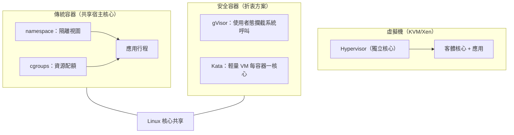

# Namespace 與 cgroups：容器核心隔離

容器的故事，要從一條看似不起眼的系統呼叫說起。一九七九年，Version 7 Unix 的開發者為了建置 chroot 測試環境，加入了 chroot()——把行程的根目錄限制在某個子目錄內。這是檔案系統隔離的起點，但僅止於檔案系統：行程照樣看得到彼此，網路照樣互通。隔離思想的下一次躍進發生在 BSD 陣營：二〇〇〇年 FreeBSD 發表 jails，除了檔案系統，還隔離了主機名、IP 位址與進程樹，管理員甚至可以遠端把 jail「外包」給別人管理——這已經有了現代代管服務的雛形。二〇〇四年，Sun 為 Solaris 10 推出 Zones，把隔離做到更完整的資源控制與企業級管理。這些先驅都證明了同一件事：輕量級虛擬化有真實的市場需求。但它們都鎖在各自的 Unix 系譜裡，無法影響當時企業市場上節節敗退的 Linux。

Linux 的回應是從核心內部長出來的。二〇〇二年，Linux 2.4.19 合入第一個 namespace——mount namespace，起源是 Linus 為了處理核心開發中的檔案系統需求。此後的演化卻相對緩慢，直到一個意想不到的角色登場：Google。二〇〇五年前後，Google 內部正用自家的容器技術 Borg 跑著全球最大的叢集，數十億個行程被封裝在輕量級「任務」中。Google 工程師 Paul Menage 與 Rohit Seth 在二〇〇六年推出 cgroups（control groups）補丁，目的很單純：他們需要對一批行程做精確的資源記帳與限制——CPU 用多少、記憶體用多少、I/O 頻寬幾何。經過與核心社群兩年的磨合，cgroups 於二〇〇八年一月合入 Linux 2.6.24。namespace 負責「看不見」，cgroups 負責「用不到」，兩者合起來就是容器的核心機制。這是一次罕見的知識遷徙：Google 把內部十年叢集管理的實戰智慧，直接注入了 Linux 核心主線。

namespace 的本質是給行程一整套「虛擬的作業系統視圖」。每一維 namespace 隔離一種資源：PID namespace 讓容器內的行程以為自己是 1 號行程；net namespace 給它獨立的網路堆疊、網卡與防火牆規則；mnt namespace 隔離掛載點；uts namespace 隔離主機名；ipc namespace 隔離 System V IPC；user namespace 則讓容器內的 root 在宿主上只是個普通使用者——最後這一維是安全模型的關鍵拼圖，歷經多年爭論才於二〇一二年後逐步穩定。cgroups 則是資源的憲法：v1 介面雜亂、每個子系統各自為政，二〇一五年後由 Tejun Heo 主導重寫的 v2 統一階層，才讓資源控制變得可組合。CPU 配額（cpu.max）、記憶體上限（memory.max）、I/O 權重——這些檔案就是現代雲原生世界的資源契約。

這些機制在核心裡沉潛多年，卻始終是極客的玩具——直到封裝發生。二〇一三年三月，Solomon Hykes 在 PyCon 上演示 Docker：`docker run` 一行指令，五秒鐘啟動一個隔離環境。Docker 的天才不在發明，而在整合與易用性——它把 namespace、cgroups、以及 AUFS 分層檔案系統打包成一個人人可用的介面。分層映像檔尤其關鍵：應用與依賴被打包成不可變的層次結構，可下載、可快取、可共享，「在我機器上會跑」這句藉口從此失效。Hykes 本人是個極具爭議色彩的人物——法國出身的連續創業者，個性強勢、口無遮攔，但正是這種偏執讓 Docker 在一年內席捲開發者社群。二〇一五年，Docker 把容器規格捐給 OCI（Open Container Initiative），runc 成為事實標準；核心機制與品牌分家，避免了單一公司壟斷基礎設施。這是開源治理對商業野心的又一次馴化。

容器的隔離層級，本質上是一場效率與安全的談判。虛擬機用 hypervisor 隔離，每臺機器一個完整核心，安全邊界堅固，但記憶體與啟動開銷巨大。容器共享宿主核心，啟動以毫秒計、密度高數十倍，但核心漏洞一旦被利用，容器可能全數淪陷——逃逸（container escape）是雲端安全的永恆夢魘。業界因而發展出折衷方案：Google 的 gVisor 在使用者態實作一個攔截系統呼叫的迷你核心，以效能換安全；Kata Containers 則每個容器配一臺極輕量虛擬機，回到硬體隔離。AWS 的 Fargate 與 Firecracker microVM（二〇一八年，用於 Lambda 與 Fargate，啟動僅 125 毫秒）證明：隔離光譜可以精細調校，而非二選一。

回望這段歷史，最深刻的啟示來自 Google 的 Borg 論文。二〇一五年四月，Google 終於公開這套跑了十餘年的叢集管理系統：數十萬臺機器、數十億容器、資源利用率因此高出一個數量級。Borg 證明了「把所有服務塞進共享核心的隔離環境、用統一排程器榨乾硬體」在工業規模上可行——這份論文直接啟發了 Kubernetes（2014，Kubernetes 的希臘語意為「舵手」，Borg 是《星艦迷航記》裡的博格人，命名血統一目瞭然）。Kubernetes 隨後在 CNCF 的開源治理下成為雲原生時代的作業系統。從 chroot 到 cgroups，從 Borg 到 Kubernetes，容器運動的內核從來不是某個天才發明，而是一個緩慢累積的真相：作業系統的核心職責——資源抽象與隔離——可以、也應該以組合而非巨石的方式交付。namespace 給了每個行程一個世界，cgroups 限定了這個世界的疆域，而整個雲端經濟就建立在這兩份核心補丁之上。
