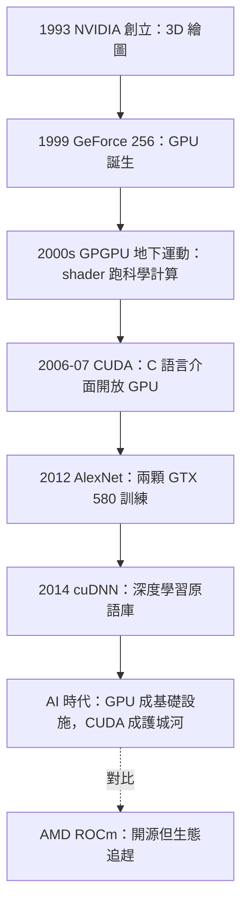

# 從 CPU 到 GPU：CUDA 與平行範式

一九九三年，黃仁勳（Jensen Huang）與 Chris Malachowsky、Curtis Priem 在一家 Denny's 連鎖餐廳的角落創立 NVIDIA。他們押注的市場是 3D 繪圖：當時 PC 遊戲正從 2D 走向 3D，圖形加速器還是分散的品牌混戰——3dfx 的 Voodoo 卡在一九九六年橫空出世，一度是玩家的信仰。NVIDIA 在生死邊緣摸索數年，一九九九年的 GeForce 256 打出「史上第一顆 GPU」的行銷口號，把幾何變換與光照計算也搬上晶片。但真正決定命運的不是產品，而是一次文化觀察：GPU 的本質是成千上萬個簡單核心的平行資料機器，而世界上恰好存在大量「圖形不像圖形」的問題——訊號處理、流體模擬、矩陣運算——它們的形狀與像素更新驚人地相似。

GPGPU（用 GPU 做通用計算）最初是學術圈的地下運動。二〇〇〇年代初，研究者發現可以欺騙繪圖管線：把資料偽裝成紋理貼進 GPU，用 vertex shader 或 pixel shader 執行矩陣運算，再把結果「渲染」回記憶體。這像是在用一把扳手當錘子——可行，但痛苦且脆弱。史丹佛的 Ian Buck 用 shader 語言寫出 Brook 這種類 C 的資料平行語言，證明了路徑的存在。二〇〇四年，NVIDIA 把 Buck 挖進公司。真正的決策發生在黃仁勳身上：二〇〇六年，他批准了一個在當時看來燒錢且偏離主業的計畫——把 GPU 的指令集開放出來，給程式師一個真正的 C 語言介面。二〇〇七年 CUDA 1.0 公開發布。華爾街的分析師質疑：遊戲公司為什麼要養一個「科學計算部門」？內部也有反對聲浪。黃仁勳的理由日後被反覆引用：GPU 若要超越遊戲，必須讓百萬程式師能用熟悉的語言接觸它——生態，而非晶片，才是護城河。

CUDA 的範式被稱為 SIMT（Single Instruction, Multiple Threads）。它的抽象階層是精心設計的：最小的執行單位是 thread，數十個 thread 組成 block，共享一塊片上 shared memory；多個 block 組成 grid，分派到整顆 GPU。硬體層面，32 個 thread 打包成 warp，以 lockstep 執行同一條指令——分支若在 warp 內分歧，就序列化執行兩條路徑。記憶體階層則是效能的靈魂：shared memory 的頻寬是全域記憶體的數十倍，全域記憶體的延遲卻可以用海量執行緒的切換來隱藏——GPU 不靠快取遮蔽延遲，而是靠「同時有十萬個執行緒在排隊」把延遲填滿。這與 CPU 的設計哲學正好相反：CPU 用快取與亂序執行對抗延遲，GPU 用吞吐量無視延遲。寫好 CUDA，意味著在心中同時持有演算法、執行緒拓撲與記憶體佈局三張地圖。

引爆點發生在二〇一二年。多倫多大學的 Alex Krizhevsky、Ilya Sutskever 與 Geoffrey Hinton 參加 ImageNet 競賽，用兩顆 GTX 580 消費級顯卡訓練出一個七層卷積網路 AlexNet，錯誤率比第二名低了十個百分點以上——深度學習的寒武紀大爆發自此啟動。關鍵細節常被忽略：Krizhevsky 並非 CUDA 專家，他們能在兩顆遊戲顯卡上完成訓練，正是因為 CUDA 讓一個研究生用幾週就能寫出可用的 GPU 卷積核。若 GPU 仍需偽裝成紋理才能使用，深度學習革命可能延後數年。NVIDIA 敏銳地抓住這波浪潮：二〇一四年推出 cuDNN，把卷積、池化等深度學習原語以高度調校的 CUDA 核心封裝起來，讓 TensorFlow、PyTorch 這些框架直接呼叫。此後 TensorRT、NCCL、Tensor Core 硬體相繼問世，CUDA 從程式語言演化為一整套 AI 運算堆疊。二〇一六年，NVIDIA 把 DGX-1 親手交付給 OpenAI，黃仁勳在機箱上題字：「獻給第一個 AI 資料中心」——商業與學術的敘事在此合流。

CUDA 的勝利同時是一場產業政治的教科書案例。AMD 並非沒有技術——其 GPU 的理論效能長期不落下風——但 CUDA 是專有的：只在 NVIDIA 硬體上執行，工具鏈閉源， 十五年積累的函式庫、教學、範例程式與「我會 CUDA」的履歷信用，構成了無法複製的生態鎖定。AMD 的回應是 ROCm（二〇一六年起），走上 HIP 轉譯層與開源堆疊的路線，試圖讓 CUDA 程式碼近乎無痛移植；Intel 則推出 oneAPI 與 SYCL。但生態之戰的殘酷在於：開發者的時間是稀缺資源，先占者的網路效應隨時間指數增長。PyTorch 二〇二二年後對 ROCm 的支援改善、以及各家大廠為議價而扶持第二供應商，才讓戰局出現鬆動。二〇二三年後，當黃仁勳的 NVIDIA 市值超越英特爾與 AMD 總和，回頭看二〇〇六年那個「燒錢」的決定，其本質是一場信仰先於證據的資本配置——用遊戲業務的現金流，養一個十年後才被證明的命題。

這段歷史對系統程式的意義深遠：CUDA 把「平行運算」從超級電腦實驗室的專屬技藝，變成百萬開發者的日常。而黃仁勳本人——物理系出身、以極度嚴格著稱、信奉「我們公司永遠距離倒閉三十天」的偏執——成為這個時代的性格註腳。技術史往往把革命歸功於論文與程式碼，但 CUDA 的故事提醒我們：有時決定一切的是一個 CEO 在質疑聲中，願意為一個看不清回報的抽象層賭上公司十年。
