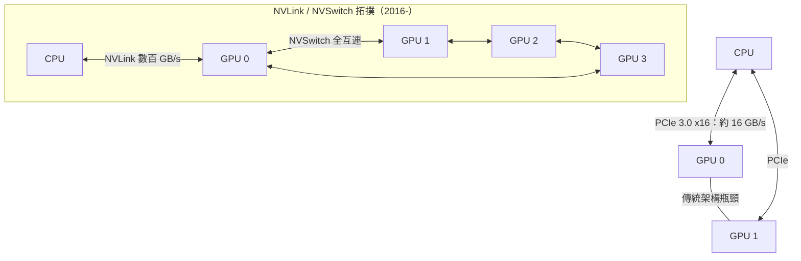

# 統一記憶體與 NVLink：資料傳輸優化

AI 運算的殘酷真相是：算力往往不是瓶頸，搬資料才是。一顆現代 GPU 的 HBM 記憶體頻寬可達數 TB/s，但它掛在主機板上，與 CPU 之間卻隔著一條 PCIe 匯流排——PCIe 3.0 x16 的頻寬不過約 16 GB/s，差了兩個數量級。深度學習訓練的典型循環裡，資料在 CPU 記憶體、GPU 記憶體之間來回搬運，每一次 PCIe 傳輸都是一次停頓。系統架構師由此提煉出一條設計哲學："move compute to data"——與其把資料搬到算力那裡，不如把算力搬到資料旁邊。這句話看似平凡，卻驅動了此後十年異質運算的所有硬體革命：統一記憶體、高頻寬互連、乃至整座資料中心的拓撲設計。

第一波攻勢是軟體層的記憶體抽象。在 CUDA 早期，程式師必須手動管理兩個世界：cudaMalloc 在 GPU 上配置顯示記憶體、cudaMemcpy 在主機與裝置之間搬運資料——每個 kernel 前後都要寫明確的複製呼叫，程式碼裡充滿物流單據般的細節。二〇一三年底，NVIDIA 在 CUDA 6 中推出 Unified Memory：CPU 與 GPU 共享同一組虛擬位址空間，指標可以兩邊通用；底層靠頁錯誤（page fault）驅動的自動頁遷移（page migration）——GPU 存取尚未駐留的頁時觸發中斷，驅動程式把頁從主機記憶體搬過來。這是作業系統虛擬記憶體思想在異質系統上的移植：透明性換來易用性，但代價是頁遷移的中斷與延遲可能造成效能陷阱。熟練的程式師學會用 cudaMemPrefetchAsync 預取資料，在「便利」與「控制」之間找平衡。統一虛擬定址的另一層意義是系統性的：它讓 GPU 成為一個真正的「可定址運算節點」而非「附加的加速器」，為後續所有架構演進鋪路。

第二波攻勢是記憶體本身的革命。二〇一三年，JEDEC 正式發布 HBM（High Bandwidth Memory）標準：把 DRAM 晶粒垂直堆疊、以矽穿孔（TSV）互連，再與 GPU 晶片以中介層（interposer）並排封裝。HBM 的介面寬度達 1024-bit，是 GDDR5 的數倍，因此能以低得多的時脈提供數倍頻寬、並大幅降低功耗。二〇一五年，採用 HBM 的 AMD Fury X 與 NVIDIA P100 相繼問世，GPU 記憶體頻寬跨入 TB/s 級別。這是封裝工程對摩爾定律放緩的回應：當電晶體不再免費變小，就把晶片在第三維堆起來。此後 HBM2、HBM2e、HBM3 一路迭代，成為 AI 晶片的戰略物資——2024 年 AI 晶片荒，本質上就是 HBM 產能被 SK 海力士、三星、美光三家瓜分的供應鏈政治。

第三波攻勢直搗 PCIe 本身。二〇一六年，NVIDIA 在 P100 上推出 NVLink：GPU 之間、GPU 與 CPU 之間的直連互連，第一代就提供 160 GB/s 的雙向頻寬，數倍於當時的 PCIe 3.0 x16；到 H100 的 NVLink 4 已達 900 GB/s。二〇一八年再推出 NVSwitch——一顆交換晶片，讓機櫃內所有 GPU 兩兩直連，形成全互連拓撲，DGX-2 因此能把 16 顆 GPU 當成一個邏輯裝置。這對大模型訓練是質變：張量並行（tensor parallelism）要求不同 GPU 在每一層前向傳播中頻繁交換中間結果，延遲與頻寬直接決定擴展效率。NVIDIA 的 NCCL（NVIDIA Collective Communications Library）在此扮演系統工程師的角色：all-reduce、all-gather 等集合通訊原語會根據機器拓撲自動選擇 NVLink、NVSwitch、PCIe 或 InfiniBand 路徑。寫高效能訓練程式的技藝，從此從「排好指令」變成「看懂拓撲」——模型切在哪裡、資料放在哪裡、通訊與計算如何重疊，每一項都是系統決策。

訓練 GPT 級模型的機櫃，是這些技術的總集成。DGX/HGX 系統把 8 顆 GPU 以 NVSwitch 全互連，機櫃之間再以 InfiniBand 或乙太網路組成叢集；Meta 二〇二二年公開的 OPT-175B 訓練日誌與 PyTorch 的 FSDP，以及微軟與 NVIDIA 聯合發表的 Megatron-LM，都記錄了同一門工程的演化：資料並行、張量並行、流水線並行三種切法的組合權衡，本質上是在通訊拓撲上做圖分割。一個耐人尋味的歷史細節是 NVIDIA 曾短暫嘗試「Grace CPU 與 GPU 以 NVLink 統一記憶體」的極端方案——CPU 與 GPU 一致性地共享位址空間，PCIe 徹底出局。這條路線在二〇二三年以 Grace Hopper 超級晶片落地，宣告異質運算的終點形態：不是 CPU 加 GPU，而是一個記憶體、多種算力。

產業的反制力量也隨之集結。二〇一九年，Intel、微軟、Google、阿里等九家公司在 Intel 主導下成立 CXL 聯盟，二〇二二年發布 CXL 2.0 標準：以 PCIe 實體層為基底，加入快取一致性協定，讓 CPU、GPU、FPGA、記憶體擴充裝置能共享統一的一致性記憶體空間。CXL 的戰略意圖明顯：用開放標準對抗 NVLink 的封閉王國，讓「異質互連」從廠商私產變成公共基礎設施。二〇二三年 CXL 併入 UALink 競局、各家 AI 晶片新創（Groq、Tenstorrent、Cerebras）各自選邊，互連標準成為 AI 時代最重要的政治經濟學戰場之一——正如數十年前匯流排大戰決定了 PC 產業的權力分配。對系統程式師而言，這一切意味著職業內涵的遷移：上個世代的功力在指令排程與快取行為，這個世代則是拓撲感知的資料佈局——把張量放在離使用它的算力最近的地方，讓通訊被計算掩蓋，讓每一 GB/s 都花在刀口上。資料的地理學，就是新世代效能工程的核心學科。
