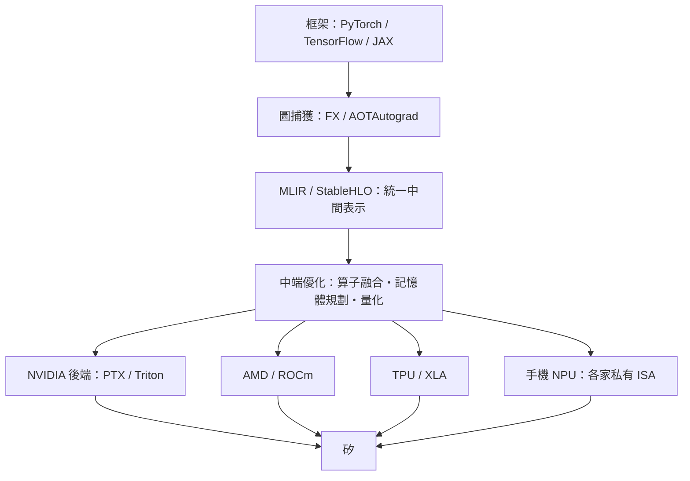

# AI 編譯器：MLIR 與 TVM

二〇一五年之前，深度學習的效能工程是少數人的黑魔法。每個新算子、每種新硬體，都需要手寫 CUDA kernel——要理解 warp 排程、shared memory bank conflict、tensor core 的資料佈局，全球能勝任的人可能不超過幾千人。當深度學習模型以月為單位演化、硬體以年為單位迭代，這種手工模式顯然不可擴展。歷史的解法早已寫在編譯器的教科書裡：把「計算的意圖」與「計算的實作」分離，讓中間表示（IR）成為翻譯的樞紐。AI 編譯器革命的本質，就是把五十年前 Thompson 與 Backus 建立的編譯傳統，移植到張量世界。

先鋒是陳天奇（Tianqi Chen）。這位上海交大出身的工程師在華盛頓大學攻讀博士期間，先與 Carlos Guestrin 合作打造了 XGBoost（2014，梯度提升樹的效能經典），二〇一七年再推出 TVM——一個端到端的張量編譯器。TVM 的架構是教科書式的兩段論：上層做計算圖優化（算子融合、常數折疊、記憶體規劃），下層以「排程」（schedule）語言描述每個算子如何映射到硬體——迴圈如何切分、平行化、用哪層記憶體。其獨到之處在 AutoTVM：用機器學習搜尋排程空間，讓「調優」本身自動化——用 AI 替 AI 搬運算子。陳天奇的風格是高產而務實的開源工程師，TVM 後被 AWS 押注、捐入 Apache 基金會，成為硬體廠商進入生態的熱門入口。同年，Google 為 TensorFlow 推出 XLA（Accelerated Linear Algebra）：把計算圖編譯成為目標硬體優化的機器碼，在 TPU 上尤其關鍵——TPU 沒有通用 kernel 庫可用，XLA 就是它的編譯器。兩條路線殊途同歸：框架不再只是 kernel 的調度器，而是編譯器的前端。

二〇一九年，一位重量級人物登場。Chris Lattner——LLVM 與 Clang 的創造者——當時正主持 Google 的 TensorFlow 團隊，面對一個碎片化的災難現場：TensorFlow 圖、XLA HLO、TPU 編譯器、各硬體廠的私有 IR、ML 框架的前端圖表示……每個系統都有自己的中間表示，彼此無法組合。Lattner 的處方是 MLIR（Multi-Level Intermediate Representation）：一個可承載多層抽象的 IR 基礎設施——從高階的「運算圖方言」、中階的「張量/迴圈方言」到低階的「LLVM 方言」，每一層都可以定義自己的操作與型別，層層下降（lowering）直到矽。MLIR 的哲學是「IR 的 IR」：不提供唯一真理，而是提供一個可擴充的方言生態，讓 TensorFlow、PyTorch、每家 NPU 廠商都能接入同一條編譯管線。二〇二〇年 Lattner 離開 Google 加入 SiFive，MLIR 移交 LLVM 基金會，成為官方專案。

MLIR 出現的時代背景，是硬體動物園的失控。深度學習的算力需求每數月翻倍，催生了一波 NPU 晶片創業潮：寒武紀、Graphcore、Groq、Cerebras、Tenstorrent、三星與蘋果的手機 NPU——每家自建 ISA、自建記憶體階層。問題隨之而來：沒有一家新晶片養得起數百人的 kernel 團隊，PyTorch 也不可能為每種硬體寫一份後端。編譯器成為規模化的鑰匙：框架只表達「要做什麼」，編譯器負責「如何在任意硬體上做好」。這正是編譯器歷史的必然回歸——一九五〇年代，FORTRAN 團隊用編譯器說服世人放棄組譯；七十年後，MLIR 要說服 AI 產業放棄手寫 kernel。

生態系中最具爆發力的一塊拼圖來自意想不到的地方。二〇一九年，OpenAI 的 Philippe Tillet 發表 Triton：一種 Pythonic 的 GPU 編程語言，把 block-level 的資料平行抽象暴露給程式師，編譯器自動處理執行緒映射與共享記憶體。它比 CUDA 高一個抽象層，比 TVM 更貼近手寫 kernel 的控制力。二〇二二年，Tri Dao 以 Triton 實作 FlashAttention——透過分塊計算與線上 softmax 重構，讓注意力機制免去寫出巨大的注意力矩陣，速度與記憶體效率雙雙躍升。FlashAttention 迅速成為 Transformer 訓練的標配，Triton 也隨之從冷門專案變成 AI 效能工程的主流載體：PyTorch 2.0 的 torch.compile（2023）底層的 Inductor 後端，編譯目標正是 Triton。這條脈絡揭示了一個深刻的分工：Lattner 的 MLIR 統一編譯基建，陳天奇的 TVM 自動調優，OpenAI 的 Triton 降低 kernel 撰寫門檻——AI 編譯器不是一個專案，而是一個分層的生態。

Lattner 的職業軌跡本身就是一部系統軟體史：二〇〇〇年在伊利諾大學讀博時創造 LLVM，是「生命期標註」尚未流行就押注模組化編譯器基建的先知式工程；隨後在 Apple 主導 Clang 取代 GCC、創造 Swift 語言（2014）；再到 Google 的 MLIR（2019）、SiFive、以及二〇二二年與前 TensorFlow 團隊成員創立 Modular，試圖打造「AI 開發者的統一引擎」（Mojo 語言——號稱 Python 的超集加上系統編程能力）。他的每一步都在回答同一個問題：抽象的邊界應該畫在哪裡，才能讓上層的創新不必重寫下層的世界？這正是本書一路追尋的主題。從 Ken Thompson 在 PDP-7 上寫下第一個組譯器，到 Lattner 在白板上畫下 MLIR 的方言層次圖，系統程式師的核心技藝始終未變：把人類的抽象翻譯成矽的物理。變的只是抽象的層級——從整數暫存器到注意力張量，從數行組譯到數十億參數的圖。而每一層新抽象的誕生，都會再造一次編譯器：因為只要人類的意圖比機器的執行更高階，翻譯的工作就永遠存在，翻譯的藝術就永遠值錢。
